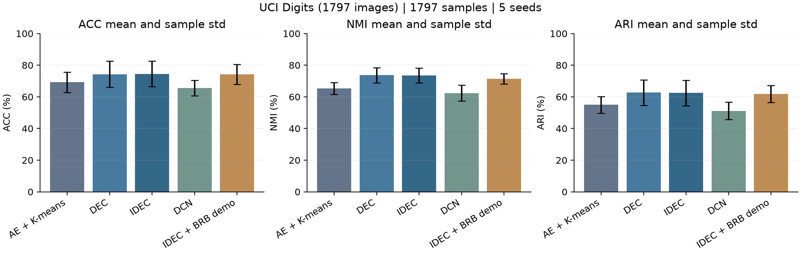
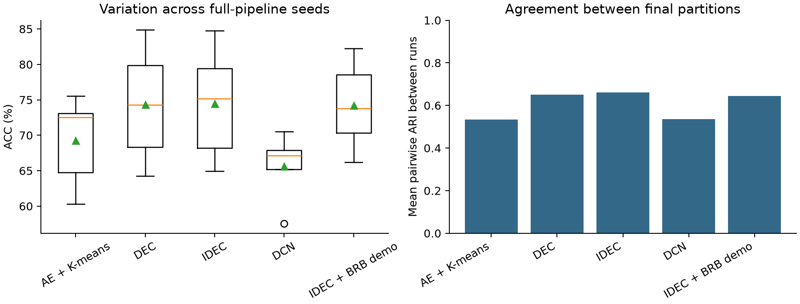
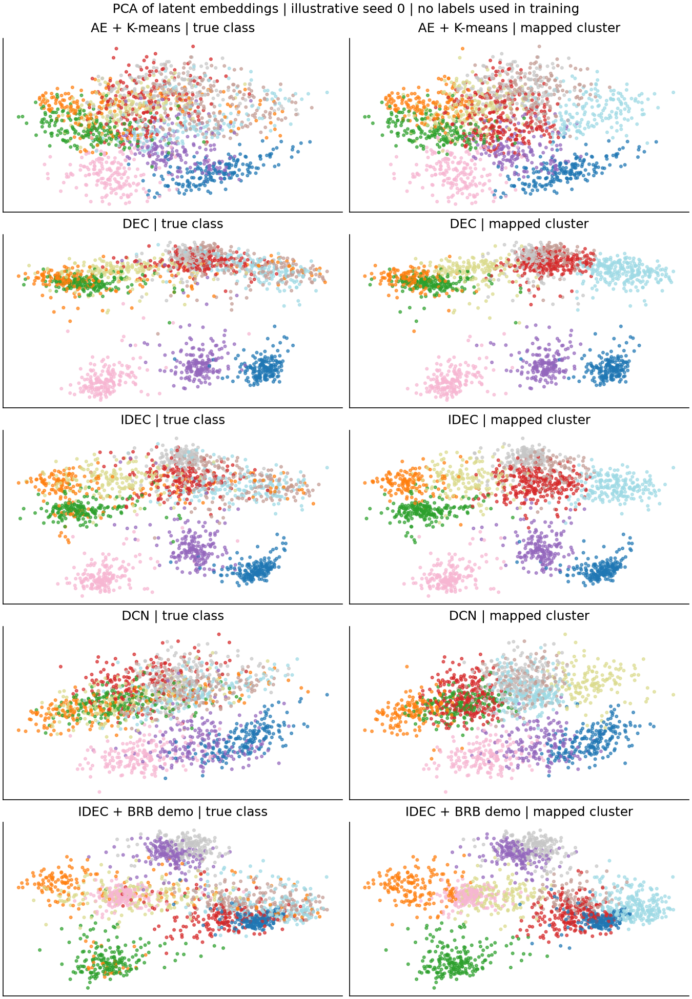
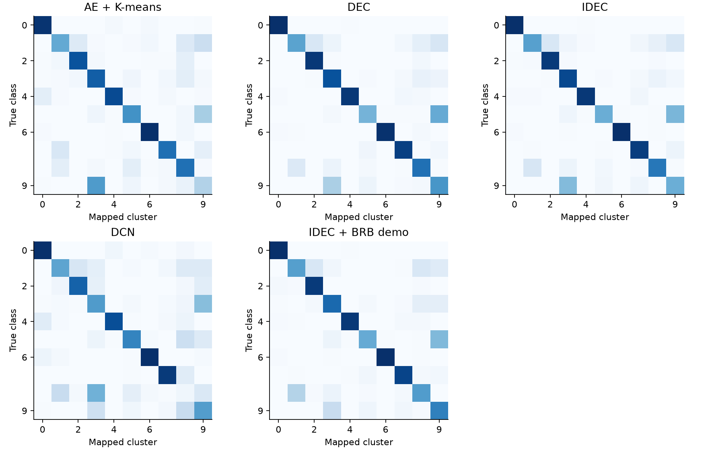
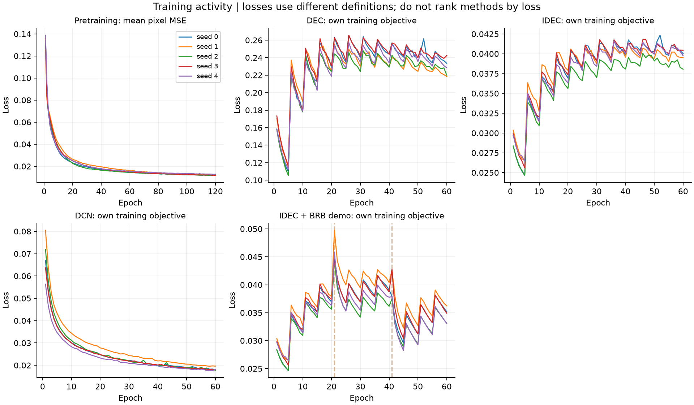

# Kiểm tra dự án và kết quả chạy lại — Phân cụm sâu trên cùng một bộ dữ liệu

Bản kiểm tra tạo lúc 12/10/2026 21:07 (UTC+7). Nguồn thực nghiệm: results_verified_20261012; thời điểm môi trường ghi nhận: 12/10/2026 20:58 (UTC+7).

Đã chạy lại tại máy người dùng 5 cấu hình × 5 seed = 25 lượt hoàn tất trên cùng tệp dữ liệu (1797 mẫu, 64 đặc trưng). Tracker hiện liệt kê 8 bài: 7 hội nghị, 1 tạp chí; 0 bài được đánh dấu hoàn tất đọc toàn văn có hệ thống. 8/8 dòng khai báo code công khai; 0 repo tác giả đã chạy thử theo tracker.

Phần thực nghiệm hiện đáp ứng bước kiểm tra cơ chế trên một dataset. Mục tiêu khảo sát 30 bài và thực nghiệm báo cáo mở rộng trong Word vẫn cần tiếp tục. Mã NumPy được viết độc lập và giản lược; kết quả này xác nhận implementation minh họa, chưa xác nhận tái hiện đầy đủ các con số của bài báo gốc.

## 1. Đối chiếu các yêu cầu trong Word gốc

Các mục tiêu được đọc từ bảng Mục tiêu khảo sát và lộ trình trong Word gốc. Báo cáo mới được tạo riêng; Word gốc được giữ nguyên.

| Tiêu chí Word | Trạng thái có chứng cứ | Đánh giá |
| --- | --- | --- |
| 30 công trình không trùng, đọc toàn văn; ≥20 bài phương pháp | 8 dòng tracker; 0 toàn văn hoàn tất; chưa có tổng số ≥20 bài phương pháp đã đọc | Chưa đủ |
| 2016–2026; ≥10 công trình từ 2023 | 2016–2025; 2 bài từ 2023 | Chưa đủ |
| Phân tích sâu 8–10 bài | 0 bài đã đánh dấu full_text_reviewed=yes | Chưa đủ |
| Số hội nghị/tạp chí/năm công bố | 7 hội nghị, 1 tạp chí; có bảng năm bên dưới | Có số liệu từ tracker hiện tại |
| Q1/Q2/Q3/Q4 kèm hệ thống, năm, ngành | 0/1 bài tạp chí xác minh Q; 1 chưa xác minh | Chưa đủ bằng chứng phân hạng |
| Code công khai và code chạy thành công | 8 code công khai; 0 repo gốc chạy thử; code demo đã chạy 25 lượt | Phân biệt availability với execution |
| Dataset và số liệu thực nghiệm | Demo dùng digits_1797.npz; có config, hash, log, CSV, ảnh; dataset paper xem tracker | Đã có cho demo; chưa tái hiện dataset paper |
| 5 cấu hình × Digits × 5 seed = 25 lượt minh họa | 5 cấu hình × 1 dataset × 5 seed = 25 lượt | Đạt bước một dataset |
| 6 cấu hình × 3 dataset × 5 seed = 90 lượt báo cáo | Hiện 5 cấu hình, 1 dataset, 25 lượt | Chưa thực hiện phạm vi mở rộng |
| Tái hiện IDEC trên MNIST/USPS; chênh lệch với paper | Digits khác MNIST/USPS; chưa có lượt chạy repo tác giả trong tracker | Chưa hoàn thành tái hiện bài gốc |

## 2. Thống kê khảo sát có thể kiểm tra lại

Mẫu số hiện tại là 8 công trình trong tracker, không phải mục tiêu 30 bài. Dòng thư mục, metadata được kiểm tra và bài đọc toàn văn là ba mức ghi nhận khác nhau. Không đánh dấu đọc xong chỉ vì đã kiểm tra trang abstract hoặc repo.

Word gốc có 12 mục tài liệu tham khảo: 8 bài nghiên cứu và 4 nguồn dữ liệu/phân hạng. Số 12 mục tham khảo không được tính thành 12 bài khảo sát.

| Thống kê | Số lượng | Cách hiểu |
| --- | --- | --- |
| Tổng dòng tracker | 8 | 100% |
| Hội nghị | 7 | 87,5% |
| Tạp chí | 1 | 12,5% |
| Đọc toàn văn hoàn tất | 0 | Trường full_text_reviewed |
| Metadata định danh được xác minh | 8 | Trang nơi công bố trong tracker |
| Liên kết code công khai | 8 | Không đồng nghĩa đã cài/chạy thành công |
| Code công khai được kiểm tra availability | 8 | Không phải kiểm tra numerical reproduction |
| Repo gốc đã chạy thử | 0 | Trường code_smoke_tested |
| Dataset công khai theo khai báo tracker | 8 | Không phải số dataset paper đã tải/chạy |
| Phạm vi/tên dataset paper đã đối chiếu | 8 | Không xác nhận mọi link tải/giấy phép |
| Dataset paper đã tải và xác minh | 0 | Tách biệt với dataset Digits đi kèm demo |

| Năm | Số bài |
| --- | --- |
| 2016 | 1 |
| 2017 | 2 |
| 2018 | 1 |
| 2020 | 1 |
| 2021 | 1 |
| 2024 | 1 |
| 2025 | 1 |

| Phân hạng tạp chí | Số bài | Tỷ lệ trên 1 bài tạp chí |
| --- | --- | --- |
| Q1 | 0 | 0,0% |
| Q2 | 0 | 0,0% |
| Q3 | 0 | 0,0% |
| Q4 | 0 | 0,0% |
| Chưa xác minh | 1 | 100,0% |

Chỉ tính Q cho bài tạp chí, theo hệ thống phân hạng + năm + ngành được ghi nguồn. Hội nghị không được đổi sang Q1–Q4. Unknown giữ riêng; số 0 ở Q1–Q4 biểu thị chưa có phân hạng được ghi nhận, không chứng minh tạp chí không thuộc các nhóm đó.

| ID / phương pháp | Năm / nơi công bố | Loại | Code công khai / chạy | Q |
| --- | --- | --- | --- | --- |
| P01 — DEC | 2016 / ICML | Hội nghị | yes / no | không áp dụng |
| P02 — IDEC | 2017 / IJCAI | Hội nghị | yes / no | không áp dụng |
| P03 — DCN | 2017 / ICML | Hội nghị | yes / no | không áp dụng |
| P04 — DEC-DA | 2018 / ACML | Hội nghị | yes / no | không áp dụng |
| P05 — SCAN | 2020 / ECCV | Hội nghị | yes / no | không áp dụng |
| P06 — CC | 2021 / AAAI | Hội nghị | yes / no | không áp dụng |
| P07 — DECRA | 2024 / Neural Processing Letters | Tạp chí | yes / no | unknown |
| P08 — BRB | 2025 / ICLR | Hội nghị | yes / no | không áp dụng |

### Thông tin và chứng cứ cho từng công trình

P01 — Unsupervised Deep Embedding for Clustering Analysis (2016). [Bài báo](https://proceedings.mlr.press/v48/xieb16.html); [Mã nguồn](https://github.com/piiswrong/dec). Nguồn code: author; đọc toàn văn: no; dataset: MNIST (70000); STL-10 labeled (13000; HOG+color features); REUTERS-10K (10000); REUTERS filtered (685071).

Chứng cứ dataset P01: [Nguồn đối chiếu benchmark](https://proceedings.mlr.press/v48/xieb16.pdf); kiểm tra phạm vi: yes; đã tải dataset paper: no.

P02 — Improved Deep Embedded Clustering with Local Structure Preservation (2017). [Bài báo](https://www.ijcai.org/proceedings/2017/243); [Mã nguồn](https://github.com/XifengGuo/IDEC). Nguồn code: author; đọc toàn văn: no; dataset: MNIST (70000); USPS (9298); REUTERS-10K (10000).

Chứng cứ dataset P02: [Nguồn đối chiếu benchmark](https://www.ijcai.org/proceedings/2017/0243.pdf); kiểm tra phạm vi: yes; đã tải dataset paper: no.

P03 — Towards K-means-friendly Spaces Simultaneous Deep Learning and Clustering (2017). [Bài báo](https://proceedings.mlr.press/v70/yang17b.html); [Mã nguồn](https://github.com/boyangumn/DCN-New). Nguồn code: author_updated_repository; đọc toàn văn: no; dataset: RCV1-v2 (365968 single-label documents in 20 topics; subsets 4/8/12/16/20); 20Newsgroups (18846); raw MNIST (70000); preprocessed MNIST (70000).

Chứng cứ dataset P03: [Nguồn đối chiếu benchmark](https://proceedings.mlr.press/v70/yang17b/yang17b.pdf); kiểm tra phạm vi: yes; đã tải dataset paper: no.

P04 — Deep Embedded Clustering with Data Augmentation (2018). [Bài báo](https://proceedings.mlr.press/v95/guo18b.html); [Mã nguồn](https://github.com/XifengGuo/DEC-DA). Nguồn code: author; đọc toàn văn: no; dataset: MNIST; MNIST-test; USPS; Fashion-MNIST.

Chứng cứ dataset P04: [Nguồn đối chiếu benchmark](https://github.com/XifengGuo/DEC-DA#highlights); kiểm tra phạm vi: yes; đã tải dataset paper: no.

P05 — SCAN Learning to Classify Images without Labels (2020). [Bài báo](https://www.ecva.net/papers/eccv_2020/papers_ECCV/html/1057_ECCV_2020_paper.php); [Mã nguồn](https://github.com/wvangansbeke/Unsupervised-Classification). Nguồn code: author; đọc toàn văn: no; dataset: CIFAR10; CIFAR100-20; STL10; ImageNet (including 50/100/200/1000 cluster configurations).

Chứng cứ dataset P05: [Nguồn đối chiếu benchmark](https://github.com/wvangansbeke/Unsupervised-Classification#setup); kiểm tra phạm vi: yes; đã tải dataset paper: no.

P06 — Contrastive Clustering (2021). [Bài báo](https://doi.org/10.1609/aaai.v35i10.17037); [Mã nguồn](https://github.com/Yunfan-Li/Contrastive-Clustering). Nguồn code: author; đọc toàn văn: no; dataset: CIFAR-10; CIFAR-100; STL-10; Tiny-ImageNet; ImageNet-10; ImageNet-dogs.

Chứng cứ dataset P06: [Nguồn đối chiếu benchmark](https://github.com/Yunfan-Li/Contrastive-Clustering#dataset); kiểm tra phạm vi: yes; đã tải dataset paper: no.

P07 — Deep Embedding Clustering Based on Residual Autoencoder (2024). [Bài báo](https://doi.org/10.1007/s11063-024-11586-0); [Mã nguồn](https://github.com/lml-mengli/DECRA). Nguồn code: author; đọc toàn văn: no; dataset: MNIST (70000); Fashion-MNIST (70000); REUTERS-10K (10000); MNIST-test (10000); USPS (9298); COIL20 (1440).

Chứng cứ dataset P07: [Nguồn đối chiếu benchmark](https://link.springer.com/article/10.1007/s11063-024-11586-0); kiểm tra phạm vi: yes; đã tải dataset paper: no.

Ghi chú phân hạng P07: Unknown: publisher verifies journal identity but not Q; SCImago primary URL https://www.scimagojr.com/journalsearch.php?q=24806&tip=sid&clean=0 returned HTTP 403 on 2026-10-12; no primary year/category evidence read

P08 — Breaking the Reclustering Barrier in Centroid-based Deep Clustering (2025). [Bài báo](https://proceedings.iclr.cc/paper_files/paper/2025/hash/f91685b940d5032f0f0c247edbd72edd-Abstract-Conference.html); [Mã nguồn](https://github.com/Probabilistic-and-Interactive-ML/breaking-the-reclustering-barrier). Nguồn code: author; đọc toàn văn: no; dataset: Repo-supported: MNIST; FashionMNIST; KMNIST; USPS; GTSRB; OPTDIGITS; CIFAR10; CIFAR100-20.

Chứng cứ dataset P08: [Nguồn đối chiếu benchmark](https://github.com/Probabilistic-and-Interactive-ML/breaking-the-reclustering-barrier#implemented-data-sets); kiểm tra phạm vi: yes; đã tải dataset paper: no.

Chi tiết đối chiếu và các giới hạn chứng cứ: [survey_audit.md](../../docs/survey_audit.md). Bảng tracker nguồn: [paper_tracker.csv](../../data/paper_tracker.csv).

## 3. Hoạt động của chương trình và cơ chế mô hình

Luồng của mỗi seed: đọc cùng X → chuẩn hóa đã lưu trong NPZ → pretrain autoencoder → K-means tạo tâm khởi đầu → sao chép mạng/tâm cho từng cấu hình → tối ưu riêng → gán cụm cuối → dùng y để đánh giá → lưu dự đoán, loss và tham số. Sau tất cả seed: tính mean/std, pairwise ARI giữa phân hoạch và vẽ biểu đồ. Nhãn thật chỉ dùng sau huấn luyện.

| Cấu hình | Cơ chế trong code | Điểm cần nhớ |
| --- | --- | --- |
| AE + K-means | MSE pretrain; giữ encoder; K-means trên z | Mốc không có cluster loss khi học biểu diễn |
| DEC | Student-t Q; target P ∝ Q²/tần suất cụm; tối ưu KL(P\|\|Q) | Decoder không cập nhật khi clustering; P cập nhật toàn dữ liệu |
| IDEC | MSE + gamma × KL; gamma=0.1 | Giữ decoder và ràng buộc tái tạo |
| DCN | MSE + 0.01 × khoảng cách bình phương đến tâm gán cứng | Tâm cập nhật theo trung bình toàn dữ liệu; khác online DCN gốc |
| IDEC + BRB | Soft reset encoder với alpha=0.8; mỗi 20 epoch; recluster và reset trạng thái Adam tâm | Demo reset toàn encoder; cần đối chiếu lịch/layer của paper |

| Tệp / hàm | Hoạt động nên xem |
| --- | --- |
| prepare_data.py | Nguồn Digits, chuẩn hóa, xuất CSV/NPZ/metadata |
| src/models.py: Autoencoder, pretrain | Forward/backward, Adam, MSE, học biểu diễn ban đầu |
| assignments, target_distribution, kl_loss_and_gradients | Soft assignment Q, target P, gradient DEC |
| train_dec, train_dcn, soft_reset_encoder | Vòng tối ưu IDEC/DEC, cập nhật tâm DCN, cơ chế BRB |
| src/evaluation.py | ACC Hungarian, NMI, ARI sau huấn luyện |
| run_demo.py | Đồng bộ dataset/seed, log, dự đoán, summary và biểu đồ |

Thứ tự này cho phép xem cơ chế và log từng bước. Trace loss giữa các mô hình có định nghĩa và hệ số khác nhau; không xếp hạng mô hình bằng cách so trực tiếp total loss.

## 4. Dữ liệu, giao thức và môi trường thực tế

| Thuộc tính | Giá trị ghi trong lần chạy |
| --- | --- |
| Tệp chung cho mọi mô hình | data\digits_1797.npz |
| Dataset / số mẫu / đặc trưng | UCI Digits (1797 images); N=1797, D=64 |
| Tiền xử lý | X = raw_pixels / 16.0 |
| Số cụm K | 10 đặt trước theo benchmark; không suy từ nhãn khi huấn luyện |
| Kiến trúc | 64 → 64 → 32 → 10 → 32 → 64 → 64 |
| Giao thức | transductive clustering on all X; y is evaluation only |
| Random seeds | 0, 1, 2, 3, 4; pretrain mới cho mỗi seed, chia sẻ khởi đầu trong cùng seed |
| Ngân sách | Pretrain 120 epoch; clustering 60 epoch; batch 128 |
| Tối ưu | Adam lr=0.001; K-means n_init=20; target interval=5 epoch |
| SHA-256 trong config | 3460276fd9ea7f0dc75aa5e0720ad8c0f91055d41b6a9b0d82552d808c09fa30 |
| SHA-256 của X huấn luyện | 23a53393488b04f92efc45ebc92767e2dcfdf206ba37a928f497d261e42267d2 |
| SHA-256 thứ tự mẫu | 67a20cc9a4089e17305c2563b9f49897c4fbe4cee8eaac614bccebe6aa3704b9 |
| Đối chiếu SHA-256 tại lúc tạo báo cáo | Khớp tệp dữ liệu |
| Giới hạn của giao thức | Toàn bộ X được học/phân cụm; không có test set chưa thấy để đo tổng quát hóa |

Nguồn dataset: [scikit-learn load_digits](https://scikit-learn.org/stable/modules/generated/sklearn.datasets.load_digits.html); [UCI](https://archive.ics.uci.edu/dataset/80/optical+recognition+of+handwritten+digits); giấy phép ghi trong metadata: CC BY 4.0.

| Môi trường | Giá trị thực tế |
| --- | --- |
| python | 3.14.2 (tags/v3.14.2:df79316, Dec  5 2025, 17:18:21) [MSC v.1944 64 bit (AMD64)] |
| platform | Windows-11-10.0.22621-SP0 |
| processor | Intel64 Family 6 Model 141 Stepping 1, GenuineIntel |
| threads | 1 |
| numpy | 2.5.1 |
| scipy | 1.18.0 |
| sklearn | 1.9.0 |
| pandas | 2.3.3 |
| matplotlib | 3.11.1 |

### Kiểm tra implementation tại máy này

| Kiểm chứng | Kết quả thực tế |
| --- | --- |
| Trạng thái kiểm chứng thực nghiệm | passed |
| Số lượt được kiểm chứng | 25 |
| Số mẫu kiểm chứng | 1797 |
| Mọi phương pháp dùng cùng X | True |
| Tính lại metric từ dự đoán đã lưu | True |
| Tính lại dự đoán từ trọng số đã lưu | True |
| Sai lệch metric tối đa khi tính lại | 5.551115123125783e-17 |
| Số cặp seed được kiểm chứng | 50 |
| Mean và sample std đã đối chiếu | True |
| Lịch reset BRB đã đối chiếu | True |

Nguồn: results_verified_20261012/verification.json. Đối chiếu metric/dự đoán/trọng số này xác nhận kết quả được sinh và có thể tính lại từ các artifact lưu trên máy, không chỉ sao chép bảng tham chiếu.

Đối chiếu với demo tham chiếu: 25 lượt khớp; sai lệch ACC/NMI/ARI tuyệt đối tối đa: acc=0.0, nmi=0.0, ari=0.0.

<details><summary>verification.json đầy đủ</summary>

```text
{
  "status": "passed",
  "runs_verified": 25,
  "dataset_samples": 1797,
  "same_training_data_all_methods": true,
  "sha256_training_X": "23a53393488b04f92efc45ebc92767e2dcfdf206ba37a928f497d261e42267d2",
  "metrics_recomputed_from_predictions": true,
  "predictions_recomputed_from_saved_models": true,
  "max_metric_error": 5.551115123125783e-17,
  "seed_pairs_verified": 50,
  "summary_and_sample_std_verified": true,
  "brb_reset_schedule_verified": true,
  "original_authors_code": "not executed; independent NumPy demonstration",
  "reference_comparison": {
    "matched_runs": 25,
    "max_absolute_metric_difference": {
      "acc": 0.0,
      "nmi": 0.0,
      "ari": 0.0
    },
    "note": "Library versions and CPU differ; timing accounting now includes initial KMeans."
  }
}
```

</details>

Dữ liệu dưới đây lấy từ checks/verification_local_models.json (hoặc verification_local.json nếu dùng bản cũ); kết quả kiểm tra tham chiếu Linux trước đây không được dùng thay cho kiểm tra tại máy này.

created_utc: 2026-10-12T13:58:19.452609+00:00

python: 3.14.2 (tags/v3.14.2:df79316, Dec  5 2025, 17:18:21) [MSC v.1944 64 bit (AMD64)]

numpy: 2.5.1

status: passed

gradient_checks: 216

max_gradient_relative_error: 9.642774276300197e-09

scope: independent educational NumPy implementation; original authors' code not executed

<details><summary>JSON kiểm tra đầy đủ</summary>

```text
{
  "created_utc": "2026-10-12T13:58:19.452609+00:00",
  "python": "3.14.2 (tags/v3.14.2:df79316, Dec  5 2025, 17:18:21) [MSC v.1944 64 bit (AMD64)]",
  "numpy": "2.5.1",
  "status": "passed",
  "gradient_checks": 216,
  "max_gradient_relative_error": 9.642774276300197e-09,
  "gradient_groups": {
    "DEC_embedding": 15,
    "DEC_centers": 9,
    "IDEC_network": 96,
    "DCN_network": 96
  },
  "semantic_checks": [
    "permuted cluster labels",
    "negative labels with unmatched clusters",
    "fewer clusters than classes",
    "invalid metric input",
    "BRB encoder interpolation",
    "Adam centroid reset",
    "DEC decoder unchanged",
    "BRB reset epochs and center moments",
    "DCN final-epoch nearest-center distortion"
  ],
  "scope": "independent educational NumPy implementation; original authors' code not executed"
}
```

</details>

## 5. Kết quả chạy lại trên cùng dữ liệu

Bảng đọc trực tiếp từ results_verified_20261012/summary.csv và runs.csv. ACC, NMI, ARI được trình bày theo %; ± là sample standard deviation giữa seed (ddof=1). Pairwise ARI giữ thang gốc. ACC dùng Hungarian để ghép nhãn; NMI dùng trung bình số học; ARI không phụ thuộc tên nhãn cụm.

| Cấu hình | Số lần | ACC (%) | NMI (%) | ARI (%) |
| --- | --- | --- | --- | --- |
| AE + K-means | 5 | 69,26 ± 6,43 | 65,44 ± 3,75 | 54,98 ± 5,18 |
| DEC | 5 | 74,32 ± 8,34 | 73,65 ± 4,88 | 62,70 ± 8,04 |
| IDEC | 5 | 74,50 ± 8,07 | 73,53 ± 4,66 | 62,49 ± 8,02 |
| DCN | 5 | 65,65 ± 4,92 | 62,39 ± 5,04 | 51,19 ± 5,45 |
| IDEC + BRB (demo) | 5 | 74,22 ± 6,37 | 71,50 ± 3,25 | 61,82 ± 5,47 |

| Cấu hình | Pairwise ARI | Số cặp | Thời gian standalone (s) |
| --- | --- | --- | --- |
| AE + K-means | 0,534 ± 0,057 | 10 | 2,68 ± 0,62 |
| DEC | 0,650 ± 0,063 | 10 | 4,08 ± 0,58 |
| IDEC | 0,662 ± 0,061 | 10 | 4,11 ± 0,62 |
| DCN | 0,536 ± 0,037 | 10 | 3,98 ± 0,60 |
| IDEC + BRB (demo) | 0,645 ± 0,047 | 10 | 4,10 ± 0,57 |

Trong cấu hình này, IDEC có ACC mean cao nhất: 74,50%. IDEC có pairwise ARI mean cao nhất: 0,662. Đây là xếp hạng mô tả của lần chạy trên một dataset, chưa là kết luận ưu thế tổng quát.

Chênh ACC mean giữa hai cấu hình dẫn đầu là 0,18 điểm phần trăm; std ACC tương ứng là 8,07 và 8,34 điểm phần trăm. So sánh này mô tả độ lớn chênh lệch; chưa thực hiện kiểm định và chưa đủ để suy ra ý nghĩa thống kê.

Có 50 dòng cặp seed. Các cặp dùng chung lần chạy nên không độc lập. Std metric nhỏ và agreement giữa phân hoạch đo hai khía cạnh khác nhau: kết quả có thể ổn định nhưng kém chính xác. Đọc độ ổn định cùng chất lượng phân cụm.

Thời gian standalone = pretrain + K-means khởi tạo chung + fit riêng của mô hình. Chương trình chia sẻ pretrain/tâm khởi đầu trong mỗi seed nhưng cộng chi phí chuẩn bị vào từng mô hình để mô tả chi phí chạy độc lập. Thời gian này không bao gồm vẽ hình/ghi file và không phải tổng thời gian treo đồng hồ của toàn pipeline.

Định nghĩa timing được lưu trong config: standalone = pretrain + shared KMeans initialization + method fitting; excludes evaluation, plots and file writes.

### Đối chiếu với kết quả tham chiếu có sẵn trong gói

| Cấu hình | Δ ACC (điểm %) | Giây tại máy này | Giây tham chiếu |
| --- | --- | --- | --- |
| AE + K-means | 0,0000 | 2,68 | 1,52 |
| DEC | 0,0000 | 4,08 | 2,26 |
| IDEC | 0,0000 | 4,11 | 2,36 |
| DCN | 0,0000 | 3,98 | 2,31 |
| IDEC + BRB (demo) | 0,0000 | 4,10 | 2,43 |

Bảng này đối chiếu demo chạy lại với demo có sẵn, không đối chiếu paper. Runtime phụ thuộc máy và phiên bản thư viện; lần chạy lại hiện cộng thêm K-means khởi tạo trong standalone_seconds, còn bảng tham chiếu có sẵn dùng định nghĩa cũ. Vì khác cách tính thời gian, không so tỷ lệ runtime giữa hai bảng. Chênh metric cần được đọc cùng config và môi trường. Không dùng chênh runtime giữa hai máy để tuyên bố mô hình nhanh hơn paper.

## 6. Hình kết quả và cách đọc


sample_images.png — Ảnh mẫu của dataset dùng chung; nhãn trong hình phục vụ minh họa sau huấn luyện.



performance.png — Hiệu năng mean ± sample std. Các error bar mô tả biến động giữa seed, không phải khoảng tin cậy.



stability.png — Biến động ACC giữa seed và mức agreement giữa các phân hoạch cuối.



embeddings.png — PCA latent của seed minh họa 0; màu nhãn thật và cluster ghép Hungarian chỉ để trực quan hóa.



confusion_matrices.png — Ma trận nhầm lẫn sau ghép nhãn cụm; xem các chữ số còn nhập nhằng.



loss_curves.png — Loss theo epoch và cơ chế cập nhật. Loss khác định nghĩa giữa các mô hình, không so trực tiếp để xếp hạng.

DEC/IDEC làm mới target P mỗi 5 epoch. KL có thể nhảy hoặc tăng theo hình răng cưa vì target thay đổi; không diễn giải toàn đường loss như một mục tiêu cố định xuyên suốt. Các bước nhảy khi BRB reset/recluster cũng phản ánh cơ chế cập nhật. Cần xem trace, lịch reset và metric cuối cùng cùng nhau trước khi kết luận phân kỳ.

## 7. Chạy lại và xem hoạt động trên Windows

Mở PowerShell tại thư mục Deep_Clustering_Demo. Nếu .venv đã tồn tại, dùng trực tiếp interpreter trong .venv. Chọn output mới mỗi lần chạy để giữ kết quả đã có.

```powershell
py -3.14 -m venv .venv
.\.venv\Scripts\python.exe -m pip install -r requirements_report.txt
.\.venv\Scripts\python.exe checks\check_gradients.py
.\.venv\Scripts\python.exe run_demo.py --seeds 0 1 2 3 4 --output results_lan_sau
.\.venv\Scripts\python.exe checks\verify_experiment.py --results results_lan_sau
.\.venv\Scripts\python.exe summarize_survey.py --output results_lan_sau\survey_counts.json
.\.venv\Scripts\python.exe build_review_report.py --results results_lan_sau
```

python-docx chỉ dùng xuất báo cáo; không ảnh hưởng huấn luyện. Script build_review_report.py đọc CSV/JSON thực tế, không huấn luyện lại. Nó xuất Word, Markdown và HTML tự chứa ảnh; mở HTML bằng trình duyệt để xem bảng, ảnh và log. Trong notebook, chạy từng ô để xem chuỗi đọc data → train → đánh giá.

| Tệp cần xem | Mục đích |
| --- | --- |
| results_verified_20261012/runs.csv | 25 dòng nếu chạy mặc định; metric, thời gian, số cụm không rỗng từng seed |
| results_verified_20261012/summary.csv | Mean/sample std của mỗi cấu hình |
| results_verified_20261012/predictions/ | Cluster của từng sample; kiểm tra gán cụm, so sánh partition |
| results_verified_20261012/traces/ | Loss theo epoch và reset; xem hoạt động mô hình |
| results_verified_20261012/models/ | Trọng số autoencoder và tâm cụm |
| results_verified_20261012/config.json, environment.json | Đối chiếu data hash, hyperparameters và phiên bản máy chạy |
| data/paper_tracker.csv, survey_counts.json | Cập nhật số lượng bài/code/data/Q có chứng cứ |

## 8. Phạm vi đã làm và bước mở rộng

Tình trạng hiện tại: đã chạy lại các cấu hình minh họa trên một tệp data và ghi kết quả có thể xem/kiểm tra. Chưa thể gọi là tái hiện đầy đủ DEC/IDEC/DCN/BRB vì kiến trúc nhỏ, pretrain, optimizer, dataset và lịch cập nhật khác cấu hình tác giả. Để gọi là tái hiện paper cần lưu commit repo, cấu hình tiền xử lý, dataset split, checkpoint, log và bảng chênh với paper theo đúng protocol.

| Bước | Sản phẩm cần có |
| --- | --- |
| Hoàn tất survey | 30 bài không trùng; phiếu trích xuất toàn văn; ≥20 bài phương pháp; ≥10 từ 2023; 8–10 bài phân tích sâu |
| Bổ sung chứng cứ | System/year/category/source cho Q; dữ liệu, số mẫu thực dùng, code tác giả/bên thứ ba, pretrained, preprocessing, số seed của từng paper |
| Chốt mô hình | Chọn danh sách cuối sau survey; nếu giữ mục tiêu Word, cần 6 cấu hình |
| Mở rộng 2–3 dataset | Mỗi benchmark mọi mô hình nhận cùng X/samples; đặt K, normalize, protocol và ngân sách trước; giữ 5 seed; xuất bộ CSV/JSON riêng từng dataset |
| Tái hiện IDEC | Chạy repo tác giả trên MNIST/USPS với config paper; báo cáo kết quả đo và chênh paper; ghi giới hạn nếu chỉ tái hiện một phần |
| Kết luận | Đọc mean/std, pairwise ARI và chi phí cùng nhau; tránh kết luận ưu thế trên mọi dữ liệu từ một benchmark |

run_demo.py nhận NPZ gồm X hữu hạn dạng (N,D) đã chuẩn hóa [0,1] và y dạng (N,) để đánh giá; đặt --data, --clusters và output riêng cho dataset mới. So sánh mỗi dataset như một benchmark độc lập; ghi riêng nếu thay backbone, augmentation, pretrain hoặc dữ liệu ngoài.

Khi đối chiếu metric với bài gốc, giữ đúng định nghĩa metric. Ví dụ nguồn DECRA dùng NMI chuẩn hóa theo maximum entropy, trong khi demo dùng trung bình số học; không đối chiếu nguyên xi hai giá trị NMI nếu chưa đồng bộ công thức.

```powershell
.\.venv\Scripts\python.exe run_demo.py --data data\dataset_moi.npz --clusters 10 --seeds 0 1 2 3 4 --output results_dataset_moi
```

## Phụ lục: toàn bộ lượt chạy tại máy này

| Cấu hình / seed | ACC % | NMI % | ARI % | Giây | Cụm |
| --- | --- | --- | --- | --- | --- |
| AE + K-means / 0 | 72,51 | 65,85 | 56,76 | 3,77 | 10 |
| DEC / 0 | 79,86 | 74,92 | 66,53 | 4,88 | 10 |
| IDEC / 0 | 79,41 | 74,87 | 66,50 | 5,19 | 10 |
| DCN / 0 | 65,16 | 60,43 | 49,36 | 5,04 | 10 |
| IDEC + BRB (demo) / 0 | 78,52 | 72,80 | 64,37 | 5,05 | 10 |
| AE + K-means / 1 | 73,12 | 70,37 | 60,58 | 2,53 | 10 |
| DEC / 1 | 74,29 | 74,70 | 62,89 | 4,47 | 10 |
| IDEC / 1 | 75,18 | 75,57 | 64,07 | 4,06 | 10 |
| DCN / 1 | 67,89 | 64,27 | 54,07 | 3,80 | 10 |
| IDEC + BRB (demo) / 1 | 73,79 | 73,79 | 62,75 | 4,18 | 10 |
| AE + K-means / 2 | 60,32 | 60,08 | 47,33 | 2,40 | 10 |
| DEC / 2 | 64,27 | 65,81 | 51,05 | 3,61 | 10 |
| IDEC / 2 | 64,94 | 66,05 | 51,36 | 3,70 | 10 |
| DCN / 2 | 57,54 | 56,87 | 43,88 | 3,66 | 10 |
| IDEC + BRB (demo) / 2 | 66,22 | 66,46 | 53,19 | 3,76 | 10 |
| AE + K-means / 3 | 75,57 | 66,68 | 57,77 | 2,49 | 10 |
| DEC / 3 | 84,86 | 79,21 | 72,80 | 3,86 | 10 |
| IDEC / 3 | 84,75 | 78,45 | 72,31 | 3,89 | 10 |
| DCN / 3 | 67,17 | 60,28 | 50,20 | 3,82 | 10 |
| IDEC + BRB (demo) / 3 | 82,25 | 74,34 | 67,90 | 3,89 | 10 |
| AE + K-means / 4 | 64,77 | 64,24 | 52,44 | 2,21 | 10 |
| DEC / 4 | 68,34 | 73,59 | 60,24 | 3,57 | 10 |
| IDEC / 4 | 68,22 | 72,73 | 58,20 | 3,69 | 10 |
| DCN / 4 | 70,51 | 70,10 | 58,45 | 3,58 | 10 |
| IDEC + BRB (demo) / 4 | 70,34 | 70,09 | 60,86 | 3,62 | 10 |

<details><summary>config.json đầy đủ</summary>

```text
{
  "data": "data\\digits_1797.npz",
  "dataset_name": "UCI Digits (1797 images)",
  "output": "results_verified_20261012",
  "seeds": [
    0,
    1,
    2,
    3,
    4
  ],
  "methods": [
    "AE_KMeans",
    "DEC",
    "IDEC",
    "DCN",
    "IDEC_BRB"
  ],
  "clusters": 10,
  "latent_dim": 10,
  "pretrain_epochs": 120,
  "cluster_epochs": 60,
  "batch_size": 128,
  "learning_rate": 0.001,
  "gamma": 0.1,
  "dcn_weight": 0.01,
  "target_interval": 5,
  "brb_interval": 20,
  "brb_alpha": 0.8,
  "limit": 0,
  "n_samples": 1797,
  "n_features": 64,
  "protocol": "transductive clustering on all X; y is evaluation only",
  "implementation": "educational NumPy; not an exact paper reproduction",
  "architecture": [
    64,
    64,
    32,
    10,
    32,
    64,
    64
  ],
  "n_init": 20,
  "loss_scaling": "reconstruction averages N*D; KL and k-means distortion average N",
  "sha256_data": "3460276fd9ea7f0dc75aa5e0720ad8c0f91055d41b6a9b0d82552d808c09fa30",
  "sha256_training_X": "23a53393488b04f92efc45ebc92767e2dcfdf206ba37a928f497d261e42267d2",
  "sha256_sample_indices": "67a20cc9a4089e17305c2563b9f49897c4fbe4cee8eaac614bccebe6aa3704b9",
  "timing_definition": "standalone = pretrain + shared KMeans initialization + method fitting; excludes evaluation, plots and file writes"
}
```

</details>

<details><summary>environment.json đầy đủ</summary>

```text
{
  "created_utc": "2026-10-12T13:58:36.446638+00:00",
  "python": "3.14.2 (tags/v3.14.2:df79316, Dec  5 2025, 17:18:21) [MSC v.1944 64 bit (AMD64)]",
  "platform": "Windows-11-10.0.22621-SP0",
  "processor": "Intel64 Family 6 Model 141 Stepping 1, GenuineIntel",
  "threads": 1,
  "numpy": "2.5.1",
  "scipy": "1.18.0",
  "sklearn": "1.9.0",
  "pandas": "2.3.3",
  "matplotlib": "3.11.1"
}
```

</details>

<details><summary>survey_counts.json đầy đủ</summary>

```text
{
  "total_papers_in_tracker": 8,
  "papers_listed": 8,
  "paper_metadata_verified": 8,
  "publication_types": {
    "conference": 7,
    "journal": 1
  },
  "publication_type_percent": {
    "conference": 87.5,
    "journal": 12.5
  },
  "papers_by_year": {
    "2016": 1,
    "2017": 2,
    "2018": 1,
    "2020": 1,
    "2021": 1,
    "2024": 1,
    "2025": 1
  },
  "papers_from_2023_onward": 2,
  "full_text_reviews_completed": 0,
  "full_text_review_percent": 0.0,
  "reviewed_publication_types": {},
  "journal_quartiles": {
    "Q1": 0,
    "Q2": 0,
    "Q3": 0,
    "Q4": 0
  },
  "journal_quartile_unknown": 1,
  "quartile_denominator_journal_papers": 1,
  "quartile_verified_journal_papers": 0,
  "journal_quartile_percent": {
    "Q1": 0.0,
    "Q2": 0.0,
    "Q3": 0.0,
    "Q4": 0.0
  },
  "journal_quartile_unknown_percent": 100.0,
  "quartile_claims_missing_evidence": [],
  "journal_ranking_records": [],
  "public_code_papers": 8,
  "public_code_verified": 8,
  "public_code_percent": 100.0,
  "original_code_smoke_tested": 0,
  "public_dataset_papers": 8,
  "dataset_scope_verified": 8,
  "original_dataset_download_verified": 0,
  "note": "Tracker rows are listed candidates, not completed full-text reviews. Quartile counts require quartile_verified=yes and system/year/category/source; conference papers are excluded. Dataset_public is a tracker claim; dataset_scope_verified confirms benchmark names only, not licenses or downloads. Public code does not imply successful execution. The independent NumPy demo is separate from original-code smoke tests and full paper reproduction."
}
```

</details>

<details><summary>pairwise_ari.csv đầy đủ</summary>

```text
method,seed_a,seed_b,pairwise_ari
AE_KMeans,0,1,0.6189568451724927
AE_KMeans,0,2,0.49011615046414037
AE_KMeans,0,3,0.5465903099182068
AE_KMeans,0,4,0.49515617192941314
AE_KMeans,1,2,0.5941351678908496
AE_KMeans,1,3,0.6157536575593042
AE_KMeans,1,4,0.5311290420017934
AE_KMeans,2,3,0.48400022235372625
AE_KMeans,2,4,0.48166209919272185
AE_KMeans,3,4,0.48311683867959715
DEC,0,1,0.7131258223658254
DEC,0,2,0.5672470874456264
DEC,0,3,0.7218535965143311
DEC,0,4,0.5873215666155696
DEC,1,2,0.7087862023960083
DEC,1,3,0.7269665917077748
DEC,1,4,0.6645619113701473
DEC,2,3,0.5997802672985663
DEC,2,4,0.6145808045244394
DEC,3,4,0.6000534282140023
IDEC,0,1,0.7264647522614854
IDEC,0,2,0.5779108575196886
IDEC,0,3,0.7132101969166585
IDEC,0,4,0.6178653710573578
IDEC,1,2,0.731367238877052
IDEC,1,3,0.731005440933279
IDEC,1,4,0.6749701973380441
IDEC,2,3,0.6006058306474715
IDEC,2,4,0.6356614997804235
IDEC,3,4,0.6064404644893536
DCN,0,1,0.5534946791336463
DCN,0,2,0.4791286311362001
DCN,0,3,0.5111977386382024
DCN,0,4,0.5455445563713928
DCN,1,2,0.5396985056785153
DCN,1,3,0.6023495192684978
DCN,1,4,0.5676491700635404
DCN,2,3,0.5056555439386952
DCN,2,4,0.5009425078549121
DCN,3,4,0.556814168564221
IDEC_BRB,0,1,0.682069417588658
IDEC_BRB,0,2,0.5588446629457018
IDEC_BRB,0,3,0.6852232983374843
IDEC_BRB,0,4,0.6175639285722221
IDEC_BRB,1,2,0.6734882678393683
IDEC_BRB,1,3,0.7026396204000064
IDEC_BRB,1,4,0.6710877271544464
IDEC_BRB,2,3,0.5825421798817123
IDEC_BRB,2,4,0.6421831907432003
IDEC_BRB,3,4,0.6330273929809143

```

</details>

### Dữ liệu để xem từng hoạt động huấn luyện

HTML và Markdown có các khối thu gọn chứa trace CSV thực tế. Mở các khối này để đối chiếu loss theo epoch với lịch cập nhật; Word giữ phần tổng hợp để dễ đọc. Notebook đã thực thi: [demo_5_algorithms_verified.ipynb](../notebooks/demo_5_algorithms_verified.ipynb).

<details><summary>Trace: DCN_seed0.csv</summary>

```text
epoch,phase,reconstruction,clustering,total,reset
1,cluster,0.013082336207920741,5.390451347890017,0.0669868496868209,0
2,cluster,0.01436767076770003,3.886429857308454,0.05323196934078457,0
3,cluster,0.015667591181050378,2.9921768421863932,0.04558935960291431,0
4,cluster,0.016508190728586385,2.427160423475865,0.04077979496334504,0
5,cluster,0.016988646512427586,2.069421223514458,0.037682858747572164,0
6,cluster,0.017272530569573324,1.8166420239220074,0.0354389508087934,0
7,cluster,0.017404891741839172,1.6275211448679068,0.03368010319051824,0
8,cluster,0.01750284753275802,1.4764573066626705,0.03226742059938473,0
9,cluster,0.017557923615968533,1.357174371219244,0.03112966732816097,0
10,cluster,0.0175099980060601,1.2635024722301444,0.030145022728361545,0
11,cluster,0.01755136168838061,1.1835473673649999,0.02938683536203061,0
12,cluster,0.017153191754996938,1.1254522167822765,0.028407713922819704,0
13,cluster,0.01721198578993284,1.0768744774518466,0.027980730564451307,0
14,cluster,0.017326550212468882,1.0290324316032424,0.027616874528501305,0
15,cluster,0.01684881937176824,0.9865116145176516,0.026713935516944752,0
16,cluster,0.016754592183760013,0.9469730672948397,0.02622432285670841,0
17,cluster,0.016822446757203218,0.9057831923249546,0.025880278680452763,0
18,cluster,0.01718506616456882,0.8713324504523317,0.025898390669092136,0
19,cluster,0.017136861157599343,0.8428071760386702,0.025564932917986047,0
20,cluster,0.016635972972630485,0.8207115016423562,0.024843087989054047,0
21,cluster,0.01625604392932277,0.7971713409774621,0.02422775733909739,0
22,cluster,0.016302997369995565,0.767218629432852,0.023975183664324086,0
23,cluster,0.01593311247704353,0.7530813937969517,0.023463926415013048,0
24,cluster,0.0160206457564153,0.7325621726449141,0.02334626748286444,0
25,cluster,0.015866785643907953,0.7139424136469276,0.023006209780377228,0
26,cluster,0.016021695737972127,0.697696247507375,0.022998658213045878,0
27,cluster,0.015868536542483984,0.6794975643585995,0.02266351218606998,0
28,cluster,0.015874816826514294,0.66875438821935,0.022562360708707794,0
29,cluster,0.01568647261595608,0.6542434568836215,0.022228907184792295,0
30,cluster,0.015789542472559724,0.63987301801516,0.022188272652711324,0
31,cluster,0.015736023008567166,0.6273024408638284,0.02200904741720545,0
32,cluster,0.015398245626533937,0.614210783727997,0.02154035346381391,0
33,cluster,0.015471450151596492,0.6027711518435006,0.0214991616700315,0
34,cluster,0.015503785239967025,0.5888393773572337,0.02139217901353936,0
35,cluster,0.015156767643078783,0.5802828565383437,0.02095959620846222,0
36,cluster,0.015172957806901385,0.566088350797845,0.020833841314879836,0
37,cluster,0.015147646485027243,0.5573495767086231,0.020721142252113474,0
38,cluster,0.015021176559678676,0.5461172968729607,0.020482349528408283,0
39,cluster,0.014899817296721692,0.5352718005328543,0.020252535302050234,0
40,cluster,0.01489438498109831,0.5240979174886057,0.020135364155984367,0
41,cluster,0.014753045312781392,0.5141667456142865,0.01989471276892426,0
42,cluster,0.014879759792327835,0.5033037487080452,0.019912797279408288,0
43,cluster,0.015330554430631086,0.4972649804149777,0.020303204234780863,0
44,cluster,0.014908539672964195,0.49460591637404894,0.019854598836704686,0
45,cluster,0.014871809901510153,0.48624473888068875,0.01973425729031704,0
46,cluster,0.014720332960323558,0.48209414756926156,0.019541274436016172,0
47,cluster,0.014806682265316633,0.47521611187303414,0.019558843384046974,0
48,cluster,0.014664781586007406,0.46962235034953015,0.019361005089502708,0
49,cluster,0.01455053317589678,0.4651206183083412,0.019201739358980195,0
50,cluster,0.014497686875455969,0.4556583063222503,0.019054269938678474,0
51,cluster,0.014597409621214804,0.4528524834391725,0.01912593445560653,0
52,cluster,0.014925569915077774,0.44226208701160846,0.01934819078519386,0
53,cluster,0.01463378625508322,0.4419622742096853,0.019053408997180072,0
54,cluster,0.0141962960251997,0.438015411714414,0.01857645014234384,0
55,cluster,0.01429816312220489,0.42923731460646336,0.018590536268269522,0
56,cluster,0.014122407211415711,0.42493678413643504,0.01837177505278006,0
57,cluster,0.014585697218917216,0.41930596451071644,0.01877875686402438,0
58,cluster,0.014094257622008081,0.41494495013254223,0.018243707123333504,0
59,cluster,0.014227716490701927,0.4084559147533698,0.018312275638235623,0
60,cluster,0.01403506738707018,0.4049125374004397,0.018084192761074577,0

```

</details>

<details><summary>Trace: DCN_seed1.csv</summary>

```text
epoch,phase,reconstruction,clustering,total,reset
1,cluster,0.013442561858853954,6.705238123858437,0.08049494309743832,0
2,cluster,0.01514876478097571,4.815665852613779,0.0633054233071135,0
3,cluster,0.016733605733674727,3.5874569191843593,0.05260817492551832,0
4,cluster,0.017684440262104917,2.902446624038552,0.04670890650249043,0
5,cluster,0.018358672915518886,2.4985045078556127,0.043343717994075014,0
6,cluster,0.018528713166532235,2.211378050399408,0.04064249367052632,0
7,cluster,0.018632077762116738,1.9850682596152092,0.03848276035826883,0
8,cluster,0.0187933666402082,1.8154258871818618,0.03694762551202682,0
9,cluster,0.018689631407851775,1.6727887498411436,0.03541751890626321,0
10,cluster,0.018646344149697555,1.575209571699516,0.03439843986669272,0
11,cluster,0.018615014168779354,1.4733595075441428,0.033348609244220784,0
12,cluster,0.018438705915697396,1.406678491163732,0.03250549082733471,0
13,cluster,0.018407313845185923,1.3404820230185701,0.031812134075371624,0
14,cluster,0.018230596611805913,1.2788419216191012,0.031019015827996925,0
15,cluster,0.018027177343880398,1.2243655508862377,0.030270832852742777,0
16,cluster,0.01802530891197459,1.1767853022555042,0.029793161934529633,0
17,cluster,0.017909901213159395,1.1492360091824347,0.029402261304983742,0
18,cluster,0.017844111306428677,1.1049036510140986,0.028893147816569664,0
19,cluster,0.018024368158799986,1.0631399327558948,0.028655767486358934,0
20,cluster,0.017529062274444,1.0261733962867372,0.02779079623731137,0
21,cluster,0.01742684781837222,1.0062242229072962,0.02748909004744518,0
22,cluster,0.017321086605328297,0.9700608560276641,0.027021695165604938,0
23,cluster,0.017140454792636126,0.9419829863358566,0.026560284655994693,0
24,cluster,0.01714348712480283,0.9045863359813369,0.0261893504846162,0
25,cluster,0.016900907950293045,0.8816137253066721,0.025717045203359767,0
26,cluster,0.016982615904398556,0.8570852403756887,0.02555346830815544,0
27,cluster,0.016720466318064127,0.8336454675461902,0.02505692099352603,0
28,cluster,0.01703530038385438,0.8171339163181502,0.02520663954703588,0
29,cluster,0.0169502876916121,0.7991580622788552,0.02494186831440065,0
30,cluster,0.01649263245009528,0.7811102068616195,0.024303734518711477,0
31,cluster,0.016604676700713,0.7621763186658658,0.024226439887371658,0
32,cluster,0.016383486951827033,0.743760516587883,0.023821092117705864,0
33,cluster,0.016679492835300225,0.7304132672222042,0.02398362550752227,0
34,cluster,0.01640857323521608,0.7064340634655355,0.023472913869871433,0
35,cluster,0.016243077438647332,0.6910508638442046,0.023153586077089377,0
36,cluster,0.016236190616333822,0.6798037306019785,0.023034227922353608,0
37,cluster,0.016485044889550313,0.6599540873804147,0.02308458576335446,0
38,cluster,0.01659215217065202,0.6511301430831271,0.02310345360148329,0
39,cluster,0.015773368228101374,0.6412921901307916,0.02218629012940929,0
40,cluster,0.015690457434949907,0.6255896992702231,0.021946354427652137,0
41,cluster,0.015891495090617394,0.6135605003955846,0.02202710009457324,0
42,cluster,0.015606961021895162,0.6110830073522211,0.021717791095417372,0
43,cluster,0.015671526121334208,0.6005855955238688,0.021677382076572896,0
44,cluster,0.015632099830443915,0.5900817583203273,0.021532917413647188,0
45,cluster,0.015527868622573493,0.5806394735946067,0.02133426335851956,0
46,cluster,0.015544824455529415,0.5652233119491521,0.021197057575020935,0
47,cluster,0.015403632019508765,0.5586757371002544,0.02099038939051131,0
48,cluster,0.015403281872341213,0.5448529546144898,0.02085181141848611,0
49,cluster,0.015296585478192277,0.535104361039843,0.02064762908859071,0
50,cluster,0.015210260272913428,0.5301989408740199,0.020512249681653626,0
51,cluster,0.015270666269693907,0.5207760912768228,0.020478427182462136,0
52,cluster,0.015075332975392711,0.5102608918927816,0.020177941894320525,0
53,cluster,0.014977317488018612,0.5151442960022918,0.02012876044804153,0
54,cluster,0.014971336184485092,0.5010939334518547,0.01998227551900364,0
55,cluster,0.015000554356238559,0.4913892629435147,0.019914446985673705,0
56,cluster,0.015093393848100923,0.4845486293683717,0.01993888014178464,0
57,cluster,0.014935001275829186,0.47744248380249465,0.019709426113854133,0
58,cluster,0.014874060120977585,0.4707265986677908,0.019581326107655492,0
59,cluster,0.015042698514475872,0.4682001153804926,0.019724699668280797,0
60,cluster,0.014975119584323026,0.464191549055905,0.019617035074882078,0

```

</details>

<details><summary>Trace: DCN_seed2.csv</summary>

```text
epoch,phase,reconstruction,clustering,total,reset
1,cluster,0.01292499600167206,5.893839360821885,0.07186338960989092,0
2,cluster,0.01413908218378492,4.330701804694818,0.0574461002307331,0
3,cluster,0.015228794628914672,3.331569844446788,0.04854449307338256,0
4,cluster,0.01614050582512401,2.697575603493674,0.04311626186006075,0
5,cluster,0.01668992369922915,2.310899465158819,0.039798918350817336,0
6,cluster,0.016948543592036666,2.0033438770397103,0.036981982362433774,0
7,cluster,0.01719290082334524,1.7968193706372302,0.03516109452971754,0
8,cluster,0.01715107856978611,1.6233668198274185,0.033384746768060296,0
9,cluster,0.017291635027026953,1.4847690581698427,0.03213932560872538,0
10,cluster,0.017439305489069284,1.3749388775313622,0.031188694264382907,0
11,cluster,0.017066054762763776,1.3008423921617027,0.030074478684380804,0
12,cluster,0.017336500083755514,1.2195405963412518,0.02953190604716803,0
13,cluster,0.01718099270150388,1.159852188345664,0.028779514584960517,0
14,cluster,0.016983334256655977,1.1028835091178113,0.02801216934783409,0
15,cluster,0.01654606510609527,1.0577082682237693,0.02712314778833296,0
16,cluster,0.01665441388154638,0.9935264282420506,0.026589678163966887,0
17,cluster,0.016673538582818486,0.9615791385998366,0.026289329968816853,0
18,cluster,0.016656192868466396,0.9271217595347745,0.02592741046381414,0
19,cluster,0.016592679213251083,0.8870720083494167,0.02546339929674525,0
20,cluster,0.01620304135304821,0.8525325106021248,0.024728366459069458,0
21,cluster,0.016122072897305495,0.8232043607471558,0.024354116504777052,0
22,cluster,0.01627494143992813,0.799626426288558,0.024271205702813707,0
23,cluster,0.01656818728213251,0.7745190378240755,0.024313377660373267,0
24,cluster,0.015961962585470654,0.7516650646842022,0.02347861323231268,0
25,cluster,0.015932795874091667,0.7259378550439792,0.023192174424531458,0
26,cluster,0.016141780800338783,0.705685716635005,0.023198637966688834,0
27,cluster,0.01595012937275625,0.6828956285708826,0.022779085658465075,0
28,cluster,0.015769957553390255,0.6746708564836755,0.02251666611822701,0
29,cluster,0.015706164362388718,0.6620091729678932,0.022326256092067648,0
30,cluster,0.015562416117905268,0.6427003942814654,0.02198942006071992,0
31,cluster,0.01525723915501072,0.6249566862423291,0.021506806017434012,0
32,cluster,0.015179593391101058,0.6099991206590418,0.021279584597691477,0
33,cluster,0.015292823072173669,0.6029996942836281,0.02132282001500995,0
34,cluster,0.015304669301419096,0.5899893314070519,0.021204562615489614,0
35,cluster,0.016473559439313192,0.577538527270437,0.022248944712017563,0
36,cluster,0.015165793833027933,0.5720464903587813,0.020886258736615745,0
37,cluster,0.014966795713314615,0.5578752636487209,0.020545548349801823,0
38,cluster,0.014975484129663342,0.5437317923873917,0.02041280205353726,0
39,cluster,0.014830292184409314,0.5360141751862613,0.02019043393627193,0
40,cluster,0.014764521548109253,0.5269501981979734,0.020034023530088988,0
41,cluster,0.014726498171401549,0.5124405648935487,0.019850903820337037,0
42,cluster,0.014806534817315985,0.5031473155858426,0.01983800797317441,0
43,cluster,0.01623337225119258,0.49877715629264163,0.021221143814118996,0
44,cluster,0.01455511857615964,0.4984551695259267,0.019539670271418907,0
45,cluster,0.014711212246461493,0.49225368705070593,0.019633749116968552,0
46,cluster,0.01449536339424334,0.4831111670024181,0.01932647506426752,0
47,cluster,0.014390925470145227,0.47663908118042786,0.019157316281949506,0
48,cluster,0.014461814527849191,0.466712259073283,0.01912893711858202,0
49,cluster,0.014399375353725985,0.4604215374347978,0.019003590728073963,0
50,cluster,0.014447644111100302,0.4518234076987075,0.018965878188087378,0
51,cluster,0.014428198155652595,0.44418924385499403,0.018870090594202533,0
52,cluster,0.014504058696207588,0.4396931573189504,0.018900990269397094,0
53,cluster,0.014166449316919617,0.434819356910129,0.018514642886020907,0
54,cluster,0.014168605212899588,0.4287203054402013,0.0184558082673016,0
55,cluster,0.014789785816892668,0.42528557238653086,0.019042641540757976,0
56,cluster,0.014365748690669672,0.4202471676664265,0.018568220367333937,0
57,cluster,0.014200541720304877,0.4156535396169901,0.018357077116474777,0
58,cluster,0.014066425206605782,0.41159408966180805,0.018182366103223862,0
59,cluster,0.014105921020689458,0.40468972399104464,0.018152818260599904,0
60,cluster,0.013765570258725067,0.4008976392567347,0.017774546651292415,0

```

</details>

<details><summary>Trace: DCN_seed3.csv</summary>

```text
epoch,phase,reconstruction,clustering,total,reset
1,cluster,0.012818727278881083,5.087385766781862,0.0636925849466997,0
2,cluster,0.014192143475196376,3.8190029471989813,0.052382172947186195,0
3,cluster,0.015116087829521098,2.9841286874806605,0.0449573747043277,0
4,cluster,0.01588256886922742,2.46218813020961,0.04050445017132352,0
5,cluster,0.016324052874885107,2.1056514720014516,0.03738056759489962,0
6,cluster,0.01666815238091724,1.8497896472310047,0.035166048853227286,0
7,cluster,0.01696328238478559,1.6541041112140176,0.03350432349692577,0
8,cluster,0.0169518295326021,1.5083731821070414,0.03203556135367251,0
9,cluster,0.017147393484737837,1.3908446543924313,0.03105584002866215,0
10,cluster,0.017066484884743875,1.2966688633826402,0.030033173518570277,0
11,cluster,0.016860290754963526,1.2164315658230016,0.029024606413193543,0
12,cluster,0.01677730221469959,1.1618147033767883,0.028395449248467472,0
13,cluster,0.016709019956101936,1.107682851673488,0.027785848472836817,0
14,cluster,0.01681580938265286,1.05420178715622,0.02735782725421506,0
15,cluster,0.016529322344015395,1.0185447245270682,0.026714769589286078,0
16,cluster,0.01687265613834796,0.9840456080427388,0.02671311221877535,0
17,cluster,0.01642131508363607,0.9474603259149657,0.025895918342785727,0
18,cluster,0.01611630579055647,0.9169339785268729,0.025285645575825196,0
19,cluster,0.016187002553026894,0.8875959043608823,0.025062961596635718,0
20,cluster,0.016158124526920725,0.859657852989827,0.024754703056818997,0
21,cluster,0.015979736616162785,0.8494594764412061,0.024474331380574844,0
22,cluster,0.015748161960333955,0.8228269593783287,0.023976431554117245,0
23,cluster,0.015627822194723057,0.8001805470222166,0.023629627664945224,0
24,cluster,0.015498698650373078,0.7772226849242758,0.023270925499615836,0
25,cluster,0.015512359255540453,0.7564685585162253,0.023077044840702707,0
26,cluster,0.015395951142291508,0.7399541929507248,0.022795493071798758,0
27,cluster,0.015267541725326158,0.7227211917364645,0.022494753642690803,0
28,cluster,0.015157672149313687,0.7098276346412596,0.022255948495726284,0
29,cluster,0.015219749220887058,0.697191019945384,0.022191659420340897,0
30,cluster,0.014926574564632701,0.6876559468183915,0.021803134032816616,0
31,cluster,0.015131941488981487,0.6731337760457791,0.021863279249439278,0
32,cluster,0.015288676174534915,0.6643540612188139,0.021932216786723056,0
33,cluster,0.014790214929356012,0.656039095992295,0.02135060588927896,0
34,cluster,0.014852768178160182,0.6487322600862089,0.02134009077902227,0
35,cluster,0.014604103889885048,0.6317633456299606,0.020921737346184653,0
36,cluster,0.014665490398324951,0.6175680922342219,0.020841171320667172,0
37,cluster,0.014736053915350055,0.606088768675255,0.020796941602102603,0
38,cluster,0.01442160217337453,0.6033509342439288,0.02045511151581382,0
39,cluster,0.014484946694423826,0.5897032851153398,0.020381979545577224,0
40,cluster,0.01427252752555327,0.581866459179052,0.020091192117343788,0
41,cluster,0.014787799455326977,0.5699548180623576,0.020487347635950552,0
42,cluster,0.014288536135461976,0.5648760313593103,0.019937296449055078,0
43,cluster,0.014373111172689936,0.5519209201835412,0.01989232037452535,0
44,cluster,0.013899861107677132,0.5426046784027513,0.019325907891704644,0
45,cluster,0.014024462010436313,0.5357142797253163,0.019381604807689475,0
46,cluster,0.013894752663446752,0.5237860805479608,0.019132613468926363,0
47,cluster,0.013816633796720542,0.5167541280732679,0.018984175077453223,0
48,cluster,0.013817414943537798,0.5076776443503606,0.018894191387041404,0
49,cluster,0.013886120514210966,0.4977401774187731,0.018863522288398694,0
50,cluster,0.01374661068201663,0.4966243185302945,0.018712853867319575,0
51,cluster,0.013849250070763534,0.48815807434006736,0.01873083081416421,0
52,cluster,0.013667845685973658,0.4788591224790925,0.01845643691076458,0
53,cluster,0.013717998763812814,0.47130412461252563,0.01843104000993807,0
54,cluster,0.013764976230037262,0.4700626628850038,0.0184656028588873,0
55,cluster,0.01406494791509431,0.4639741062747609,0.01870468897784192,0
56,cluster,0.013749717017393356,0.4590982913751686,0.01834069993114504,0
57,cluster,0.013679206583513384,0.45232309158887823,0.018202437499402167,0
58,cluster,0.01365479722193282,0.44784398627879257,0.018133237084720748,0
59,cluster,0.013483845971946714,0.4460915508428696,0.01794476148037541,0
60,cluster,0.013569260310418956,0.4378982602687288,0.017948242913106243,0

```

</details>

<details><summary>Trace: DCN_seed4.csv</summary>

```text
epoch,phase,reconstruction,clustering,total,reset
1,cluster,0.014103973295336733,4.222361997786627,0.056327593273203004,0
2,cluster,0.015424988827562549,3.107880960623231,0.04650379843379486,0
3,cluster,0.016012239822445134,2.4494783770071593,0.040507023592516726,0
4,cluster,0.016754294903130105,2.032174532596257,0.03707604022909267,0
5,cluster,0.01717497071923176,1.7547932023948352,0.034722902743180115,0
6,cluster,0.01739923992627583,1.5729590743357509,0.03312883066963334,0
7,cluster,0.017359143348905533,1.4163933621978002,0.03152307697088354,0
8,cluster,0.017474575362420173,1.2996629234902557,0.030471204597322728,0
9,cluster,0.017193676322758852,1.201648604446359,0.029210162367222445,0
10,cluster,0.017124760468259104,1.1211839639201775,0.028336600107460877,0
11,cluster,0.01713981918895009,1.054291387742258,0.02768273306637267,0
12,cluster,0.017358845985267622,0.9982445766302718,0.02734129175157034,0
13,cluster,0.017029644846880757,0.9441809566496304,0.02647145441337706,0
14,cluster,0.01678149503810611,0.9002750624389529,0.02578424566249564,0
15,cluster,0.01683255142684651,0.8689794886341551,0.02552234631318806,0
16,cluster,0.016674571372817137,0.8293391379905425,0.02496796275272256,0
17,cluster,0.016568587518021666,0.7959439020230502,0.024528026538252166,0
18,cluster,0.016467134984786372,0.7663972708344202,0.024131107693130573,0
19,cluster,0.016287955607710274,0.7432709335520848,0.023720664943231124,0
20,cluster,0.016115093694977975,0.7162465813642653,0.023277559508620628,0
21,cluster,0.015970043912472844,0.6911860861155535,0.022881904773628378,0
22,cluster,0.016002148872924088,0.6717307152562497,0.022719456025486584,0
23,cluster,0.01598178894355363,0.6515414668297698,0.02249720361185133,0
24,cluster,0.016199864104411505,0.6418965985117049,0.022618830089528554,0
25,cluster,0.015805150215003477,0.6190041835648906,0.021995192050652382,0
26,cluster,0.01596987961912028,0.6077698107975671,0.02204757772709595,0
27,cluster,0.015484740607942879,0.5911177647627829,0.021395918255570707,0
28,cluster,0.015534968848484317,0.5748317519498057,0.021283286367982376,0
29,cluster,0.015525302461774937,0.5659733330884218,0.021185035792659155,0
30,cluster,0.015324646528983877,0.5564000489436041,0.020888647018419918,0
31,cluster,0.01541286428422329,0.5423047853003939,0.02083591213722723,0
32,cluster,0.015373349248377457,0.5327706033527455,0.020701055281904912,0
33,cluster,0.015224888345069744,0.5237431253628198,0.02046231959869794,0
34,cluster,0.015196984988169624,0.5130818145616493,0.020327803133786116,0
35,cluster,0.015258117164189176,0.5031127440065707,0.020289244604254884,0
36,cluster,0.015489457925158745,0.49598913251159754,0.02044934925027472,0
37,cluster,0.01501134961024109,0.4852720517022338,0.01986407012726343,0
38,cluster,0.014972260199067543,0.47941658076985927,0.019766426006766136,0
39,cluster,0.015007213368088105,0.4776768510761404,0.01978398187884951,0
40,cluster,0.015088517977986682,0.4686312778039052,0.019774830756025735,0
41,cluster,0.014704555213211562,0.45998769335595996,0.01930443214677116,0
42,cluster,0.01471855481167861,0.45025111396290074,0.01922106595130762,0
43,cluster,0.014538863286002448,0.44365373874224906,0.018975400673424937,0
44,cluster,0.014842656004084761,0.4401909090676466,0.01924456509476123,0
45,cluster,0.014498829492362668,0.4388340455128662,0.01888716994749133,0
46,cluster,0.014635054669759428,0.42804531269014107,0.01891550779666084,0
47,cluster,0.014506301073619596,0.4197283515757754,0.01870358458937735,0
48,cluster,0.01449015472663419,0.4155752611872301,0.01864590733850649,0
49,cluster,0.01449655909180301,0.4125687352659014,0.018622246444462025,0
50,cluster,0.014383398229459065,0.4042821201033097,0.018426219430492163,0
51,cluster,0.014403325336308864,0.39917373990788324,0.0183950627353877,0
52,cluster,0.014102800442475015,0.3974796498732082,0.0180775969412071,0
53,cluster,0.014111222086988387,0.38644559184777244,0.017975678005466112,0
54,cluster,0.014477637152908332,0.38384242112243133,0.018316061364132646,0
55,cluster,0.014153395225349107,0.3791608134458279,0.017945003359807386,0
56,cluster,0.014311129619667025,0.37576348113293406,0.018068764430996365,0
57,cluster,0.01400172622085548,0.3691235216315793,0.017692961437171275,0
58,cluster,0.014051131658674122,0.3644067256544094,0.017695198915218216,0
59,cluster,0.01398572351083657,0.36238220010526534,0.017609545511889223,0
60,cluster,0.014579407756606178,0.3578650374180578,0.018158058130786754,0

```

</details>

<details><summary>Trace: DEC_seed0.csv</summary>

```text
epoch,phase,reconstruction,clustering,total,reset
1,cluster,0.013248567639806185,0.15842596883277785,0.15842596883277785,0
2,cluster,0.014215054932486395,0.14226248289949145,0.14226248289949145,0
3,cluster,0.015804097023472456,0.12677554429295881,0.12677554429295881,0
4,cluster,0.01637429901992364,0.11625619200624722,0.11625619200624722,0
5,cluster,0.017490618581475794,0.10952506898344698,0.10952506898344698,0
6,cluster,0.01938807571939064,0.21913522166950627,0.21913522166950627,0
7,cluster,0.021269259732542324,0.20844404087181406,0.20844404087181406,0
8,cluster,0.021583019935965866,0.19343719085097058,0.19343719085097058,0
9,cluster,0.02260373884457581,0.19030383021020247,0.19030383021020247,0
10,cluster,0.02338341920451095,0.1787945320781976,0.1787945320781976,0
11,cluster,0.024760553014270353,0.24344802118540507,0.24344802118540507,0
12,cluster,0.025580068448195707,0.22998560143277147,0.22998560143277147,0
13,cluster,0.02636479693561063,0.2206602362663226,0.2206602362663226,0
14,cluster,0.027231098638193493,0.21542940309172173,0.21542940309172173,0
15,cluster,0.028194730793906407,0.212639612622589,0.212639612622589,0
16,cluster,0.028539613655889542,0.25648499206991643,0.25648499206991643,0
17,cluster,0.029413314982118972,0.25196625238298087,0.25196625238298087,0
18,cluster,0.02972131701841277,0.242933505367228,0.242933505367228,0
19,cluster,0.030436281421587035,0.2396340001155628,0.2396340001155628,0
20,cluster,0.030698022724429914,0.22867554959032985,0.22867554959032985,0
21,cluster,0.031209628458016198,0.26312450669595483,0.26312450669595483,0
22,cluster,0.031491234754403276,0.25386656346539666,0.25386656346539666,0
23,cluster,0.03208009499089393,0.24926000742712304,0.24926000742712304,0
24,cluster,0.03283803234642371,0.24015684654417752,0.24015684654417752,0
25,cluster,0.03295287162229197,0.2348066880912506,0.2348066880912506,0
26,cluster,0.033090397027237275,0.26538438054440194,0.26538438054440194,0
27,cluster,0.03371660269457238,0.25796802605400865,0.25796802605400865,0
28,cluster,0.03437590266677551,0.2529816543545489,0.2529816543545489,0
29,cluster,0.034904484549906224,0.24676923938366832,0.24676923938366832,0
30,cluster,0.03492907688699333,0.24032670915458018,0.24032670915458018,0
31,cluster,0.03580291476039119,0.26400339611182666,0.26400339611182666,0
32,cluster,0.03599787382290788,0.25553247230627685,0.25553247230627685,0
33,cluster,0.03636201153377743,0.2504424856016583,0.2504424856016583,0
34,cluster,0.03661766760983953,0.246613749246147,0.246613749246147,0
35,cluster,0.03690908520546047,0.24083361405715795,0.24083361405715795,0
36,cluster,0.037307515059584684,0.2598157077452708,0.2598157077452708,0
37,cluster,0.03766513708514689,0.2547727944137467,0.2547727944137467,0
38,cluster,0.03834322402277209,0.2490969368157713,0.2490969368157713,0
39,cluster,0.038655518694563094,0.2458457113317765,0.2458457113317765,0
40,cluster,0.03872222943495659,0.2441717552040959,0.2441717552040959,0
41,cluster,0.03897881199758952,0.2569136814994116,0.2569136814994116,0
42,cluster,0.03942630499873276,0.24976831265013316,0.24976831265013316,0
43,cluster,0.039545969768432256,0.24594923699601068,0.24594923699601068,0
44,cluster,0.03965276925549894,0.24414338575931074,0.24414338575931074,0
45,cluster,0.040076351864876514,0.24069211977231192,0.24069211977231192,0
46,cluster,0.040458110427367425,0.2530564964724665,0.2530564964724665,0
47,cluster,0.04040499962371638,0.24691745343633442,0.24691745343633442,0
48,cluster,0.040789383522422513,0.24787699939471858,0.24787699939471858,0
49,cluster,0.04106357631507077,0.2407871683685322,0.2407871683685322,0
50,cluster,0.041529936001421394,0.2404686177464358,0.2404686177464358,0
51,cluster,0.04177094531813809,0.24762816622460365,0.24762816622460365,0
52,cluster,0.04179760095878544,0.2615447277938739,0.2615447277938739,0
53,cluster,0.04199972562334502,0.24155297580408713,0.24155297580408713,0
54,cluster,0.04253012575192982,0.2370517760833122,0.2370517760833122,0
55,cluster,0.04287057032797142,0.23411291925438027,0.23411291925438027,0
56,cluster,0.0430081726249177,0.2472627577727603,0.2472627577727603,0
57,cluster,0.04311873562263055,0.2424943296092941,0.2424943296092941,0
58,cluster,0.04341081505964328,0.23819229457252378,0.23819229457252378,0
59,cluster,0.043576666240964304,0.23652951619385335,0.23652951619385335,0
60,cluster,0.04333045447042682,0.2335625572936304,0.2335625572936304,0

```

</details>

<details><summary>Trace: DEC_seed1.csv</summary>

```text
epoch,phase,reconstruction,clustering,total,reset
1,cluster,0.013891755292487408,0.17025740951612028,0.17025740951612028,0
2,cluster,0.015030333498520886,0.14932433162356643,0.14932433162356643,0
3,cluster,0.01614511928383345,0.13409604032097266,0.13409604032097266,0
4,cluster,0.016783403714654473,0.12497809390643441,0.12497809390643441,0
5,cluster,0.017964695241900662,0.11424525143767521,0.11424525143767521,0
6,cluster,0.019595186115748578,0.2371867089409769,0.2371867089409769,0
7,cluster,0.02114893357892346,0.21921615759408092,0.21921615759408092,0
8,cluster,0.021942502386819718,0.20720755326107346,0.20720755326107346,0
9,cluster,0.022707658352090754,0.19927040434906967,0.19927040434906967,0
10,cluster,0.023302510941040695,0.1899360632773529,0.1899360632773529,0
11,cluster,0.0243802132746689,0.2492015806274944,0.2492015806274944,0
12,cluster,0.02562146565558338,0.2438404275242444,0.2438404275242444,0
13,cluster,0.026200720011774103,0.23107783793297662,0.23107783793297662,0
14,cluster,0.026718183970337515,0.2252397641607564,0.2252397641607564,0
15,cluster,0.027328734138043993,0.2165469569227546,0.2165469569227546,0
16,cluster,0.02763538296256495,0.251089309911583,0.251089309911583,0
17,cluster,0.02869680406977773,0.2534125507442142,0.2534125507442142,0
18,cluster,0.029303664631394458,0.2439088917201653,0.2439088917201653,0
19,cluster,0.0294636943331725,0.23042573774927091,0.23042573774927091,0
20,cluster,0.029988867296406308,0.2248941738139293,0.2248941738139293,0
21,cluster,0.030484626243744716,0.2556988646295899,0.2556988646295899,0
22,cluster,0.030950558233204358,0.24626956197675773,0.24626956197675773,0
23,cluster,0.03158056123616441,0.24262335618161504,0.24262335618161504,0
24,cluster,0.03182481819179875,0.23571837061558218,0.23571837061558218,0
25,cluster,0.032391712501086405,0.23259287181034857,0.23259287181034857,0
26,cluster,0.03271935910471636,0.2495679172115219,0.2495679172115219,0
27,cluster,0.03295104422900299,0.24395644234420552,0.24395644234420552,0
28,cluster,0.03353193754585006,0.24492433080879952,0.24492433080879952,0
29,cluster,0.03376842657936638,0.23641333330636477,0.23641333330636477,0
30,cluster,0.03403438459549293,0.22994093841020247,0.22994093841020247,0
31,cluster,0.03425909955366703,0.24735053842076904,0.24735053842076904,0
32,cluster,0.03472963562031841,0.24399353651742225,0.24399353651742225,0
33,cluster,0.03521415278638576,0.2466928690074383,0.2466928690074383,0
34,cluster,0.0350745822740798,0.23532190594335822,0.23532190594335822,0
35,cluster,0.03540937417727727,0.22896567834745815,0.22896567834745815,0
36,cluster,0.03582614321164668,0.24335347790580705,0.24335347790580705,0
37,cluster,0.036200423121422284,0.23909384658899513,0.23909384658899513,0
38,cluster,0.03640575887996874,0.23675551928101235,0.23675551928101235,0
39,cluster,0.03663750358430371,0.23399424254943757,0.23399424254943757,0
40,cluster,0.03684029633925778,0.22959499011041215,0.22959499011041215,0
41,cluster,0.03699234023704269,0.240011680184563,0.240011680184563,0
42,cluster,0.03732090953713195,0.23887967493017404,0.23887967493017404,0
43,cluster,0.037671381409401385,0.23501024027382217,0.23501024027382217,0
44,cluster,0.03786265302636437,0.23060235701180848,0.23060235701180848,0
45,cluster,0.037997057684795915,0.2266857004707846,0.2266857004707846,0
46,cluster,0.038220404099228784,0.24011871422528616,0.24011871422528616,0
47,cluster,0.038245159602461866,0.23470378029458192,0.23470378029458192,0
48,cluster,0.03857235821103809,0.22933315229275028,0.22933315229275028,0
49,cluster,0.03869877347417659,0.2266508766603456,0.2266508766603456,0
50,cluster,0.03874861843307326,0.22436626745786928,0.22436626745786928,0
51,cluster,0.039225646781170256,0.23477863039399477,0.23477863039399477,0
52,cluster,0.03948760624217249,0.23145199919104545,0.23145199919104545,0
53,cluster,0.03954268709982023,0.22620306807901422,0.22620306807901422,0
54,cluster,0.03972511065105162,0.22467294447810152,0.22467294447810152,0
55,cluster,0.04021369019441174,0.22404692409810242,0.22404692409810242,0
56,cluster,0.04032045410893924,0.22914501128870193,0.22914501128870193,0
57,cluster,0.040346394999524963,0.22600312625074911,0.22600312625074911,0
58,cluster,0.04053256430073236,0.22233096466368188,0.22233096466368188,0
59,cluster,0.04074925262485446,0.22061614155482767,0.22061614155482767,0
60,cluster,0.040848793856911696,0.21844715963518618,0.21844715963518618,0

```

</details>

<details><summary>Trace: DEC_seed2.csv</summary>

```text
epoch,phase,reconstruction,clustering,total,reset
1,cluster,0.012941234770485446,0.15742516948771468,0.15742516948771468,0
2,cluster,0.014312598866748696,0.13836857920111287,0.13836857920111287,0
3,cluster,0.015223171188714435,0.12542219501474808,0.12542219501474808,0
4,cluster,0.016439218430738495,0.11325439222065341,0.11325439222065341,0
5,cluster,0.017332465430662955,0.10529859719506247,0.10529859719506247,0
6,cluster,0.018568266538080583,0.21958397523244233,0.21958397523244233,0
7,cluster,0.020172845193047424,0.20748599032400308,0.20748599032400308,0
8,cluster,0.021416314459672684,0.19998500449368284,0.19998500449368284,0
9,cluster,0.022228429329944795,0.18521244722970834,0.18521244722970834,0
10,cluster,0.022993375316681337,0.17796034293465418,0.17796034293465418,0
11,cluster,0.024153959026222145,0.24234997940261377,0.24234997940261377,0
12,cluster,0.02524084541969485,0.2280882941468136,0.2280882941468136,0
13,cluster,0.02618421752706113,0.22021592045901014,0.22021592045901014,0
14,cluster,0.026506674792830094,0.2103461340577542,0.2103461340577542,0
15,cluster,0.0270150518991599,0.20530778378573689,0.20530778378573689,0
16,cluster,0.027605986420331154,0.24466263873528687,0.24466263873528687,0
17,cluster,0.028869976781350976,0.2390830500921697,0.2390830500921697,0
18,cluster,0.029074026987196407,0.2304440795217645,0.2304440795217645,0
19,cluster,0.029953011300152887,0.22784873285200063,0.22784873285200063,0
20,cluster,0.030411795363690722,0.22387004461023471,0.22387004461023471,0
21,cluster,0.030775792796555408,0.2443683734902864,0.2443683734902864,0
22,cluster,0.031940875459802426,0.2414887267125652,0.2414887267125652,0
23,cluster,0.032332003048286026,0.2368152323842358,0.2368152323842358,0
24,cluster,0.03296338235498544,0.2278362516707126,0.2278362516707126,0
25,cluster,0.033330258305624985,0.22757526168483688,0.22757526168483688,0
26,cluster,0.03373280361584703,0.24587254395340946,0.24587254395340946,0
27,cluster,0.034217671042062504,0.2379296842795135,0.2379296842795135,0
28,cluster,0.03454574968656813,0.23267831565570885,0.23267831565570885,0
29,cluster,0.03476153687886289,0.22993669551641824,0.22993669551641824,0
30,cluster,0.035472134203380704,0.2240269863072716,0.2240269863072716,0
31,cluster,0.036072352544671546,0.24785305522758722,0.24785305522758722,0
32,cluster,0.03618920619362913,0.2422348863850164,0.2422348863850164,0
33,cluster,0.036433744831858995,0.24261650209819957,0.24261650209819957,0
34,cluster,0.03670394173985707,0.2332560783650751,0.2332560783650751,0
35,cluster,0.03712468200913086,0.23143618142457706,0.23143618142457706,0
36,cluster,0.03754936768824875,0.24473696934295353,0.24473696934295353,0
37,cluster,0.03761826527286807,0.24108354102556168,0.24108354102556168,0
38,cluster,0.03834469756085169,0.23551024446310223,0.23551024446310223,0
39,cluster,0.03841665199755164,0.23325190316732736,0.23325190316732736,0
40,cluster,0.03875321058337726,0.22915805992688637,0.22915805992688637,0
41,cluster,0.03928227227674895,0.24271844942252613,0.24271844942252613,0
42,cluster,0.03963618892434414,0.23744547461802523,0.23744547461802523,0
43,cluster,0.039903560540416216,0.2358235952859575,0.2358235952859575,0
44,cluster,0.04018350650259037,0.23062496838596805,0.23062496838596805,0
45,cluster,0.040068600791661246,0.23050296960197036,0.23050296960197036,0
46,cluster,0.0406354438635078,0.24260430734226504,0.24260430734226504,0
47,cluster,0.041196253884090143,0.23958618765860917,0.23958618765860917,0
48,cluster,0.04096466472717668,0.23564110966693086,0.23564110966693086,0
49,cluster,0.04107028217730084,0.22965829650853511,0.22965829650853511,0
50,cluster,0.041560516423589086,0.2307681125888651,0.2307681125888651,0
51,cluster,0.042000812246785875,0.23646699877643948,0.23646699877643948,0
52,cluster,0.042044167424213644,0.23409435130581216,0.23409435130581216,0
53,cluster,0.042452469322792084,0.22970260449607616,0.22970260449607616,0
54,cluster,0.04230026524250958,0.23006755465495915,0.23006755465495915,0
55,cluster,0.04271023851253644,0.22613548475967532,0.22613548475967532,0
56,cluster,0.042868988843216126,0.2322841916994821,0.2322841916994821,0
57,cluster,0.0431293541583492,0.22966328693722585,0.22966328693722585,0
58,cluster,0.04334593987941228,0.2273130196116772,0.2273130196116772,0
59,cluster,0.04394303715822776,0.22838530675969287,0.22838530675969287,0
60,cluster,0.04388451207018461,0.22003024963399936,0.22003024963399936,0

```

</details>

<details><summary>Trace: DEC_seed3.csv</summary>

```text
epoch,phase,reconstruction,clustering,total,reset
1,cluster,0.01305430148765103,0.1733341015308806,0.1733341015308806,0
2,cluster,0.013671431456599107,0.15116803613932886,0.15116803613932886,0
3,cluster,0.014395066971729849,0.13624364005193101,0.13624364005193101,0
4,cluster,0.015498997347840332,0.12577267795714445,0.12577267795714445,0
5,cluster,0.01665287199235085,0.11633436797341816,0.11633436797341816,0
6,cluster,0.018057642787980145,0.2296000722400402,0.2296000722400402,0
7,cluster,0.019712129430560284,0.21121208255488574,0.21121208255488574,0
8,cluster,0.021409434378653367,0.1992478833402212,0.1992478833402212,0
9,cluster,0.02224631884179468,0.18723425649495942,0.18723425649495942,0
10,cluster,0.02268134434269114,0.18049766669515857,0.18049766669515857,0
11,cluster,0.023960197829505873,0.2507051105968271,0.2507051105968271,0
12,cluster,0.025236101751500258,0.23770550425541348,0.23770550425541348,0
13,cluster,0.02635540793126009,0.22714880685048952,0.22714880685048952,0
14,cluster,0.026596345324262683,0.22257529951925237,0.22257529951925237,0
15,cluster,0.027219861514636286,0.21275004082260018,0.21275004082260018,0
16,cluster,0.028304042059757152,0.2616786468542975,0.2616786468542975,0
17,cluster,0.028965496082814776,0.2487701748491919,0.2487701748491919,0
18,cluster,0.029551955936833265,0.24566752281767007,0.24566752281767007,0
19,cluster,0.030358158707396193,0.2376018710171055,0.2376018710171055,0
20,cluster,0.03105841821023126,0.23060706116387547,0.23060706116387547,0
21,cluster,0.03175775823785538,0.26302484240772006,0.26302484240772006,0
22,cluster,0.03247293419680035,0.2567151997043681,0.2567151997043681,0
23,cluster,0.03292606163823181,0.2484074980753687,0.2484074980753687,0
24,cluster,0.03323011325593165,0.24562111037085785,0.24562111037085785,0
25,cluster,0.033542554372823614,0.23622783956635884,0.23622783956635884,0
26,cluster,0.03419456382142125,0.2657362211728282,0.2657362211728282,0
27,cluster,0.03469381443310795,0.2578952273738288,0.2578952273738288,0
28,cluster,0.03503825472660211,0.25176948249481634,0.25176948249481634,0
29,cluster,0.03533872027933048,0.24865993884919818,0.24865993884919818,0
30,cluster,0.035600605333886585,0.24190821161236117,0.24190821161236117,0
31,cluster,0.03622977763759625,0.262715423600377,0.262715423600377,0
32,cluster,0.036633996621343014,0.2586225044331753,0.2586225044331753,0
33,cluster,0.03708981299407188,0.25415676981194807,0.25415676981194807,0
34,cluster,0.03710167589718452,0.25047956544445366,0.25047956544445366,0
35,cluster,0.037365513156908024,0.24530389254952012,0.24530389254952012,0
36,cluster,0.037689962227084116,0.26082016842562444,0.26082016842562444,0
37,cluster,0.038035976431863155,0.2557930598439361,0.2557930598439361,0
38,cluster,0.038419243180900675,0.2514827232568883,0.2514827232568883,0
39,cluster,0.038668821498639136,0.24872370652611092,0.24872370652611092,0
40,cluster,0.03888015208070861,0.2437902712067178,0.2437902712067178,0
41,cluster,0.039164936286116746,0.2566818035605791,0.2566818035605791,0
42,cluster,0.03972473906052622,0.25538636407301385,0.25538636407301385,0
43,cluster,0.04000951823387765,0.25082885938436433,0.25082885938436433,0
44,cluster,0.039858909085054496,0.24608708776602572,0.24608708776602572,0
45,cluster,0.03995964844498346,0.24222689373835302,0.24222689373835302,0
46,cluster,0.040428279102081355,0.2547316026689064,0.2547316026689064,0
47,cluster,0.040724786890804804,0.24947529562676407,0.24947529562676407,0
48,cluster,0.041183799638345675,0.24650660111825956,0.24650660111825956,0
49,cluster,0.041812922226223695,0.2460734526225556,0.2460734526225556,0
50,cluster,0.04166422338783027,0.2399402717047267,0.2399402717047267,0
51,cluster,0.04230068779381326,0.25098097226089633,0.25098097226089633,0
52,cluster,0.04205704046664823,0.24539607910526787,0.24539607910526787,0
53,cluster,0.04205987652170913,0.2448862817752802,0.2448862817752802,0
54,cluster,0.042315611393194036,0.2423839934458161,0.2423839934458161,0
55,cluster,0.042532292722660424,0.23870326136546888,0.23870326136546888,0
56,cluster,0.04284875475318936,0.245388395755279,0.245388395755279,0
57,cluster,0.04327342017553992,0.24398146428710502,0.24398146428710502,0
58,cluster,0.043116013453003456,0.241088558525543,0.241088558525543,0
59,cluster,0.04376804443561258,0.2391378757214759,0.2391378757214759,0
60,cluster,0.04403694019534696,0.24232681510157833,0.24232681510157833,0

```

</details>

<details><summary>Trace: DEC_seed4.csv</summary>

```text
epoch,phase,reconstruction,clustering,total,reset
1,cluster,0.014114337379599863,0.1578020793399007,0.1578020793399007,0
2,cluster,0.014951984484405975,0.14087649368442495,0.14087649368442495,0
3,cluster,0.015896586856336582,0.12845547276026212,0.12845547276026212,0
4,cluster,0.01668939464841646,0.11952866011002075,0.11952866011002075,0
5,cluster,0.01729543371451239,0.11229487965185733,0.11229487965185733,0
6,cluster,0.018739694052338836,0.22165109161747162,0.22165109161747162,0
7,cluster,0.01922116906768142,0.2045319484084641,0.2045319484084641,0
8,cluster,0.020035837927170137,0.19729283584251706,0.19729283584251706,0
9,cluster,0.02075396433145574,0.1868252129986343,0.1868252129986343,0
10,cluster,0.02147864929878563,0.17848708545042707,0.17848708545042707,0
11,cluster,0.022016533250227587,0.2357846084502501,0.2357846084502501,0
12,cluster,0.023475948358102336,0.2260185823627859,0.2260185823627859,0
13,cluster,0.024275572221477797,0.2226312661262442,0.2226312661262442,0
14,cluster,0.024378766336171392,0.21441400903942553,0.21441400903942553,0
15,cluster,0.02508156111694364,0.20260290957097288,0.20260290957097288,0
16,cluster,0.026463958566161957,0.2504331756239944,0.2504331756239944,0
17,cluster,0.026439541394169073,0.2414362980012936,0.2414362980012936,0
18,cluster,0.027145096445026946,0.23212640388331882,0.23212640388331882,0
19,cluster,0.027868623784281697,0.22417084498528206,0.22417084498528206,0
20,cluster,0.0284665416288188,0.2187240228734249,0.2187240228734249,0
21,cluster,0.029571925932934867,0.25442340329287155,0.25442340329287155,0
22,cluster,0.029992517196193898,0.245654639279891,0.245654639279891,0
23,cluster,0.030365268943571673,0.2418031370955027,0.2418031370955027,0
24,cluster,0.030654021984640102,0.23260023373541908,0.23260023373541908,0
25,cluster,0.03099881307679806,0.2283055619236101,0.2283055619236101,0
26,cluster,0.0314049957343491,0.2574091151694463,0.2574091151694463,0
27,cluster,0.03204250508002466,0.2473240159907401,0.2473240159907401,0
28,cluster,0.03243697735734092,0.24312519197799567,0.24312519197799567,0
29,cluster,0.032818547763334,0.2407255760209968,0.2407255760209968,0
30,cluster,0.033537024833347126,0.23479824765455606,0.23479824765455606,0
31,cluster,0.03383492186228555,0.2538077352856694,0.2538077352856694,0
32,cluster,0.034059618522015146,0.24804660625431602,0.24804660625431602,0
33,cluster,0.03422474884340058,0.24396324654541218,0.24396324654541218,0
34,cluster,0.03498882991624266,0.23642492966627165,0.23642492966627165,0
35,cluster,0.03558988222199421,0.2335371504417483,0.2335371504417483,0
36,cluster,0.03545765216338307,0.2567022106926557,0.2567022106926557,0
37,cluster,0.03573721837331522,0.2500402032733808,0.2500402032733808,0
38,cluster,0.03637868560352666,0.24295571287772344,0.24295571287772344,0
39,cluster,0.036836661815480405,0.23955411901192858,0.23955411901192858,0
40,cluster,0.0368262567460716,0.2341347238080454,0.2341347238080454,0
41,cluster,0.03734983733139364,0.25463139133690676,0.25463139133690676,0
42,cluster,0.03806804041583842,0.2514680088025649,0.2514680088025649,0
43,cluster,0.03837770544372905,0.24515510508884245,0.24515510508884245,0
44,cluster,0.038288550943546336,0.23850338174932895,0.23850338174932895,0
45,cluster,0.0386873784997248,0.23545157408574563,0.23545157408574563,0
46,cluster,0.03914273233899829,0.2498377731684571,0.2498377731684571,0
47,cluster,0.03937410904101595,0.24605849529639698,0.24605849529639698,0
48,cluster,0.039893074895754534,0.24074674744439686,0.24074674744439686,0
49,cluster,0.04016303988710597,0.24404184204051502,0.24404184204051502,0
50,cluster,0.04056270038863099,0.2354747570944136,0.2354747570944136,0
51,cluster,0.04100653449149005,0.24487028975523967,0.24487028975523967,0
52,cluster,0.04088185918019982,0.24087988638757704,0.24087988638757704,0
53,cluster,0.04140959074509269,0.23708375075815696,0.23708375075815696,0
54,cluster,0.04177497607686699,0.23444327916143481,0.23444327916143481,0
55,cluster,0.04194182114829606,0.23050098144253714,0.23050098144253714,0
56,cluster,0.041958599188237605,0.24152642060802737,0.24152642060802737,0
57,cluster,0.04228735791133503,0.23886872493471956,0.23886872493471956,0
58,cluster,0.043147300165895866,0.2348513983141184,0.2348513983141184,0
59,cluster,0.04303989105498949,0.23091158270135792,0.23091158270135792,0
60,cluster,0.04341126488953022,0.22846621673356887,0.22846621673356887,0

```

</details>

<details><summary>Trace: IDEC_BRB_seed0.csv</summary>

```text
epoch,phase,reconstruction,clustering,total,reset
1,cluster,0.012075970660763826,0.16263007962060222,0.02833897862282405,0
2,cluster,0.012244008855353546,0.14762306090010524,0.02700631494536407,0
3,cluster,0.012490890623055622,0.13497974245186364,0.025988864868241986,0
4,cluster,0.01256426772015767,0.1263384571388249,0.025198113434040163,0
5,cluster,0.012609624240785265,0.12030871775812281,0.024640496016597548,0
6,cluster,0.012861436418577076,0.21754741604955594,0.03461617802353267,0
7,cluster,0.01316502024636503,0.20467199856540602,0.03363222010290563,0
8,cluster,0.01325192700887924,0.1952202636339765,0.03277395337227689,0
9,cluster,0.013456768604460916,0.18970585681780341,0.03242735428624126,0
10,cluster,0.013337049817581489,0.18118271272338515,0.03145532108992,0
11,cluster,0.013470925603523816,0.23641151231893898,0.037112076835417715,0
12,cluster,0.013776288161032635,0.22970171241238657,0.036746459402271295,0
13,cluster,0.013731373762273971,0.22210630268332374,0.03594200403060635,0
14,cluster,0.014251059872459849,0.21350360911119817,0.03560142078357967,0
15,cluster,0.014133967227986433,0.21036595679854475,0.03517056290784091,0
16,cluster,0.014457575446631689,0.25064851404421945,0.03952242685105364,0
17,cluster,0.014474752222899333,0.242096558635645,0.03868440808646383,0
18,cluster,0.014781130983010711,0.2360405697547629,0.038385187958487,0
19,cluster,0.014489324373600641,0.23027514298231108,0.037516838671831754,0
20,cluster,0.014477404239707005,0.22464058795484562,0.036941463035191566,0
21,cluster,0.02153282702820874,0.23577400741557059,0.045110227769765796,1
22,cluster,0.018819215662798136,0.22215349952838948,0.041034565615637085,0
23,cluster,0.017810700373153434,0.21302472685424448,0.03911317305857788,0
24,cluster,0.017072023281445033,0.20752367155579,0.037824390437024034,0
25,cluster,0.01663409311360109,0.20181613934744969,0.03681570704834606,0
26,cluster,0.016375446424046654,0.238069115627403,0.04018235798678695,0
27,cluster,0.016257411797924448,0.23193240266685167,0.03945065206460961,0
28,cluster,0.016045080822538516,0.22489673647346223,0.03853475446988474,0
29,cluster,0.01583023526628067,0.2189544976927795,0.03772568503555862,0
30,cluster,0.015722578110816506,0.21298183403693116,0.03702076151450963,0
31,cluster,0.015680535401488206,0.2520644865539984,0.040886984056888044,0
32,cluster,0.015698707483375058,0.2455337919876837,0.04025208668214343,0
33,cluster,0.01561013854631221,0.2375790294455609,0.0393680414908683,0
34,cluster,0.01556196114213433,0.23193615663124095,0.03875557680525843,0
35,cluster,0.01541286805962694,0.22627395436796535,0.038040263496423476,0
36,cluster,0.015458848102682242,0.2612202380192596,0.0415808719046082,0
37,cluster,0.015385313825050703,0.25468065597863054,0.040853379422913755,0
38,cluster,0.015456706328825105,0.24902006720021477,0.040358713048846584,0
39,cluster,0.015432167433734595,0.24404292512589623,0.03983645994632422,0
40,cluster,0.015284867550406952,0.23794418634446107,0.03907928618485306,0
41,cluster,0.021573714596641567,0.1637655043231965,0.03795026502896122,1
42,cluster,0.018174867480187068,0.15619287087763742,0.03379415456795081,0
43,cluster,0.01708853123429651,0.14807593164901828,0.03189612439919834,0
44,cluster,0.016486693594196643,0.1417542095093861,0.030662114545135254,0
45,cluster,0.01598421198592822,0.13598846663483402,0.029583058649411624,0
46,cluster,0.01569382214654078,0.1894274842912067,0.034636570575661454,0
47,cluster,0.015531523405182417,0.1813751711462828,0.0336690405198107,0
48,cluster,0.01538078084183786,0.17472289924551296,0.03285307076638916,0
49,cluster,0.015196435532372073,0.1676012546780094,0.031956561000173016,0
50,cluster,0.015008075693937972,0.1619260583564849,0.031200681529586462,0
51,cluster,0.014989330962145045,0.21390500329973955,0.036379831292119004,0
52,cluster,0.014959146373276491,0.20714003173399975,0.03567314954667647,0
53,cluster,0.014882287751039657,0.1984324291051448,0.034725530661554135,0
54,cluster,0.01475843851408287,0.19170414788493115,0.03392885330257599,0
55,cluster,0.014646963322183003,0.18534862644272215,0.03318182596645522,0
56,cluster,0.014660029236525991,0.23430154329891495,0.03809018356641749,0
57,cluster,0.014699475734775442,0.2261987872961708,0.03731935446439252,0
58,cluster,0.014757010282484663,0.21826622344487703,0.03658363262697237,0
59,cluster,0.014721476568831894,0.21146802023200076,0.03586827859203197,0
60,cluster,0.014640939162159304,0.20553569861633722,0.03519450902379303,0

```

</details>

<details><summary>Trace: IDEC_BRB_seed1.csv</summary>

```text
epoch,phase,reconstruction,clustering,total,reset
1,cluster,0.012668489411799306,0.17685374659794134,0.03035386407159344,0
2,cluster,0.012869264563993814,0.15943470882484848,0.02881273544647866,0
3,cluster,0.0128720113547663,0.1470817323380847,0.027580184588574773,0
4,cluster,0.012966649252653823,0.13799010994726044,0.02676566024737987,0
5,cluster,0.013262858010949263,0.13239866904427958,0.026502724915377224,0
6,cluster,0.013359085352749453,0.22990470529600776,0.03634955588235023,0
7,cluster,0.013688424748346716,0.21558819231192863,0.03524724397953958,0
8,cluster,0.013824118462691723,0.20633436414546255,0.03445755487723798,0
9,cluster,0.014133729031789303,0.19982661982891833,0.03411639101468114,0
10,cluster,0.0138593658146453,0.1885581522215729,0.03271518103680259,0
11,cluster,0.013903895197856184,0.24715088485470227,0.03861898368332641,0
12,cluster,0.014265226595390161,0.24152928703543483,0.038418155298933644,0
13,cluster,0.014433094451238195,0.22958307876485623,0.03739140232772382,0
14,cluster,0.014330069584469602,0.22332078262108873,0.03666214784657848,0
15,cluster,0.014361054854846258,0.21671990304304015,0.036033045159150276,0
16,cluster,0.014707674032990989,0.25406354264665787,0.04011402829765678,0
17,cluster,0.01496192792660064,0.25196031935560986,0.04015795986216163,0
18,cluster,0.014961097755155691,0.24336624430684345,0.03929772218584004,0
19,cluster,0.014820032567280447,0.2346451913082669,0.038284551698107135,0
20,cluster,0.014978827490793252,0.22919156949044062,0.037897984439837315,0
21,cluster,0.02446366024327065,0.2529209106247335,0.049755751305744,1
22,cluster,0.020191040273604632,0.24101298764803505,0.04429233903840814,0
23,cluster,0.019004183768285582,0.234683777089557,0.04247256147724128,0
24,cluster,0.01823946438479826,0.22728480504323867,0.04096794488912213,0
25,cluster,0.01774364926704602,0.2224581404796229,0.039989463315008314,0
26,cluster,0.01736364671569577,0.2529430446048463,0.0426579511761804,0
27,cluster,0.01702169674288741,0.24718380599071454,0.041740077341958864,0
28,cluster,0.016944282180838405,0.24252705823166526,0.04119698800400493,0
29,cluster,0.016713837966277817,0.2353827430323909,0.04025211226951691,0
30,cluster,0.016515785903642277,0.22925934012054047,0.039441719915696324,0
31,cluster,0.016362444223597842,0.26085296525163,0.04244774074876084,0
32,cluster,0.016263575428959582,0.2546802183669145,0.04173159726565104,0
33,cluster,0.01634397355029271,0.2501813483598377,0.04136210838627648,0
34,cluster,0.016159797609300672,0.2430690874264276,0.04046670635194344,0
35,cluster,0.015982262905868953,0.23787564607617656,0.03976982751348661,0
36,cluster,0.015984111412579112,0.26731160767677986,0.0427152721802571,0
37,cluster,0.015989737231847344,0.26106601917888567,0.042096339149735915,0
38,cluster,0.016071409278568913,0.25662355775826906,0.04173376505439582,0
39,cluster,0.015987119849837035,0.25264090444255255,0.04125121029409229,0
40,cluster,0.015843604978387542,0.24563948492371548,0.04040755347075909,0
41,cluster,0.02582603500650434,0.1685984435409451,0.04268587936059885,1
42,cluster,0.021299986997538357,0.16700517521664232,0.03800050451920259,0
43,cluster,0.019205977935918387,0.15924479647980547,0.03513045758389893,0
44,cluster,0.018316365140405123,0.1517530224552331,0.03349166738592843,0
45,cluster,0.017774871784681522,0.1447783275929905,0.032252704543980576,0
46,cluster,0.017150875220868275,0.19596559503767405,0.03674743472463568,0
47,cluster,0.016804085770908323,0.18783817980185544,0.03558790375109387,0
48,cluster,0.016471917849635313,0.17975187521470395,0.03444710537110571,0
49,cluster,0.0162277782677015,0.17335275483245538,0.033563053750947036,0
50,cluster,0.015995817235439126,0.16710758869169473,0.0327065761046086,0
51,cluster,0.015879160391480195,0.21820876434836323,0.03770003682631652,0
52,cluster,0.015860340415909436,0.2111152156228534,0.03697186197819478,0
53,cluster,0.015619698264265807,0.2032061415348417,0.035940312417749976,0
54,cluster,0.01547120175290785,0.19620949600643242,0.03509215135355109,0
55,cluster,0.01539561432169374,0.19008465751317496,0.03440408007301124,0
56,cluster,0.015370712226534751,0.23696754884300247,0.039067467110835,0
57,cluster,0.015248933201459437,0.2291116701311192,0.038160100214571356,0
58,cluster,0.015286415969513762,0.2218771532768279,0.03747413129719655,0
59,cluster,0.015147970562842268,0.21575206492999327,0.0367231770558416,0
60,cluster,0.01515988058042289,0.21069577451856983,0.03622945803227987,0

```

</details>

<details><summary>Trace: IDEC_BRB_seed2.csv</summary>

```text
epoch,phase,reconstruction,clustering,total,reset
1,cluster,0.011928409488443101,0.16435727552754517,0.02836413704119762,0
2,cluster,0.012133442994896914,0.1480351222326017,0.026936955218157088,0
3,cluster,0.012223233100527746,0.1363409470286527,0.025857327803393018,0
4,cluster,0.012414836848176191,0.1287615814751224,0.02529099499568843,0
5,cluster,0.012531864333571287,0.12128247564289052,0.02466011189786034,0
6,cluster,0.012615284836395242,0.21305818007818283,0.03392110284421353,0
7,cluster,0.01311941635135892,0.20241987428811986,0.03336140378017091,0
8,cluster,0.013208050317205247,0.19308040646951846,0.0325160909641571,0
9,cluster,0.013153812240941486,0.18284565270345668,0.031438377511287155,0
10,cluster,0.01330328103418384,0.17632505385153308,0.030935786419337148,0
11,cluster,0.013282041786362553,0.2354784951158102,0.036829891297943576,0
12,cluster,0.013699374912732801,0.2248999732386653,0.036189372236599335,0
13,cluster,0.013483797879989826,0.21867583309736666,0.03535138118972649,0
14,cluster,0.013604529634785376,0.21263211283132066,0.034867740917917445,0
15,cluster,0.013541158179781429,0.20572294228464014,0.03411345240824545,0
16,cluster,0.01363863825212434,0.24092492836576077,0.03773113108870042,0
17,cluster,0.013929407793799612,0.2352339721028904,0.03745280500408865,0
18,cluster,0.014052355964211548,0.22701093766987865,0.036753449731199414,0
19,cluster,0.013854869774199741,0.22217129146113973,0.036071998920313715,0
20,cluster,0.0138742739752183,0.21748509924853573,0.035622783900071876,0
21,cluster,0.02335473664977882,0.20958498759898989,0.04431323540967781,1
22,cluster,0.019135926283009204,0.20342591251852643,0.03947851753486185,0
23,cluster,0.017937598429513,0.19785861100662888,0.03772345953017589,0
24,cluster,0.017111150468538824,0.19134768590052845,0.036245919058591675,0
25,cluster,0.016759340943438762,0.1866237558860535,0.03542171653204411,0
26,cluster,0.016327565610550984,0.21081290209588308,0.037408855820139295,0
27,cluster,0.01602898502755705,0.2042333387576323,0.03645231890332028,0
28,cluster,0.015827456340343205,0.19871450301654264,0.03569890664199747,0
29,cluster,0.015556666227137778,0.19329433539171678,0.03488609976630946,0
30,cluster,0.015343757369773257,0.18859719036003916,0.03420347640577717,0
31,cluster,0.015279715084592353,0.22501578815899087,0.03778129390049144,0
32,cluster,0.015271604752590763,0.21807478184747062,0.037079082937337825,0
33,cluster,0.015086213467414135,0.21311767565189596,0.036397981032603735,0
34,cluster,0.01507433526127231,0.20732194359475298,0.03580652962074761,0
35,cluster,0.014928870903566864,0.20377929583437865,0.03530680048700473,0
36,cluster,0.014794077979410828,0.2376025184085192,0.03855432982026275,0
37,cluster,0.014784653565731833,0.23189448220255407,0.037974101785987244,0
38,cluster,0.014887524979190598,0.2259279952466146,0.03748032450385206,0
39,cluster,0.01471669839904996,0.21986151497219142,0.0367028498962691,0
40,cluster,0.014640854688791217,0.21518665304390255,0.03615951999318147,0
41,cluster,0.021978204262858587,0.15512341272959956,0.03749054553581854,1
42,cluster,0.018261223995095027,0.1478176661586154,0.03304299061095657,0
43,cluster,0.016889650723353244,0.14112848048275584,0.031002498771628827,0
44,cluster,0.016225897081989602,0.13623170866116974,0.029849067948106576,0
45,cluster,0.01576266866834631,0.13077185202547212,0.028839853870893523,0
46,cluster,0.015344453824605721,0.17522506201653393,0.032866960026259114,0
47,cluster,0.01516395679318775,0.16732990960883085,0.031896947754070835,0
48,cluster,0.014986687259771765,0.1606753112226452,0.031054218382036286,0
49,cluster,0.014735279907755406,0.15430403915527272,0.030165683823282677,0
50,cluster,0.014476077128802218,0.14905491941582302,0.02938156907038452,0
51,cluster,0.014446199523386483,0.19843024734503317,0.0342892242578898,0
52,cluster,0.014335634058462282,0.191768549230958,0.033512488981558085,0
53,cluster,0.014203370808795383,0.18435238006699714,0.032638608815495095,0
54,cluster,0.014186898670879227,0.17761627995090826,0.031948526665970055,0
55,cluster,0.01410578147427687,0.1718948912614127,0.03129527060041814,0
56,cluster,0.014042915556916226,0.21897199441276594,0.03594011499819282,0
57,cluster,0.014034194351066825,0.21158761476065835,0.035192955827132666,0
58,cluster,0.014055268426812999,0.20525545603671042,0.03458081403048404,0
59,cluster,0.013969185850224232,0.1982086083152783,0.03379004668175206,0
60,cluster,0.013881381896729772,0.1924217315472297,0.033123555051452744,0

```

</details>

<details><summary>Trace: IDEC_BRB_seed3.csv</summary>

```text
epoch,phase,reconstruction,clustering,total,reset
1,cluster,0.012025108073655418,0.17860844895658937,0.029885952969314355,0
2,cluster,0.012202697029036282,0.16179925631475353,0.028382622660511635,0
3,cluster,0.012310111113555483,0.14825428549350234,0.027135539662905717,0
4,cluster,0.012558283680485614,0.13921789257998707,0.026480072938484322,0
5,cluster,0.012510027392392148,0.13095012965519714,0.025605040357911862,0
6,cluster,0.012679423385603706,0.22346389781105958,0.03502581316670966,0
7,cluster,0.013190985518789684,0.21095635442173555,0.03428662096096324,0
8,cluster,0.013283836308034737,0.1995852585148301,0.03324236215951775,0
9,cluster,0.013359852679955743,0.18943280264804455,0.0323031329447602,0
10,cluster,0.013419107024521556,0.18589148881513218,0.032008255906034774,0
11,cluster,0.013500506696044419,0.24201176456720583,0.037701683152765,0
12,cluster,0.013760836868683944,0.23546468358640177,0.037307305227324124,0
13,cluster,0.013988822908070294,0.22370391705885284,0.03635921461395558,0
14,cluster,0.014030010592569725,0.22022442804592152,0.03605245339716188,0
15,cluster,0.014065020726539538,0.2102299314681668,0.03508801387335622,0
16,cluster,0.014404166021604763,0.25734621745745606,0.04013878776735037,0
17,cluster,0.014097095756934082,0.2478538060113711,0.0388824763580712,0
18,cluster,0.014190715228055182,0.2423955426129913,0.03843026948935431,0
19,cluster,0.014366446203683556,0.23467330378629006,0.037833776582312566,0
20,cluster,0.014374755987064575,0.22977681306380268,0.03735243729344484,0
21,cluster,0.021073082049327837,0.23646192531039614,0.04471927458036745,1
22,cluster,0.01869956294070872,0.22529439306322838,0.04122900224703156,0
23,cluster,0.0174520686076229,0.21725918202311548,0.03917798680993445,0
24,cluster,0.01670020946465657,0.21031913715286452,0.037732123179943025,0
25,cluster,0.01628386210197145,0.20485240068555335,0.036769102170526785,0
26,cluster,0.015952338764913088,0.24272721931387725,0.040225060696300816,0
27,cluster,0.015644067573367077,0.2359781147460524,0.039241879047972314,0
28,cluster,0.015429031948481758,0.2291400473433367,0.038343036682815426,0
29,cluster,0.01529287028927285,0.22329252434433713,0.03762212272370657,0
30,cluster,0.015128942301019894,0.2179627734886717,0.03692521964988707,0
31,cluster,0.015136763730785308,0.25458610124888625,0.04059537385567394,0
32,cluster,0.015115926822774782,0.24799378502109196,0.03991530532488398,0
33,cluster,0.01503178415476862,0.24059618009090106,0.03909140216385873,0
34,cluster,0.014936188471692483,0.23402059371052078,0.03833824784274456,0
35,cluster,0.014865228941958852,0.2302983619765343,0.037895065139612286,0
36,cluster,0.01506250980779291,0.26632949329186045,0.04169545913697896,0
37,cluster,0.014939464827650958,0.2594076049154929,0.040880225319200256,0
38,cluster,0.014811409388687757,0.2523106809927571,0.04004247748796347,0
39,cluster,0.014752630635528756,0.2465175099507884,0.039404381630607596,0
40,cluster,0.014679353911750868,0.24054003711895336,0.03873335762364621,0
41,cluster,0.02602822846122235,0.16763110579965526,0.04279133904118788,1
42,cluster,0.01975565127939886,0.1607936413338941,0.035835015412788274,0
43,cluster,0.017945579025301243,0.15266565837173016,0.03321214486247426,0
44,cluster,0.017033435737799835,0.14576264030600403,0.03160969976840024,0
45,cluster,0.016405666076575787,0.13987655912312616,0.030393321988888403,0
46,cluster,0.015995828994508413,0.1919086902980776,0.035186698024316176,0
47,cluster,0.015789882875802713,0.1832760126823628,0.03411748414403899,0
48,cluster,0.015403445303739447,0.17651620592655556,0.033055065896395,0
49,cluster,0.015119142210814202,0.16949081906282587,0.03206822411709679,0
50,cluster,0.014949254560681564,0.16283765740539372,0.031233020301220937,0
51,cluster,0.014825028676111017,0.21645448748570134,0.03647047742468115,0
52,cluster,0.0147717614835806,0.20800602102307247,0.03557236358588785,0
53,cluster,0.014692243055692378,0.20037056148619353,0.03472929920431173,0
54,cluster,0.014553839934533101,0.19339925091516205,0.03389376502604931,0
55,cluster,0.014566791634877766,0.18692918035944586,0.033259709670822354,0
56,cluster,0.014475859025077635,0.2369483522919388,0.03817069425427152,0
57,cluster,0.014446627172572207,0.22832624810628385,0.03727925198320059,0
58,cluster,0.014460726974558498,0.22040592743770196,0.03650131971832869,0
59,cluster,0.014322785055019648,0.21337690889520444,0.035660475944540096,0
60,cluster,0.014320089563154705,0.20596968945802582,0.03491705850895729,0

```

</details>

<details><summary>Trace: IDEC_BRB_seed4.csv</summary>

```text
epoch,phase,reconstruction,clustering,total,reset
1,cluster,0.013222291094440652,0.1647294107952693,0.02969523217396758,0
2,cluster,0.013203425829889948,0.15063576789164734,0.028267002619054682,0
3,cluster,0.01327303593527775,0.14050376928102,0.02732341286337975,0
4,cluster,0.013667286155540638,0.13431093077504308,0.027098379233044947,0
5,cluster,0.013515738217042347,0.12920538287170946,0.026436276504213294,0
6,cluster,0.01373308589410745,0.2127857187127936,0.03501165776538681,0
7,cluster,0.01375267947107561,0.20080908189604876,0.03383358766068049,0
8,cluster,0.01380400860472563,0.19161155919085757,0.03296516452381139,0
9,cluster,0.013699312677696801,0.18408333971666552,0.03210764664936335,0
10,cluster,0.013815699236346485,0.17649990025167378,0.031465689261513864,0
11,cluster,0.01392873302431655,0.23014804599215807,0.036943537623532356,0
12,cluster,0.014116684711728097,0.2222720471101353,0.036343889422741624,0
13,cluster,0.014508444260046003,0.2162031068643837,0.036128754946484376,0
14,cluster,0.01447770601016454,0.2081841007849894,0.03529611608866348,0
15,cluster,0.014465555555881637,0.20197998102667697,0.03466355365854934,0
16,cluster,0.014546428416214152,0.24123720885296543,0.0386701493015107,0
17,cluster,0.014730408566705214,0.23595647110833975,0.03832605567753919,0
18,cluster,0.01461389178604639,0.2262077662029705,0.037234668406343444,0
19,cluster,0.014717599638693698,0.22056419889719656,0.03677401952841335,0
20,cluster,0.014761108463649164,0.21552718322312117,0.03631382678596128,0
21,cluster,0.023661239877790965,0.22214518651951648,0.045875758529742613,1
22,cluster,0.01956024586921566,0.2064014267324527,0.040200388542460934,0
23,cluster,0.018129854997474857,0.19623285233078638,0.0377531402305535,0
24,cluster,0.01742614010112218,0.18839546031116458,0.03626568613223864,0
25,cluster,0.016989183761677643,0.18295120576521864,0.03528430433819951,0
26,cluster,0.01670633836780109,0.22053777451198886,0.03876011581899998,0
27,cluster,0.016473738504814407,0.21181901349995255,0.037655639854809665,0
28,cluster,0.01622439553656044,0.20567342369253397,0.03679173790581384,0
29,cluster,0.016167673322285192,0.20010596346788154,0.03617826966907335,0
30,cluster,0.015953495003002537,0.19471097322438702,0.03542459232544124,0
31,cluster,0.01589482268434483,0.23091118371489608,0.038985941055834444,0
32,cluster,0.015810857503926377,0.22467593127942984,0.03827845063186936,0
33,cluster,0.01572736912853535,0.2196517742333936,0.03769254655187471,0
34,cluster,0.01576569575843262,0.21309427169375522,0.03707512292780814,0
35,cluster,0.01565204049630821,0.20762138287687942,0.03641417878399615,0
36,cluster,0.015697226301280745,0.24257704970861962,0.03995493127214271,0
37,cluster,0.015630505234819313,0.23591257150930597,0.03922176238574991,0
38,cluster,0.0156282927289261,0.23019426014639052,0.03864771874356515,0
39,cluster,0.015501164633163131,0.22528617627392908,0.03802978226055604,0
40,cluster,0.01577250886409352,0.22003970876662557,0.03777647974075608,0
41,cluster,0.02369432248501819,0.14191781861562666,0.03788610434658086,1
42,cluster,0.019646942787149436,0.13440176533454487,0.033087119320603924,0
43,cluster,0.018229318692725805,0.12647178562083108,0.030876497254808913,0
44,cluster,0.017448525494116702,0.11975661659599993,0.029424187153716697,0
45,cluster,0.016839586236504483,0.11396704090682541,0.028236290327187025,0
46,cluster,0.01651819739066981,0.1652538268984272,0.03304358008051253,0
47,cluster,0.01622841130659456,0.15707395003657704,0.031935806310252265,0
48,cluster,0.016017370220829004,0.14970464274660994,0.03098783449549,0
49,cluster,0.015720265104643576,0.14337558196299677,0.030057823300943254,0
50,cluster,0.015533947067098482,0.13740480236971417,0.0292744273040699,0
51,cluster,0.015548792864124767,0.18862272018076356,0.03441106488220112,0
52,cluster,0.015428066411112268,0.18017176890358416,0.03344524330147069,0
53,cluster,0.015262540337859442,0.17349232600145822,0.03261177293800527,0
54,cluster,0.015224293584491146,0.16618017829375603,0.03184231141386675,0
55,cluster,0.015150350327553472,0.15956488119519177,0.031106838447072648,0
56,cluster,0.015127201501536514,0.20988281510912818,0.03611548301244934,0
57,cluster,0.015159941116361344,0.20114985673164446,0.03527492678952579,0
58,cluster,0.015095405863217743,0.19393964884630313,0.03448937074784805,0
59,cluster,0.015015944439888738,0.18765301762970826,0.03378124620285956,0
60,cluster,0.01494450949010651,0.18142810028617382,0.033087319518723894,0

```

</details>

<details><summary>Trace: IDEC_seed0.csv</summary>

```text
epoch,phase,reconstruction,clustering,total,reset
1,cluster,0.012075970660763826,0.16263007962060222,0.02833897862282405,0
2,cluster,0.012244008855353546,0.14762306090010524,0.02700631494536407,0
3,cluster,0.012490890623055622,0.13497974245186364,0.025988864868241986,0
4,cluster,0.01256426772015767,0.1263384571388249,0.025198113434040163,0
5,cluster,0.012609624240785265,0.12030871775812281,0.024640496016597548,0
6,cluster,0.012861436418577076,0.21754741604955594,0.03461617802353267,0
7,cluster,0.01316502024636503,0.20467199856540602,0.03363222010290563,0
8,cluster,0.01325192700887924,0.1952202636339765,0.03277395337227689,0
9,cluster,0.013456768604460916,0.18970585681780341,0.03242735428624126,0
10,cluster,0.013337049817581489,0.18118271272338515,0.03145532108992,0
11,cluster,0.013470925603523816,0.23641151231893898,0.037112076835417715,0
12,cluster,0.013776288161032635,0.22970171241238657,0.036746459402271295,0
13,cluster,0.013731373762273971,0.22210630268332374,0.03594200403060635,0
14,cluster,0.014251059872459849,0.21350360911119817,0.03560142078357967,0
15,cluster,0.014133967227986433,0.21036595679854475,0.03517056290784091,0
16,cluster,0.014457575446631689,0.25064851404421945,0.03952242685105364,0
17,cluster,0.014474752222899333,0.242096558635645,0.03868440808646383,0
18,cluster,0.014781130983010711,0.2360405697547629,0.038385187958487,0
19,cluster,0.014489324373600641,0.23027514298231108,0.037516838671831754,0
20,cluster,0.014477404239707005,0.22464058795484562,0.036941463035191566,0
21,cluster,0.014452650374772537,0.2581782715207562,0.040270477526848154,0
22,cluster,0.014896973150666966,0.25123870085521305,0.04002084323618827,0
23,cluster,0.014684146000295197,0.2441177293677636,0.03909591893707156,0
24,cluster,0.014804778022557797,0.23887684468142845,0.038692462490700644,0
25,cluster,0.014808833901247055,0.23389323127546935,0.03819815702879399,0
26,cluster,0.014797352457817216,0.26270432405580585,0.0410677848633978,0
27,cluster,0.015295826711908135,0.25697249773345265,0.0409930764852534,0
28,cluster,0.015149251100602314,0.2508400769761421,0.04023325879821652,0
29,cluster,0.015122222262410905,0.24633496277489766,0.039755718539900675,0
30,cluster,0.015126319185721724,0.240032810479636,0.03912960023368533,0
31,cluster,0.014971036138608196,0.2630294348479807,0.041273979623406266,0
32,cluster,0.015240280291127763,0.2610741438841664,0.041347694679544404,0
33,cluster,0.015147746424928719,0.25283511511834744,0.040431257936763464,0
34,cluster,0.015254241773629893,0.2481080719202835,0.04006504896565825,0
35,cluster,0.015074831955950954,0.2440587877652279,0.03948071073247375,0
36,cluster,0.015304769833227799,0.26235738084323684,0.041540507917551484,0
37,cluster,0.015213571004421863,0.2580639468649316,0.041019965690915025,0
38,cluster,0.015454235249923133,0.25255730606119725,0.04070996585604286,0
39,cluster,0.015578005131641998,0.2490002791384307,0.04047803304548507,0
40,cluster,0.015294519154751314,0.24557734603482198,0.039852253758233515,0
41,cluster,0.015359109192431894,0.26392353092700666,0.04175146228513256,0
42,cluster,0.015501846316295592,0.25759116048897984,0.041260962365193575,0
43,cluster,0.015547298497461032,0.2529364132262272,0.04084093982008375,0
44,cluster,0.015757488938465382,0.2511337705939591,0.04087086599786129,0
45,cluster,0.015575488004794079,0.24864208396859555,0.04043969640165364,0
46,cluster,0.015488906547699018,0.2589296021605242,0.04138186676375144,0
47,cluster,0.015473736277293664,0.25468074412083685,0.04094181068937735,0
48,cluster,0.015504283383498534,0.25157599723153456,0.04066188310665199,0
49,cluster,0.01544078408774228,0.2481226181134443,0.04025304589908671,0
50,cluster,0.015641459240337212,0.24697560900167684,0.040339020140504896,0
51,cluster,0.015825161911096258,0.25794834889666524,0.04161999680076278,0
52,cluster,0.015488548834389512,0.2686741872046668,0.04235596755485619,0
53,cluster,0.015747072385122185,0.25019650758208584,0.04076672314333077,0
54,cluster,0.015398054651071063,0.24568003192273277,0.03996605784334434,0
55,cluster,0.015471334646565348,0.2433180553152468,0.03980314017809003,0
56,cluster,0.015483569253415997,0.25601769897343174,0.041085339150759174,0
57,cluster,0.01565167717414057,0.25306749282416763,0.04095842645655733,0
58,cluster,0.015727948317303057,0.24873254253695612,0.04060120257099867,0
59,cluster,0.015695596873411193,0.24694733158634144,0.04039033003204534,0
60,cluster,0.01550286984505105,0.24528089045141238,0.04003095889019229,0

```

</details>

<details><summary>Trace: IDEC_seed1.csv</summary>

```text
epoch,phase,reconstruction,clustering,total,reset
1,cluster,0.012668489411799306,0.17685374659794134,0.03035386407159344,0
2,cluster,0.012869264563993814,0.15943470882484848,0.02881273544647866,0
3,cluster,0.0128720113547663,0.1470817323380847,0.027580184588574773,0
4,cluster,0.012966649252653823,0.13799010994726044,0.02676566024737987,0
5,cluster,0.013262858010949263,0.13239866904427958,0.026502724915377224,0
6,cluster,0.013359085352749453,0.22990470529600776,0.03634955588235023,0
7,cluster,0.013688424748346716,0.21558819231192863,0.03524724397953958,0
8,cluster,0.013824118462691723,0.20633436414546255,0.03445755487723798,0
9,cluster,0.014133729031789303,0.19982661982891833,0.03411639101468114,0
10,cluster,0.0138593658146453,0.1885581522215729,0.03271518103680259,0
11,cluster,0.013903895197856184,0.24715088485470227,0.03861898368332641,0
12,cluster,0.014265226595390161,0.24152928703543483,0.038418155298933644,0
13,cluster,0.014433094451238195,0.22958307876485623,0.03739140232772382,0
14,cluster,0.014330069584469602,0.22332078262108873,0.03666214784657848,0
15,cluster,0.014361054854846258,0.21671990304304015,0.036033045159150276,0
16,cluster,0.014707674032990989,0.25406354264665787,0.04011402829765678,0
17,cluster,0.01496192792660064,0.25196031935560986,0.04015795986216163,0
18,cluster,0.014961097755155691,0.24336624430684345,0.03929772218584004,0
19,cluster,0.014820032567280447,0.2346451913082669,0.038284551698107135,0
20,cluster,0.014978827490793252,0.22919156949044062,0.037897984439837315,0
21,cluster,0.015017782520851152,0.2558050274047109,0.040598285261322246,0
22,cluster,0.015220099956593696,0.24786180682860479,0.040006280639454175,0
23,cluster,0.014985632923648788,0.24689537846136955,0.039675170769785745,0
24,cluster,0.015003791813980276,0.23832405367849974,0.03883619718183025,0
25,cluster,0.014976434975374086,0.23504051362873932,0.03848048633824802,0
26,cluster,0.015111562265967977,0.2559619571600158,0.04070775798196956,0
27,cluster,0.015091245553194977,0.2494824358362003,0.04003948913681501,0
28,cluster,0.01543385462684294,0.2503717496899515,0.04047102959583809,0
29,cluster,0.015320480839121258,0.24038135329178353,0.03935861616829961,0
30,cluster,0.015185214588490998,0.23571706153206765,0.03875692074169776,0
31,cluster,0.015162537104338845,0.254475690008651,0.04061010610520395,0
32,cluster,0.015239684314096141,0.2526862668265678,0.04050831099675292,0
33,cluster,0.015516950895116488,0.24901741821731854,0.040418692716848344,0
34,cluster,0.015414464599669747,0.2433932360314391,0.03975378820281365,0
35,cluster,0.015275172243445038,0.23790357730572162,0.0390655299740172,0
36,cluster,0.015495236441037287,0.25350393852865005,0.04084563029390229,0
37,cluster,0.015508634156892836,0.2492451238969005,0.04043314654658289,0
38,cluster,0.01545550725799832,0.24596697495126363,0.04005220475312468,0
39,cluster,0.015762559502188488,0.2455072718465169,0.04031328668684018,0
40,cluster,0.015616972290304615,0.23943751011032147,0.03956072330133676,0
41,cluster,0.015864369616535017,0.2551070384443938,0.041375073460974396,0
42,cluster,0.015665263977429043,0.2487785261761101,0.04054311659504005,0
43,cluster,0.01574103319200916,0.2437003941712015,0.040111072609129314,0
44,cluster,0.015568243824880075,0.2421640730281588,0.039784651127695955,0
45,cluster,0.0156047905451234,0.23906533464146743,0.03951132400927014,0
46,cluster,0.01553826922883489,0.2514909125432581,0.040687360483160705,0
47,cluster,0.015770619571001558,0.24781462168810264,0.04055208173981183,0
48,cluster,0.015735789514568475,0.242522196506849,0.03998800916525337,0
49,cluster,0.015517222859469208,0.23982363870663378,0.03949958673013259,0
50,cluster,0.015757069252089657,0.23686934181809705,0.039444003433899366,0
51,cluster,0.01586891488506428,0.24654901273231525,0.04052381615829581,0
52,cluster,0.015771025436827207,0.24430599706008208,0.040201625142835415,0
53,cluster,0.015684336590486174,0.2409325593212998,0.03977759252261616,0
54,cluster,0.015881944968811405,0.23751428797351898,0.0396333737661633,0
55,cluster,0.015582869058259643,0.23427969798602896,0.039010838856862545,0
56,cluster,0.015795815872328204,0.2441658433044643,0.04021240020277464,0
57,cluster,0.0159861382131195,0.24225789554283844,0.040211927767403344,0
58,cluster,0.01578182064355606,0.23869587324310457,0.03965140796786652,0
59,cluster,0.015905397858293154,0.23638206729787345,0.0395436045880805,0
60,cluster,0.016028991419797328,0.2349328036464686,0.03952227178444419,0

```

</details>

<details><summary>Trace: IDEC_seed2.csv</summary>

```text
epoch,phase,reconstruction,clustering,total,reset
1,cluster,0.011928409488443101,0.16435727552754517,0.02836413704119762,0
2,cluster,0.012133442994896914,0.1480351222326017,0.026936955218157088,0
3,cluster,0.012223233100527746,0.1363409470286527,0.025857327803393018,0
4,cluster,0.012414836848176191,0.1287615814751224,0.02529099499568843,0
5,cluster,0.012531864333571287,0.12128247564289052,0.02466011189786034,0
6,cluster,0.012615284836395242,0.21305818007818283,0.03392110284421353,0
7,cluster,0.01311941635135892,0.20241987428811986,0.03336140378017091,0
8,cluster,0.013208050317205247,0.19308040646951846,0.0325160909641571,0
9,cluster,0.013153812240941486,0.18284565270345668,0.031438377511287155,0
10,cluster,0.01330328103418384,0.17632505385153308,0.030935786419337148,0
11,cluster,0.013282041786362553,0.2354784951158102,0.036829891297943576,0
12,cluster,0.013699374912732801,0.2248999732386653,0.036189372236599335,0
13,cluster,0.013483797879989826,0.21867583309736666,0.03535138118972649,0
14,cluster,0.013604529634785376,0.21263211283132066,0.034867740917917445,0
15,cluster,0.013541158179781429,0.20572294228464014,0.03411345240824545,0
16,cluster,0.01363863825212434,0.24092492836576077,0.03773113108870042,0
17,cluster,0.013929407793799612,0.2352339721028904,0.03745280500408865,0
18,cluster,0.014052355964211548,0.22701093766987865,0.036753449731199414,0
19,cluster,0.013854869774199741,0.22217129146113973,0.036071998920313715,0
20,cluster,0.0138742739752183,0.21748509924853573,0.035622783900071876,0
21,cluster,0.014032985486170262,0.24388220217649048,0.03842120570381931,0
22,cluster,0.014185381940618278,0.23792627751350312,0.03797800969196859,0
23,cluster,0.014341945444117658,0.23149194097784362,0.037491139541902016,0
24,cluster,0.014295343323217746,0.2258173231229303,0.03687707563551078,0
25,cluster,0.014260138680103134,0.22351194122138598,0.036611332802241735,0
26,cluster,0.014427524351201843,0.24629012936233868,0.039056537287435716,0
27,cluster,0.014523783142939806,0.2398080056717467,0.038504583710114476,0
28,cluster,0.014370414215853486,0.23534859384140364,0.03790527359999385,0
29,cluster,0.014449158814600837,0.2311309251337908,0.03756225132797992,0
30,cluster,0.01437849564612573,0.22614761261402944,0.03699325690752868,0
31,cluster,0.014445471192136091,0.2480129296907458,0.03924676416121067,0
32,cluster,0.01461865892362022,0.24419142850846076,0.0390378017744663,0
33,cluster,0.014689979141614146,0.24077569906482663,0.03876754904809681,0
34,cluster,0.014673345460851597,0.23643490667995853,0.038316836128847453,0
35,cluster,0.014571669147292281,0.23303294919571116,0.0378749640668634,0
36,cluster,0.014463742164627121,0.24796681292280684,0.039260423456907806,0
37,cluster,0.014692813943422351,0.24516077198766328,0.03920889114218868,0
38,cluster,0.014975178590472173,0.24050890514944928,0.0390260691054171,0
39,cluster,0.014819097615163954,0.23515685664823527,0.03833478327998748,0
40,cluster,0.014751021536102495,0.2331378355570983,0.03806480509181233,0
41,cluster,0.014801488845368811,0.24751791263696524,0.039553280109065336,0
42,cluster,0.014568693896999493,0.24289784545928286,0.03885847844292778,0
43,cluster,0.014905880619068968,0.24028409339057955,0.03893428995812692,0
44,cluster,0.01494276226035729,0.23795923101925948,0.03873868536228324,0
45,cluster,0.01504889199629297,0.23383804938952765,0.03843269693524574,0
46,cluster,0.014915850191392337,0.2514997479033811,0.04006582498173045,0
47,cluster,0.015149734429720356,0.2435354460805102,0.03950327903777138,0
48,cluster,0.015249718799232335,0.2457642585731579,0.03982614465654813,0
49,cluster,0.015508641536935389,0.24249961255513333,0.03975860279244872,0
50,cluster,0.015112197077873063,0.23986498480499827,0.03909869555837289,0
51,cluster,0.015104630245958461,0.24350889136621173,0.039455519382579636,0
52,cluster,0.014850769770370278,0.23953640402399312,0.03880441017276959,0
53,cluster,0.014977411176574812,0.23635905064626153,0.038613316241200964,0
54,cluster,0.015116176823977104,0.23650567629545347,0.03876674445352245,0
55,cluster,0.015134724794190636,0.2317186873700145,0.03830659353119209,0
56,cluster,0.015019555485612367,0.24027678086939394,0.039047233572551764,0
57,cluster,0.015142788691646975,0.23798090391536272,0.03894087908318325,0
58,cluster,0.015545132127722188,0.23685960862521643,0.039231092990243834,0
59,cluster,0.01505049341261311,0.23219509759873086,0.038270003172486196,0
60,cluster,0.015054159302628739,0.22995703116479027,0.038049862419107766,0

```

</details>

<details><summary>Trace: IDEC_seed3.csv</summary>

```text
epoch,phase,reconstruction,clustering,total,reset
1,cluster,0.012025108073655418,0.17860844895658937,0.029885952969314355,0
2,cluster,0.012202697029036282,0.16179925631475353,0.028382622660511635,0
3,cluster,0.012310111113555483,0.14825428549350234,0.027135539662905717,0
4,cluster,0.012558283680485614,0.13921789257998707,0.026480072938484322,0
5,cluster,0.012510027392392148,0.13095012965519714,0.025605040357911862,0
6,cluster,0.012679423385603706,0.22346389781105958,0.03502581316670966,0
7,cluster,0.013190985518789684,0.21095635442173555,0.03428662096096324,0
8,cluster,0.013283836308034737,0.1995852585148301,0.03324236215951775,0
9,cluster,0.013359852679955743,0.18943280264804455,0.0323031329447602,0
10,cluster,0.013419107024521556,0.18589148881513218,0.032008255906034774,0
11,cluster,0.013500506696044419,0.24201176456720583,0.037701683152765,0
12,cluster,0.013760836868683944,0.23546468358640177,0.037307305227324124,0
13,cluster,0.013988822908070294,0.22370391705885284,0.03635921461395558,0
14,cluster,0.014030010592569725,0.22022442804592152,0.03605245339716188,0
15,cluster,0.014065020726539538,0.2102299314681668,0.03508801387335622,0
16,cluster,0.014404166021604763,0.25734621745745606,0.04013878776735037,0
17,cluster,0.014097095756934082,0.2478538060113711,0.0388824763580712,0
18,cluster,0.014190715228055182,0.2423955426129913,0.03843026948935431,0
19,cluster,0.014366446203683556,0.23467330378629006,0.037833776582312566,0
20,cluster,0.014374755987064575,0.22977681306380268,0.03735243729344484,0
21,cluster,0.014417186004012624,0.2608439583907675,0.04050158184308938,0
22,cluster,0.014564387981800778,0.25421091988148614,0.03998547996994939,0
23,cluster,0.014646345573654745,0.2484519391918434,0.03949153949283909,0
24,cluster,0.014547090263395542,0.2417029677649539,0.03871738703989093,0
25,cluster,0.014581825641546623,0.2376490234914927,0.03834672799069589,0
26,cluster,0.014845555902781435,0.26257132774824327,0.04110268867760576,0
27,cluster,0.014748263215287083,0.2566964075551179,0.04041790397079888,0
28,cluster,0.014766930817253918,0.25120504458406684,0.039887435275660604,0
29,cluster,0.01487985300499746,0.2474331744854909,0.03962317045354655,0
30,cluster,0.014805135523687955,0.24270514498076107,0.039075650021764066,0
31,cluster,0.015347615593597909,0.264332509918706,0.04178086658546851,0
32,cluster,0.015300064936990996,0.25937246008950515,0.04123731094594151,0
33,cluster,0.015223625069415764,0.25510926640297715,0.04073455170971348,0
34,cluster,0.015226619537917424,0.24891926012459153,0.040118545550376576,0
35,cluster,0.014893052547344365,0.24512604881839614,0.03940565742918398,0
36,cluster,0.015184930124248064,0.26579803002605085,0.04176473312685315,0
37,cluster,0.015099254557846694,0.26171862427198095,0.04127111698504479,0
38,cluster,0.015117487861376056,0.2569807439492687,0.04081556225630292,0
39,cluster,0.015294585871393367,0.2554078139782769,0.04083536726922106,0
40,cluster,0.015148903299235877,0.250802295066128,0.04022913280584868,0
41,cluster,0.015095363561704057,0.2625577639448748,0.04135113995619154,0
42,cluster,0.015155004760030994,0.2609414732235703,0.041249152082388024,0
43,cluster,0.015112016785678046,0.25535336411076104,0.04064735319675415,0
44,cluster,0.015534604800755261,0.25084886285616215,0.04061949108637147,0
45,cluster,0.015290873683773817,0.24687332511675994,0.03997820619544981,0
46,cluster,0.01527885658844778,0.2649647299892273,0.04177532958737051,0
47,cluster,0.015870832449155534,0.259628404067384,0.04183367285589394,0
48,cluster,0.01527143987203207,0.25554260695455594,0.04082570056748766,0
49,cluster,0.015117478496186304,0.25010542827855964,0.040128021324042265,0
50,cluster,0.015518534311888385,0.2475999177960613,0.040278526091494515,0
51,cluster,0.015218518837056515,0.2596911920886949,0.041187638045926005,0
52,cluster,0.015286209290570873,0.2562979384170497,0.04091600313227584,0
53,cluster,0.015451314404315736,0.25350379525956246,0.040801693930271984,0
54,cluster,0.015133628920939023,0.2510511628145595,0.040238745202394975,0
55,cluster,0.015362192695911738,0.24663633994530235,0.040025826690441975,0
56,cluster,0.015248164604584719,0.25733638689437227,0.04098180329402195,0
57,cluster,0.015394189439737084,0.2579107712946317,0.041185266569200255,0
58,cluster,0.015359775202770976,0.2505593020651786,0.040415705409288835,0
59,cluster,0.015508299010436023,0.24955474731918878,0.0404637737423549,0
60,cluster,0.01547186519803947,0.24970593561324284,0.04044245875936375,0

```

</details>

<details><summary>Trace: IDEC_seed4.csv</summary>

```text
epoch,phase,reconstruction,clustering,total,reset
1,cluster,0.013222291094440652,0.1647294107952693,0.02969523217396758,0
2,cluster,0.013203425829889948,0.15063576789164734,0.028267002619054682,0
3,cluster,0.01327303593527775,0.14050376928102,0.02732341286337975,0
4,cluster,0.013667286155540638,0.13431093077504308,0.027098379233044947,0
5,cluster,0.013515738217042347,0.12920538287170946,0.026436276504213294,0
6,cluster,0.01373308589410745,0.2127857187127936,0.03501165776538681,0
7,cluster,0.01375267947107561,0.20080908189604876,0.03383358766068049,0
8,cluster,0.01380400860472563,0.19161155919085757,0.03296516452381139,0
9,cluster,0.013699312677696801,0.18408333971666552,0.03210764664936335,0
10,cluster,0.013815699236346485,0.17649990025167378,0.031465689261513864,0
11,cluster,0.01392873302431655,0.23014804599215807,0.036943537623532356,0
12,cluster,0.014116684711728097,0.2222720471101353,0.036343889422741624,0
13,cluster,0.014508444260046003,0.2162031068643837,0.036128754946484376,0
14,cluster,0.01447770601016454,0.2081841007849894,0.03529611608866348,0
15,cluster,0.014465555555881637,0.20197998102667697,0.03466355365854934,0
16,cluster,0.014546428416214152,0.24123720885296543,0.0386701493015107,0
17,cluster,0.014730408566705214,0.23595647110833975,0.03832605567753919,0
18,cluster,0.01461389178604639,0.2262077662029705,0.037234668406343444,0
19,cluster,0.014717599638693698,0.22056419889719656,0.03677401952841335,0
20,cluster,0.014761108463649164,0.21552718322312117,0.03631382678596128,0
21,cluster,0.014885192265724694,0.246893654189848,0.039574557684709494,0
22,cluster,0.014913010152237715,0.24031944537604819,0.038944954689842534,0
23,cluster,0.015264007671093642,0.2358065464172298,0.03884466231281662,0
24,cluster,0.01552330988426593,0.23150015001260835,0.038673324885526765,0
25,cluster,0.01534705424194515,0.22533691373757453,0.03788074561570261,0
26,cluster,0.015400460354366388,0.252393559574732,0.04063981631183959,0
27,cluster,0.015611039315078132,0.24699321241794966,0.0403103605568731,0
28,cluster,0.015406585493535106,0.24337237875394782,0.039743823368929884,0
29,cluster,0.01524968240352645,0.23503529083914262,0.038753211487440715,0
30,cluster,0.015377118283039172,0.2302366949511433,0.038400787778153506,0
31,cluster,0.015577419346727647,0.25209037534275097,0.04078645688100275,0
32,cluster,0.01547326323936514,0.24738767422038246,0.040212030661403386,0
33,cluster,0.015576330889113605,0.24646879833546567,0.04022321072266018,0
34,cluster,0.015714160290325914,0.2390389375131712,0.039618054041643036,0
35,cluster,0.01560435151708003,0.23287756465160075,0.038892107982240104,0
36,cluster,0.016032538235344288,0.25602628642636155,0.04163516687798044,0
37,cluster,0.015899111606258155,0.24925889580443902,0.040825001186702056,0
38,cluster,0.015844313552149783,0.24360621573325408,0.0402049351254752,0
39,cluster,0.01622814138793807,0.24320150177435604,0.04054829156537368,0
40,cluster,0.016241198929011203,0.23762344727257034,0.04000354365626824,0
41,cluster,0.01598866684275413,0.2530693126929862,0.04129559811205275,0
42,cluster,0.01589796587139856,0.24836546025177625,0.04073451189657619,0
43,cluster,0.01606941258177558,0.24431139554553988,0.04050055213632957,0
44,cluster,0.016076523841625213,0.24062898700622729,0.04013942254224794,0
45,cluster,0.015904740758476872,0.2379296249851949,0.03969770325699636,0
46,cluster,0.016170444273318322,0.25292276863099117,0.04146272113641744,0
47,cluster,0.016079484669751648,0.2490046711507323,0.04097995178482488,0
48,cluster,0.016059435907545255,0.24418378328907628,0.040477814236452886,0
49,cluster,0.015903479033999943,0.24357214508000405,0.04026069354200035,0
50,cluster,0.016183343415654965,0.2375771879780242,0.03994106221345739,0
51,cluster,0.016163402580315026,0.2517742127596189,0.04134082385627692,0
52,cluster,0.016167489640596482,0.24849600177992956,0.04101708981858944,0
53,cluster,0.01619384320459963,0.24385554828958164,0.0405793980335578,0
54,cluster,0.016165843372923278,0.240551771023495,0.040221020475272776,0
55,cluster,0.016066239340456184,0.23797495424788745,0.039863734765244935,0
56,cluster,0.016045808232915303,0.24870247003617352,0.04091605523653266,0
57,cluster,0.01617694305024008,0.24484540031937024,0.040661483082177104,0
58,cluster,0.016387248385672123,0.24339806004864686,0.04072705439053681,0
59,cluster,0.016332664826665347,0.23941763562035717,0.040274428388701065,0
60,cluster,0.016096586976917602,0.2366151464649159,0.03975810162340919,0

```

</details>

<details><summary>Trace: pretrain_seed0.csv</summary>

```text
epoch,phase,reconstruction,clustering,total,reset
1,pretrain,0.1340583560531029,0.0,0.1340583560531029,0
2,pretrain,0.08393802512215234,0.0,0.08393802512215234,0
3,pretrain,0.06800104141396786,0.0,0.06800104141396786,0
4,pretrain,0.06057643853660634,0.0,0.06057643853660634,0
5,pretrain,0.054092838929805126,0.0,0.054092838929805126,0
6,pretrain,0.04830007980494542,0.0,0.04830007980494542,0
7,pretrain,0.043463287904070454,0.0,0.043463287904070454,0
8,pretrain,0.039654061553761416,0.0,0.039654061553761416,0
9,pretrain,0.03664537148041245,0.0,0.03664537148041245,0
10,pretrain,0.03429899896380158,0.0,0.03429899896380158,0
11,pretrain,0.03195909256458366,0.0,0.03195909256458366,0
12,pretrain,0.03011387185640221,0.0,0.03011387185640221,0
13,pretrain,0.0287977648194189,0.0,0.0287977648194189,0
14,pretrain,0.027665930743653117,0.0,0.027665930743653117,0
15,pretrain,0.026665667833942086,0.0,0.026665667833942086,0
16,pretrain,0.025843270000340902,0.0,0.025843270000340902,0
17,pretrain,0.0249306159458795,0.0,0.0249306159458795,0
18,pretrain,0.024414175765980574,0.0,0.024414175765980574,0
19,pretrain,0.023925245351237016,0.0,0.023925245351237016,0
20,pretrain,0.023148212993370863,0.0,0.023148212993370863,0
21,pretrain,0.02259915146079034,0.0,0.02259915146079034,0
22,pretrain,0.022179146672747313,0.0,0.022179146672747313,0
23,pretrain,0.02181113580904189,0.0,0.02181113580904189,0
24,pretrain,0.02130426831468432,0.0,0.02130426831468432,0
25,pretrain,0.020877548366985355,0.0,0.020877548366985355,0
26,pretrain,0.02051531794742086,0.0,0.02051531794742086,0
27,pretrain,0.020092410529281506,0.0,0.020092410529281506,0
28,pretrain,0.019899783291039818,0.0,0.019899783291039818,0
29,pretrain,0.01963579550783921,0.0,0.01963579550783921,0
30,pretrain,0.019520030342098538,0.0,0.019520030342098538,0
31,pretrain,0.019052149715740353,0.0,0.019052149715740353,0
32,pretrain,0.018971781864073247,0.0,0.018971781864073247,0
33,pretrain,0.018633010665469213,0.0,0.018633010665469213,0
34,pretrain,0.018362417049254422,0.0,0.018362417049254422,0
35,pretrain,0.018044289944838598,0.0,0.018044289944838598,0
36,pretrain,0.017801979070084555,0.0,0.017801979070084555,0
37,pretrain,0.017501717543557054,0.0,0.017501717543557054,0
38,pretrain,0.017187594395738595,0.0,0.017187594395738595,0
39,pretrain,0.017159796649774187,0.0,0.017159796649774187,0
40,pretrain,0.01701169829140281,0.0,0.01701169829140281,0
41,pretrain,0.01664349472263089,0.0,0.01664349472263089,0
42,pretrain,0.016564717136820638,0.0,0.016564717136820638,0
43,pretrain,0.01670728438277534,0.0,0.01670728438277534,0
44,pretrain,0.016401589845408217,0.0,0.016401589845408217,0
45,pretrain,0.016037923353262887,0.0,0.016037923353262887,0
46,pretrain,0.016062737710170766,0.0,0.016062737710170766,0
47,pretrain,0.015888010015766525,0.0,0.015888010015766525,0
48,pretrain,0.015701288768017182,0.0,0.015701288768017182,0
49,pretrain,0.015573059751307294,0.0,0.015573059751307294,0
50,pretrain,0.015323357619919148,0.0,0.015323357619919148,0
51,pretrain,0.015474610485125866,0.0,0.015474610485125866,0
52,pretrain,0.015851396596375154,0.0,0.015851396596375154,0
53,pretrain,0.015371640698771932,0.0,0.015371640698771932,0
54,pretrain,0.014942329010637991,0.0,0.014942329010637991,0
55,pretrain,0.014999777496220409,0.0,0.014999777496220409,0
56,pretrain,0.014959269653162676,0.0,0.014959269653162676,0
57,pretrain,0.014756522242600115,0.0,0.014756522242600115,0
58,pretrain,0.014637102098671528,0.0,0.014637102098671528,0
59,pretrain,0.014456140850821884,0.0,0.014456140850821884,0
60,pretrain,0.014420226062890576,0.0,0.014420226062890576,0
61,pretrain,0.01445012389877662,0.0,0.01445012389877662,0
62,pretrain,0.014298925079337334,0.0,0.014298925079337334,0
63,pretrain,0.014336122938377212,0.0,0.014336122938377212,0
64,pretrain,0.014132726228612336,0.0,0.014132726228612336,0
65,pretrain,0.014088336382975504,0.0,0.014088336382975504,0
66,pretrain,0.01403777742375572,0.0,0.01403777742375572,0
67,pretrain,0.013975516707336811,0.0,0.013975516707336811,0
68,pretrain,0.01392836015160818,0.0,0.01392836015160818,0
69,pretrain,0.013949029610777187,0.0,0.013949029610777187,0
70,pretrain,0.013820527382548908,0.0,0.013820527382548908,0
71,pretrain,0.013655727814892542,0.0,0.013655727814892542,0
72,pretrain,0.013719054604051168,0.0,0.013719054604051168,0
73,pretrain,0.013596359110239289,0.0,0.013596359110239289,0
74,pretrain,0.013636773061229103,0.0,0.013636773061229103,0
75,pretrain,0.013482691030333515,0.0,0.013482691030333515,0
76,pretrain,0.013450282348605213,0.0,0.013450282348605213,0
77,pretrain,0.013306072594952086,0.0,0.013306072594952086,0
78,pretrain,0.013251961819482658,0.0,0.013251961819482658,0
79,pretrain,0.013338172983463601,0.0,0.013338172983463601,0
80,pretrain,0.013209294917384054,0.0,0.013209294917384054,0
81,pretrain,0.013096785562436122,0.0,0.013096785562436122,0
82,pretrain,0.012997160422377006,0.0,0.012997160422377006,0
83,pretrain,0.013082013383863826,0.0,0.013082013383863826,0
84,pretrain,0.013186645620266753,0.0,0.013186645620266753,0
85,pretrain,0.013147237791858873,0.0,0.013147237791858873,0
86,pretrain,0.012881034103332613,0.0,0.012881034103332613,0
87,pretrain,0.012873544651262083,0.0,0.012873544651262083,0
88,pretrain,0.012996497211544845,0.0,0.012996497211544845,0
89,pretrain,0.012992069979967337,0.0,0.012992069979967337,0
90,pretrain,0.013082824576087566,0.0,0.013082824576087566,0
91,pretrain,0.01287304722847801,0.0,0.01287304722847801,0
92,pretrain,0.01270827486667047,0.0,0.01270827486667047,0
93,pretrain,0.012581275115809452,0.0,0.012581275115809452,0
94,pretrain,0.012668131809634501,0.0,0.012668131809634501,0
95,pretrain,0.012687397841835014,0.0,0.012687397841835014,0
96,pretrain,0.012563924513027715,0.0,0.012563924513027715,0
97,pretrain,0.012447674150259016,0.0,0.012447674150259016,0
98,pretrain,0.0123792869707461,0.0,0.0123792869707461,0
99,pretrain,0.012383139159123903,0.0,0.012383139159123903,0
100,pretrain,0.012390873260568012,0.0,0.012390873260568012,0
101,pretrain,0.01230998188295484,0.0,0.01230998188295484,0
102,pretrain,0.012401030156870232,0.0,0.012401030156870232,0
103,pretrain,0.012374834327268616,0.0,0.012374834327268616,0
104,pretrain,0.012296621378452605,0.0,0.012296621378452605,0
105,pretrain,0.012202977995029661,0.0,0.012202977995029661,0
106,pretrain,0.012208234568541504,0.0,0.012208234568541504,0
107,pretrain,0.012513600804963937,0.0,0.012513600804963937,0
108,pretrain,0.012067631423158252,0.0,0.012067631423158252,0
109,pretrain,0.012021731228012473,0.0,0.012021731228012473,0
110,pretrain,0.01195180739228782,0.0,0.01195180739228782,0
111,pretrain,0.011950262031837303,0.0,0.011950262031837303,0
112,pretrain,0.012151298792971952,0.0,0.012151298792971952,0
113,pretrain,0.012011688815930219,0.0,0.012011688815930219,0
114,pretrain,0.012149522255171697,0.0,0.012149522255171697,0
115,pretrain,0.011874165894161352,0.0,0.011874165894161352,0
116,pretrain,0.012026322213240345,0.0,0.012026322213240345,0
117,pretrain,0.011923988273864724,0.0,0.011923988273864724,0
118,pretrain,0.012044792558500009,0.0,0.012044792558500009,0
119,pretrain,0.011806020050001285,0.0,0.011806020050001285,0
120,pretrain,0.011939242745802856,0.0,0.011939242745802856,0

```

</details>

<details><summary>Trace: pretrain_seed1.csv</summary>

```text
epoch,phase,reconstruction,clustering,total,reset
1,pretrain,0.12542323245739578,0.0,0.12542323245739578,0
2,pretrain,0.0803999983873538,0.0,0.0803999983873538,0
3,pretrain,0.07194643256921428,0.0,0.07194643256921428,0
4,pretrain,0.06655887275605687,0.0,0.06655887275605687,0
5,pretrain,0.0610010045960554,0.0,0.0610010045960554,0
6,pretrain,0.05543400305580493,0.0,0.05543400305580493,0
7,pretrain,0.05042038332133889,0.0,0.05042038332133889,0
8,pretrain,0.04630086913783255,0.0,0.04630086913783255,0
9,pretrain,0.043075025236603046,0.0,0.043075025236603046,0
10,pretrain,0.04076719598099875,0.0,0.04076719598099875,0
11,pretrain,0.038722837017818194,0.0,0.038722837017818194,0
12,pretrain,0.036743088499063416,0.0,0.036743088499063416,0
13,pretrain,0.034719921699920504,0.0,0.034719921699920504,0
14,pretrain,0.03293065485889829,0.0,0.03293065485889829,0
15,pretrain,0.0313680802350694,0.0,0.0313680802350694,0
16,pretrain,0.030055390671944904,0.0,0.030055390671944904,0
17,pretrain,0.028815531254243125,0.0,0.028815531254243125,0
18,pretrain,0.028032697014712542,0.0,0.028032697014712542,0
19,pretrain,0.027040266244614537,0.0,0.027040266244614537,0
20,pretrain,0.026446182921409458,0.0,0.026446182921409458,0
21,pretrain,0.025756809705454523,0.0,0.025756809705454523,0
22,pretrain,0.02549507802678958,0.0,0.02549507802678958,0
23,pretrain,0.024823785003614623,0.0,0.024823785003614623,0
24,pretrain,0.02451436523910202,0.0,0.02451436523910202,0
25,pretrain,0.023614606844591435,0.0,0.023614606844591435,0
26,pretrain,0.023264090146759113,0.0,0.023264090146759113,0
27,pretrain,0.022703865514998887,0.0,0.022703865514998887,0
28,pretrain,0.022495292791679285,0.0,0.022495292791679285,0
29,pretrain,0.022204183932519602,0.0,0.022204183932519602,0
30,pretrain,0.021916614550303852,0.0,0.021916614550303852,0
31,pretrain,0.021477783566210155,0.0,0.021477783566210155,0
32,pretrain,0.021163485479230304,0.0,0.021163485479230304,0
33,pretrain,0.021119116501363028,0.0,0.021119116501363028,0
34,pretrain,0.0207413400337166,0.0,0.0207413400337166,0
35,pretrain,0.02048858600151319,0.0,0.02048858600151319,0
36,pretrain,0.020424829104997783,0.0,0.020424829104997783,0
37,pretrain,0.020094979329636376,0.0,0.020094979329636376,0
38,pretrain,0.01991046234127433,0.0,0.01991046234127433,0
39,pretrain,0.019817012750957912,0.0,0.019817012750957912,0
40,pretrain,0.01949322676234158,0.0,0.01949322676234158,0
41,pretrain,0.019350765901085684,0.0,0.019350765901085684,0
42,pretrain,0.019057842666364837,0.0,0.019057842666364837,0
43,pretrain,0.018844770976928993,0.0,0.018844770976928993,0
44,pretrain,0.01885090171632202,0.0,0.01885090171632202,0
45,pretrain,0.018449600335159286,0.0,0.018449600335159286,0
46,pretrain,0.018218122785277367,0.0,0.018218122785277367,0
47,pretrain,0.018032747186370025,0.0,0.018032747186370025,0
48,pretrain,0.017889407475376644,0.0,0.017889407475376644,0
49,pretrain,0.01772823962387209,0.0,0.01772823962387209,0
50,pretrain,0.017623073892022105,0.0,0.017623073892022105,0
51,pretrain,0.01731554787930757,0.0,0.01731554787930757,0
52,pretrain,0.017269465165270365,0.0,0.017269465165270365,0
53,pretrain,0.017151007271802392,0.0,0.017151007271802392,0
54,pretrain,0.01698843653879923,0.0,0.01698843653879923,0
55,pretrain,0.016735280768311524,0.0,0.016735280768311524,0
56,pretrain,0.01666246602251072,0.0,0.01666246602251072,0
57,pretrain,0.016691082971844552,0.0,0.016691082971844552,0
58,pretrain,0.016401091866707327,0.0,0.016401091866707327,0
59,pretrain,0.01641283280507368,0.0,0.01641283280507368,0
60,pretrain,0.016029426118863665,0.0,0.016029426118863665,0
61,pretrain,0.015871912072979767,0.0,0.015871912072979767,0
62,pretrain,0.016022990302622157,0.0,0.016022990302622157,0
63,pretrain,0.016014990040632348,0.0,0.016014990040632348,0
64,pretrain,0.01561518074403047,0.0,0.01561518074403047,0
65,pretrain,0.015523079511182137,0.0,0.015523079511182137,0
66,pretrain,0.015512855768496096,0.0,0.015512855768496096,0
67,pretrain,0.015328106074517806,0.0,0.015328106074517806,0
68,pretrain,0.015326497803188358,0.0,0.015326497803188358,0
69,pretrain,0.01498726569870692,0.0,0.01498726569870692,0
70,pretrain,0.015138819366569004,0.0,0.015138819366569004,0
71,pretrain,0.014783210362843413,0.0,0.014783210362843413,0
72,pretrain,0.014950274886644839,0.0,0.014950274886644839,0
73,pretrain,0.014589771980134074,0.0,0.014589771980134074,0
74,pretrain,0.014786665138722082,0.0,0.014786665138722082,0
75,pretrain,0.014684720265224868,0.0,0.014684720265224868,0
76,pretrain,0.014438477340833185,0.0,0.014438477340833185,0
77,pretrain,0.014442811964308706,0.0,0.014442811964308706,0
78,pretrain,0.014354307497035451,0.0,0.014354307497035451,0
79,pretrain,0.014214745256088184,0.0,0.014214745256088184,0
80,pretrain,0.014175235335131608,0.0,0.014175235335131608,0
81,pretrain,0.014137781012199658,0.0,0.014137781012199658,0
82,pretrain,0.014163648629744986,0.0,0.014163648629744986,0
83,pretrain,0.013941219033891313,0.0,0.013941219033891313,0
84,pretrain,0.013961301506734011,0.0,0.013961301506734011,0
85,pretrain,0.01384873806091451,0.0,0.01384873806091451,0
86,pretrain,0.013794863268963321,0.0,0.013794863268963321,0
87,pretrain,0.013654750277020154,0.0,0.013654750277020154,0
88,pretrain,0.013673696464983906,0.0,0.013673696464983906,0
89,pretrain,0.01359209450685565,0.0,0.01359209450685565,0
90,pretrain,0.013648999963290718,0.0,0.013648999963290718,0
91,pretrain,0.013555118446686039,0.0,0.013555118446686039,0
92,pretrain,0.013254135149252408,0.0,0.013254135149252408,0
93,pretrain,0.013205142472110175,0.0,0.013205142472110175,0
94,pretrain,0.01320033858456801,0.0,0.01320033858456801,0
95,pretrain,0.013184563153185828,0.0,0.013184563153185828,0
96,pretrain,0.01312188986316907,0.0,0.01312188986316907,0
97,pretrain,0.012975650087769538,0.0,0.012975650087769538,0
98,pretrain,0.013016887465442765,0.0,0.013016887465442765,0
99,pretrain,0.012973679568168976,0.0,0.012973679568168976,0
100,pretrain,0.0129973895019373,0.0,0.0129973895019373,0
101,pretrain,0.013029575282115301,0.0,0.013029575282115301,0
102,pretrain,0.012843492026604045,0.0,0.012843492026604045,0
103,pretrain,0.012749746329604095,0.0,0.012749746329604095,0
104,pretrain,0.01268819354476907,0.0,0.01268819354476907,0
105,pretrain,0.012668295380185752,0.0,0.012668295380185752,0
106,pretrain,0.012678721983991764,0.0,0.012678721983991764,0
107,pretrain,0.0129012334005,0.0,0.0129012334005,0
108,pretrain,0.01270885664262695,0.0,0.01270885664262695,0
109,pretrain,0.012640734075776804,0.0,0.012640734075776804,0
110,pretrain,0.012549899430064262,0.0,0.012549899430064262,0
111,pretrain,0.012518524551729191,0.0,0.012518524551729191,0
112,pretrain,0.012476858110323725,0.0,0.012476858110323725,0
113,pretrain,0.012340571938167457,0.0,0.012340571938167457,0
114,pretrain,0.012412505770469451,0.0,0.012412505770469451,0
115,pretrain,0.012350359193761751,0.0,0.012350359193761751,0
116,pretrain,0.01222781429891728,0.0,0.01222781429891728,0
117,pretrain,0.012181633724866187,0.0,0.012181633724866187,0
118,pretrain,0.012133613850341991,0.0,0.012133613850341991,0
119,pretrain,0.012161434359790294,0.0,0.012161434359790294,0
120,pretrain,0.012202678036094072,0.0,0.012202678036094072,0

```

</details>

<details><summary>Trace: pretrain_seed2.csv</summary>

```text
epoch,phase,reconstruction,clustering,total,reset
1,pretrain,0.13846106086232102,0.0,0.13846106086232102,0
2,pretrain,0.09246986423007988,0.0,0.09246986423007988,0
3,pretrain,0.06975300759462838,0.0,0.06975300759462838,0
4,pretrain,0.06213849222802889,0.0,0.06213849222802889,0
5,pretrain,0.05648241595572088,0.0,0.05648241595572088,0
6,pretrain,0.051324073266115204,0.0,0.051324073266115204,0
7,pretrain,0.04677932634611197,0.0,0.04677932634611197,0
8,pretrain,0.04332623849944345,0.0,0.04332623849944345,0
9,pretrain,0.0405069286924039,0.0,0.0405069286924039,0
10,pretrain,0.03773874196238389,0.0,0.03773874196238389,0
11,pretrain,0.03556953860879201,0.0,0.03556953860879201,0
12,pretrain,0.03341076362490199,0.0,0.03341076362490199,0
13,pretrain,0.03130032295244779,0.0,0.03130032295244779,0
14,pretrain,0.02954490761773287,0.0,0.02954490761773287,0
15,pretrain,0.028023128979028172,0.0,0.028023128979028172,0
16,pretrain,0.026790762425678735,0.0,0.026790762425678735,0
17,pretrain,0.025698024949046494,0.0,0.025698024949046494,0
18,pretrain,0.024746134502087312,0.0,0.024746134502087312,0
19,pretrain,0.02373902421584771,0.0,0.02373902421584771,0
20,pretrain,0.022726764084371475,0.0,0.022726764084371475,0
21,pretrain,0.022048272189035784,0.0,0.022048272189035784,0
22,pretrain,0.02135337640699748,0.0,0.02135337640699748,0
23,pretrain,0.02097118224266026,0.0,0.02097118224266026,0
24,pretrain,0.020180850016004545,0.0,0.020180850016004545,0
25,pretrain,0.019991041429458036,0.0,0.019991041429458036,0
26,pretrain,0.019577249674696012,0.0,0.019577249674696012,0
27,pretrain,0.019076878905963362,0.0,0.019076878905963362,0
28,pretrain,0.01881837242788658,0.0,0.01881837242788658,0
29,pretrain,0.018383158192735723,0.0,0.018383158192735723,0
30,pretrain,0.01823088002140694,0.0,0.01823088002140694,0
31,pretrain,0.017758745889487965,0.0,0.017758745889487965,0
32,pretrain,0.01761608120299389,0.0,0.01761608120299389,0
33,pretrain,0.017644580020669723,0.0,0.017644580020669723,0
34,pretrain,0.01733812492935127,0.0,0.01733812492935127,0
35,pretrain,0.017262495625489156,0.0,0.017262495625489156,0
36,pretrain,0.016903306184609033,0.0,0.016903306184609033,0
37,pretrain,0.01684952854726506,0.0,0.01684952854726506,0
38,pretrain,0.016928765078583922,0.0,0.016928765078583922,0
39,pretrain,0.016632040598088167,0.0,0.016632040598088167,0
40,pretrain,0.016444175505535983,0.0,0.016444175505535983,0
41,pretrain,0.016306815280884738,0.0,0.016306815280884738,0
42,pretrain,0.016226831640196924,0.0,0.016226831640196924,0
43,pretrain,0.01617215212080458,0.0,0.01617215212080458,0
44,pretrain,0.016052167761490956,0.0,0.016052167761490956,0
45,pretrain,0.01588397355082375,0.0,0.01588397355082375,0
46,pretrain,0.015692638918788932,0.0,0.015692638918788932,0
47,pretrain,0.015742471958158404,0.0,0.015742471958158404,0
48,pretrain,0.01574404418214816,0.0,0.01574404418214816,0
49,pretrain,0.015511475083254627,0.0,0.015511475083254627,0
50,pretrain,0.015259345197985951,0.0,0.015259345197985951,0
51,pretrain,0.015166855972555529,0.0,0.015166855972555529,0
52,pretrain,0.015091601371282007,0.0,0.015091601371282007,0
53,pretrain,0.015021123918143692,0.0,0.015021123918143692,0
54,pretrain,0.015023241459539009,0.0,0.015023241459539009,0
55,pretrain,0.01491501193139741,0.0,0.01491501193139741,0
56,pretrain,0.014748463759253417,0.0,0.014748463759253417,0
57,pretrain,0.014721858590578576,0.0,0.014721858590578576,0
58,pretrain,0.014751409452878674,0.0,0.014751409452878674,0
59,pretrain,0.01467044290247874,0.0,0.01467044290247874,0
60,pretrain,0.014522434529710674,0.0,0.014522434529710674,0
61,pretrain,0.014379647453418687,0.0,0.014379647453418687,0
62,pretrain,0.014304062429896193,0.0,0.014304062429896193,0
63,pretrain,0.014261854396865394,0.0,0.014261854396865394,0
64,pretrain,0.014089218105374763,0.0,0.014089218105374763,0
65,pretrain,0.014132784178126242,0.0,0.014132784178126242,0
66,pretrain,0.014073443407708122,0.0,0.014073443407708122,0
67,pretrain,0.013920600683363128,0.0,0.013920600683363128,0
68,pretrain,0.013872332471059222,0.0,0.013872332471059222,0
69,pretrain,0.013780760273632602,0.0,0.013780760273632602,0
70,pretrain,0.01374871044367858,0.0,0.01374871044367858,0
71,pretrain,0.013716448637282982,0.0,0.013716448637282982,0
72,pretrain,0.013737333253794717,0.0,0.013737333253794717,0
73,pretrain,0.013628373910852436,0.0,0.013628373910852436,0
74,pretrain,0.013706200484907824,0.0,0.013706200484907824,0
75,pretrain,0.0135799324049347,0.0,0.0135799324049347,0
76,pretrain,0.01359713164813,0.0,0.01359713164813,0
77,pretrain,0.013508100923639839,0.0,0.013508100923639839,0
78,pretrain,0.013393356533046068,0.0,0.013393356533046068,0
79,pretrain,0.013219188008142736,0.0,0.013219188008142736,0
80,pretrain,0.013412465339691365,0.0,0.013412465339691365,0
81,pretrain,0.013203955126529431,0.0,0.013203955126529431,0
82,pretrain,0.013113279138994228,0.0,0.013113279138994228,0
83,pretrain,0.013229837512874739,0.0,0.013229837512874739,0
84,pretrain,0.013249654324641414,0.0,0.013249654324641414,0
85,pretrain,0.013070361211686997,0.0,0.013070361211686997,0
86,pretrain,0.013056145453818264,0.0,0.013056145453818264,0
87,pretrain,0.012963060131173224,0.0,0.012963060131173224,0
88,pretrain,0.012941561666608377,0.0,0.012941561666608377,0
89,pretrain,0.012929320355436464,0.0,0.012929320355436464,0
90,pretrain,0.012871360470647863,0.0,0.012871360470647863,0
91,pretrain,0.012782106033849662,0.0,0.012782106033849662,0
92,pretrain,0.012693711126974035,0.0,0.012693711126974035,0
93,pretrain,0.012762598125716883,0.0,0.012762598125716883,0
94,pretrain,0.012702026210351871,0.0,0.012702026210351871,0
95,pretrain,0.01258340374747071,0.0,0.01258340374747071,0
96,pretrain,0.012543997543112894,0.0,0.012543997543112894,0
97,pretrain,0.012712908804731273,0.0,0.012712908804731273,0
98,pretrain,0.012450627134361429,0.0,0.012450627134361429,0
99,pretrain,0.012446395511237548,0.0,0.012446395511237548,0
100,pretrain,0.012397883446779204,0.0,0.012397883446779204,0
101,pretrain,0.01232181957589113,0.0,0.01232181957589113,0
102,pretrain,0.012255591530663084,0.0,0.012255591530663084,0
103,pretrain,0.012352486697078308,0.0,0.012352486697078308,0
104,pretrain,0.012273839884410036,0.0,0.012273839884410036,0
105,pretrain,0.012294374085991638,0.0,0.012294374085991638,0
106,pretrain,0.01215955573444519,0.0,0.01215955573444519,0
107,pretrain,0.012077262028902025,0.0,0.012077262028902025,0
108,pretrain,0.012113606226936864,0.0,0.012113606226936864,0
109,pretrain,0.012045755068714583,0.0,0.012045755068714583,0
110,pretrain,0.012101231217260904,0.0,0.012101231217260904,0
111,pretrain,0.012054807234362655,0.0,0.012054807234362655,0
112,pretrain,0.012092846768736046,0.0,0.012092846768736046,0
113,pretrain,0.011918898655052915,0.0,0.011918898655052915,0
114,pretrain,0.01194809703896186,0.0,0.01194809703896186,0
115,pretrain,0.011902236087153491,0.0,0.011902236087153491,0
116,pretrain,0.011743942518713813,0.0,0.011743942518713813,0
117,pretrain,0.011765172842687202,0.0,0.011765172842687202,0
118,pretrain,0.011816078178704701,0.0,0.011816078178704701,0
119,pretrain,0.011689242550528132,0.0,0.011689242550528132,0
120,pretrain,0.01171218140455207,0.0,0.01171218140455207,0

```

</details>

<details><summary>Trace: pretrain_seed3.csv</summary>

```text
epoch,phase,reconstruction,clustering,total,reset
1,pretrain,0.13584507718185113,0.0,0.13584507718185113,0
2,pretrain,0.08390231333842414,0.0,0.08390231333842414,0
3,pretrain,0.07023089311022505,0.0,0.07023089311022505,0
4,pretrain,0.06443932722823296,0.0,0.06443932722823296,0
5,pretrain,0.05839285855231523,0.0,0.05839285855231523,0
6,pretrain,0.0527614074692547,0.0,0.0527614074692547,0
7,pretrain,0.04771994390135177,0.0,0.04771994390135177,0
8,pretrain,0.0429882568020263,0.0,0.0429882568020263,0
9,pretrain,0.03959215611239888,0.0,0.03959215611239888,0
10,pretrain,0.036904482847798854,0.0,0.036904482847798854,0
11,pretrain,0.03488518777637388,0.0,0.03488518777637388,0
12,pretrain,0.03311909191411969,0.0,0.03311909191411969,0
13,pretrain,0.03165437415161198,0.0,0.03165437415161198,0
14,pretrain,0.030166691241061704,0.0,0.030166691241061704,0
15,pretrain,0.02922476463976647,0.0,0.02922476463976647,0
16,pretrain,0.02827933810627723,0.0,0.02827933810627723,0
17,pretrain,0.027296272419001514,0.0,0.027296272419001514,0
18,pretrain,0.026406166096596743,0.0,0.026406166096596743,0
19,pretrain,0.02571618656049171,0.0,0.02571618656049171,0
20,pretrain,0.025060347618626883,0.0,0.025060347618626883,0
21,pretrain,0.024410066722460586,0.0,0.024410066722460586,0
22,pretrain,0.023846099480141058,0.0,0.023846099480141058,0
23,pretrain,0.023342350278689673,0.0,0.023342350278689673,0
24,pretrain,0.022820517238385987,0.0,0.022820517238385987,0
25,pretrain,0.022293190799353716,0.0,0.022293190799353716,0
26,pretrain,0.02177494096931771,0.0,0.02177494096931771,0
27,pretrain,0.021373307481883794,0.0,0.021373307481883794,0
28,pretrain,0.02093449923063376,0.0,0.02093449923063376,0
29,pretrain,0.02070003989037838,0.0,0.02070003989037838,0
30,pretrain,0.020420732692244575,0.0,0.020420732692244575,0
31,pretrain,0.019892058641961544,0.0,0.019892058641961544,0
32,pretrain,0.019724566188773746,0.0,0.019724566188773746,0
33,pretrain,0.019348787253553754,0.0,0.019348787253553754,0
34,pretrain,0.019094899161127592,0.0,0.019094899161127592,0
35,pretrain,0.01885636459870777,0.0,0.01885636459870777,0
36,pretrain,0.01841782845416559,0.0,0.01841782845416559,0
37,pretrain,0.01827318545716015,0.0,0.01827318545716015,0
38,pretrain,0.018052480661878728,0.0,0.018052480661878728,0
39,pretrain,0.017812056746899542,0.0,0.017812056746899542,0
40,pretrain,0.017856724596224637,0.0,0.017856724596224637,0
41,pretrain,0.017521907119833514,0.0,0.017521907119833514,0
42,pretrain,0.017307406545706762,0.0,0.017307406545706762,0
43,pretrain,0.01707603981356822,0.0,0.01707603981356822,0
44,pretrain,0.016864060383143455,0.0,0.016864060383143455,0
45,pretrain,0.016764675126191234,0.0,0.016764675126191234,0
46,pretrain,0.016601808723544158,0.0,0.016601808723544158,0
47,pretrain,0.01635103476398048,0.0,0.01635103476398048,0
48,pretrain,0.016310672891975266,0.0,0.016310672891975266,0
49,pretrain,0.016210675580633147,0.0,0.016210675580633147,0
50,pretrain,0.015970635765343494,0.0,0.015970635765343494,0
51,pretrain,0.015857598212106392,0.0,0.015857598212106392,0
52,pretrain,0.015833564268390412,0.0,0.015833564268390412,0
53,pretrain,0.015884788323883806,0.0,0.015884788323883806,0
54,pretrain,0.015535436179616927,0.0,0.015535436179616927,0
55,pretrain,0.015476797553497143,0.0,0.015476797553497143,0
56,pretrain,0.015288549345412168,0.0,0.015288549345412168,0
57,pretrain,0.015190897351986928,0.0,0.015190897351986928,0
58,pretrain,0.015158685372361213,0.0,0.015158685372361213,0
59,pretrain,0.015084336274835292,0.0,0.015084336274835292,0
60,pretrain,0.014865867958011713,0.0,0.014865867958011713,0
61,pretrain,0.01502253559843978,0.0,0.01502253559843978,0
62,pretrain,0.014813352090281076,0.0,0.014813352090281076,0
63,pretrain,0.014728630737350182,0.0,0.014728630737350182,0
64,pretrain,0.014457399739134028,0.0,0.014457399739134028,0
65,pretrain,0.014453163417639907,0.0,0.014453163417639907,0
66,pretrain,0.014461633430595085,0.0,0.014461633430595085,0
67,pretrain,0.014442748994798894,0.0,0.014442748994798894,0
68,pretrain,0.014254574876869866,0.0,0.014254574876869866,0
69,pretrain,0.014225312317713257,0.0,0.014225312317713257,0
70,pretrain,0.014010958255189093,0.0,0.014010958255189093,0
71,pretrain,0.01396063229114005,0.0,0.01396063229114005,0
72,pretrain,0.014168221945016142,0.0,0.014168221945016142,0
73,pretrain,0.013877556166022138,0.0,0.013877556166022138,0
74,pretrain,0.013861953910846896,0.0,0.013861953910846896,0
75,pretrain,0.013608581370381196,0.0,0.013608581370381196,0
76,pretrain,0.013712335407886992,0.0,0.013712335407886992,0
77,pretrain,0.013560893316097083,0.0,0.013560893316097083,0
78,pretrain,0.013586892843977042,0.0,0.013586892843977042,0
79,pretrain,0.013535332823967062,0.0,0.013535332823967062,0
80,pretrain,0.013337469995038265,0.0,0.013337469995038265,0
81,pretrain,0.013409850286214936,0.0,0.013409850286214936,0
82,pretrain,0.013335332765154315,0.0,0.013335332765154315,0
83,pretrain,0.01321483245634262,0.0,0.01321483245634262,0
84,pretrain,0.013234508545640152,0.0,0.013234508545640152,0
85,pretrain,0.013065413818945857,0.0,0.013065413818945857,0
86,pretrain,0.013115476473094608,0.0,0.013115476473094608,0
87,pretrain,0.013066269949098845,0.0,0.013066269949098845,0
88,pretrain,0.01310451811768698,0.0,0.01310451811768698,0
89,pretrain,0.012889074413471124,0.0,0.012889074413471124,0
90,pretrain,0.01305564982220861,0.0,0.01305564982220861,0
91,pretrain,0.012953978159849071,0.0,0.012953978159849071,0
92,pretrain,0.012920535923686619,0.0,0.012920535923686619,0
93,pretrain,0.01264768442660071,0.0,0.01264768442660071,0
94,pretrain,0.01271704136218164,0.0,0.01271704136218164,0
95,pretrain,0.012652031234176816,0.0,0.012652031234176816,0
96,pretrain,0.01267141421635456,0.0,0.01267141421635456,0
97,pretrain,0.012463343489875014,0.0,0.012463343489875014,0
98,pretrain,0.012681266680450417,0.0,0.012681266680450417,0
99,pretrain,0.0125700593887491,0.0,0.0125700593887491,0
100,pretrain,0.012461966175802999,0.0,0.012461966175802999,0
101,pretrain,0.012588981162205448,0.0,0.012588981162205448,0
102,pretrain,0.012379735642393546,0.0,0.012379735642393546,0
103,pretrain,0.01228218324294134,0.0,0.01228218324294134,0
104,pretrain,0.012319551399710818,0.0,0.012319551399710818,0
105,pretrain,0.012296267673477192,0.0,0.012296267673477192,0
106,pretrain,0.012280360850730558,0.0,0.012280360850730558,0
107,pretrain,0.012163467291255534,0.0,0.012163467291255534,0
108,pretrain,0.012227586167691758,0.0,0.012227586167691758,0
109,pretrain,0.01216248483489766,0.0,0.01216248483489766,0
110,pretrain,0.012226555892582973,0.0,0.012226555892582973,0
111,pretrain,0.012080745424115939,0.0,0.012080745424115939,0
112,pretrain,0.012294779338730554,0.0,0.012294779338730554,0
113,pretrain,0.011967626319751786,0.0,0.011967626319751786,0
114,pretrain,0.012252643038907178,0.0,0.012252643038907178,0
115,pretrain,0.01223918017625588,0.0,0.01223918017625588,0
116,pretrain,0.012239435917371646,0.0,0.012239435917371646,0
117,pretrain,0.01208437819087415,0.0,0.01208437819087415,0
118,pretrain,0.011871951420426975,0.0,0.011871951420426975,0
119,pretrain,0.011800612753860974,0.0,0.011800612753860974,0
120,pretrain,0.011919503350244245,0.0,0.011919503350244245,0

```

</details>

<details><summary>Trace: pretrain_seed4.csv</summary>

```text
epoch,phase,reconstruction,clustering,total,reset
1,pretrain,0.13887904562453832,0.0,0.13887904562453832,0
2,pretrain,0.09576482606611776,0.0,0.09576482606611776,0
3,pretrain,0.07099686861554846,0.0,0.07099686861554846,0
4,pretrain,0.057770136007263266,0.0,0.057770136007263266,0
5,pretrain,0.05130287969302004,0.0,0.05130287969302004,0
6,pretrain,0.04672130111009608,0.0,0.04672130111009608,0
7,pretrain,0.043226712851205995,0.0,0.043226712851205995,0
8,pretrain,0.04019387065274842,0.0,0.04019387065274842,0
9,pretrain,0.03740890732962968,0.0,0.03740890732962968,0
10,pretrain,0.03484802323149458,0.0,0.03484802323149458,0
11,pretrain,0.032852955835579525,0.0,0.032852955835579525,0
12,pretrain,0.031382889019970835,0.0,0.031382889019970835,0
13,pretrain,0.030437665128972325,0.0,0.030437665128972325,0
14,pretrain,0.029281598681336386,0.0,0.029281598681336386,0
15,pretrain,0.028464218574302532,0.0,0.028464218574302532,0
16,pretrain,0.027755220866264026,0.0,0.027755220866264026,0
17,pretrain,0.027118847200601582,0.0,0.027118847200601582,0
18,pretrain,0.026473523833921344,0.0,0.026473523833921344,0
19,pretrain,0.025874307972572525,0.0,0.025874307972572525,0
20,pretrain,0.025013852470303955,0.0,0.025013852470303955,0
21,pretrain,0.02440705497810308,0.0,0.02440705497810308,0
22,pretrain,0.02398390386296201,0.0,0.02398390386296201,0
23,pretrain,0.023517747006373987,0.0,0.023517747006373987,0
24,pretrain,0.02322651253208847,0.0,0.02322651253208847,0
25,pretrain,0.022366539094622183,0.0,0.022366539094622183,0
26,pretrain,0.02189430871440437,0.0,0.02189430871440437,0
27,pretrain,0.021362853018370594,0.0,0.021362853018370594,0
28,pretrain,0.020841394662217527,0.0,0.020841394662217527,0
29,pretrain,0.02059375966383984,0.0,0.02059375966383984,0
30,pretrain,0.020247374574721207,0.0,0.020247374574721207,0
31,pretrain,0.019949981851790814,0.0,0.019949981851790814,0
32,pretrain,0.019590235096461732,0.0,0.019590235096461732,0
33,pretrain,0.019291538648690373,0.0,0.019291538648690373,0
34,pretrain,0.019082769880862376,0.0,0.019082769880862376,0
35,pretrain,0.01887733604222289,0.0,0.01887733604222289,0
36,pretrain,0.01870327287811307,0.0,0.01870327287811307,0
37,pretrain,0.018355924074190386,0.0,0.018355924074190386,0
38,pretrain,0.01821229118641023,0.0,0.01821229118641023,0
39,pretrain,0.01796222739607996,0.0,0.01796222739607996,0
40,pretrain,0.017856306304037093,0.0,0.017856306304037093,0
41,pretrain,0.01760923026020195,0.0,0.01760923026020195,0
42,pretrain,0.01750956188107837,0.0,0.01750956188107837,0
43,pretrain,0.0172248404664377,0.0,0.0172248404664377,0
44,pretrain,0.017114883703932045,0.0,0.017114883703932045,0
45,pretrain,0.016972787160020045,0.0,0.016972787160020045,0
46,pretrain,0.016968797200745296,0.0,0.016968797200745296,0
47,pretrain,0.016797173303809716,0.0,0.016797173303809716,0
48,pretrain,0.016584775627958744,0.0,0.016584775627958744,0
49,pretrain,0.016535085616521145,0.0,0.016535085616521145,0
50,pretrain,0.016551758027485913,0.0,0.016551758027485913,0
51,pretrain,0.016374231884850494,0.0,0.016374231884850494,0
52,pretrain,0.016151467666583666,0.0,0.016151467666583666,0
53,pretrain,0.016044428944437025,0.0,0.016044428944437025,0
54,pretrain,0.015885774848193455,0.0,0.015885774848193455,0
55,pretrain,0.01577581332648465,0.0,0.01577581332648465,0
56,pretrain,0.01594893344235486,0.0,0.01594893344235486,0
57,pretrain,0.01577673474714227,0.0,0.01577673474714227,0
58,pretrain,0.015434200562974608,0.0,0.015434200562974608,0
59,pretrain,0.015719574697083644,0.0,0.015719574697083644,0
60,pretrain,0.015658875838137357,0.0,0.015658875838137357,0
61,pretrain,0.015372819577433462,0.0,0.015372819577433462,0
62,pretrain,0.015246455402880674,0.0,0.015246455402880674,0
63,pretrain,0.015173026556408143,0.0,0.015173026556408143,0
64,pretrain,0.015358607748030351,0.0,0.015358607748030351,0
65,pretrain,0.014975620714503264,0.0,0.014975620714503264,0
66,pretrain,0.01498460945920294,0.0,0.01498460945920294,0
67,pretrain,0.01502770587647836,0.0,0.01502770587647836,0
68,pretrain,0.015044888676605203,0.0,0.015044888676605203,0
69,pretrain,0.014682558164642902,0.0,0.014682558164642902,0
70,pretrain,0.014784995448398529,0.0,0.014784995448398529,0
71,pretrain,0.01461981199874056,0.0,0.01461981199874056,0
72,pretrain,0.014499124256319969,0.0,0.014499124256319969,0
73,pretrain,0.01444942568501455,0.0,0.01444942568501455,0
74,pretrain,0.014483112375519249,0.0,0.014483112375519249,0
75,pretrain,0.01433033835497527,0.0,0.01433033835497527,0
76,pretrain,0.014402002582307732,0.0,0.014402002582307732,0
77,pretrain,0.014350325999360517,0.0,0.014350325999360517,0
78,pretrain,0.014184506183113023,0.0,0.014184506183113023,0
79,pretrain,0.014123729277628285,0.0,0.014123729277628285,0
80,pretrain,0.014037761100306826,0.0,0.014037761100306826,0
81,pretrain,0.014103999003819336,0.0,0.014103999003819336,0
82,pretrain,0.014073406416490162,0.0,0.014073406416490162,0
83,pretrain,0.013894201648539323,0.0,0.013894201648539323,0
84,pretrain,0.014131317909258445,0.0,0.014131317909258445,0
85,pretrain,0.013894625872644924,0.0,0.013894625872644924,0
86,pretrain,0.013839736500836896,0.0,0.013839736500836896,0
87,pretrain,0.01373675292489777,0.0,0.01373675292489777,0
88,pretrain,0.013835035625561286,0.0,0.013835035625561286,0
89,pretrain,0.013801221249089444,0.0,0.013801221249089444,0
90,pretrain,0.013758193289624108,0.0,0.013758193289624108,0
91,pretrain,0.013708592700406575,0.0,0.013708592700406575,0
92,pretrain,0.013579265825128022,0.0,0.013579265825128022,0
93,pretrain,0.01371815379924737,0.0,0.01371815379924737,0
94,pretrain,0.0137583449251535,0.0,0.0137583449251535,0
95,pretrain,0.013671808936859401,0.0,0.013671808936859401,0
96,pretrain,0.013442132247668674,0.0,0.013442132247668674,0
97,pretrain,0.013376464013972115,0.0,0.013376464013972115,0
98,pretrain,0.013343295621409193,0.0,0.013343295621409193,0
99,pretrain,0.013409999041479218,0.0,0.013409999041479218,0
100,pretrain,0.013313871464692668,0.0,0.013313871464692668,0
101,pretrain,0.013408009386883319,0.0,0.013408009386883319,0
102,pretrain,0.013339522797555906,0.0,0.013339522797555906,0
103,pretrain,0.013308632784690301,0.0,0.013308632784690301,0
104,pretrain,0.013300310273010773,0.0,0.013300310273010773,0
105,pretrain,0.013245184784981717,0.0,0.013245184784981717,0
106,pretrain,0.0130731209987847,0.0,0.0130731209987847,0
107,pretrain,0.013147681923455582,0.0,0.013147681923455582,0
108,pretrain,0.013047505306337772,0.0,0.013047505306337772,0
109,pretrain,0.01332438655849107,0.0,0.01332438655849107,0
110,pretrain,0.013005954463020863,0.0,0.013005954463020863,0
111,pretrain,0.013092772493386483,0.0,0.013092772493386483,0
112,pretrain,0.013047039245492003,0.0,0.013047039245492003,0
113,pretrain,0.012998176947880514,0.0,0.012998176947880514,0
114,pretrain,0.01299810416461237,0.0,0.01299810416461237,0
115,pretrain,0.013005810970185482,0.0,0.013005810970185482,0
116,pretrain,0.012987873851864538,0.0,0.012987873851864538,0
117,pretrain,0.012947760746458887,0.0,0.012947760746458887,0
118,pretrain,0.012833351823298495,0.0,0.012833351823298495,0
119,pretrain,0.012733830325801651,0.0,0.012733830325801651,0
120,pretrain,0.012850368378284625,0.0,0.012850368378284625,0

```

</details>

Word gốc: Bao_cao_Survey_Deep_Clustering_va_Demo_5_Phuong_phap.docx; SHA-256 khi tạo báo cáo: e726f8ceb245e2f5017e7fe6eee95f513611497699074d18cf0a7790f17162fb. Không ghi đè file gốc.
