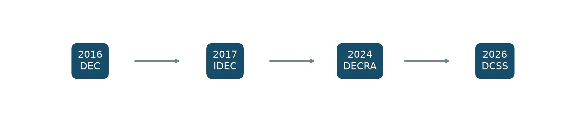
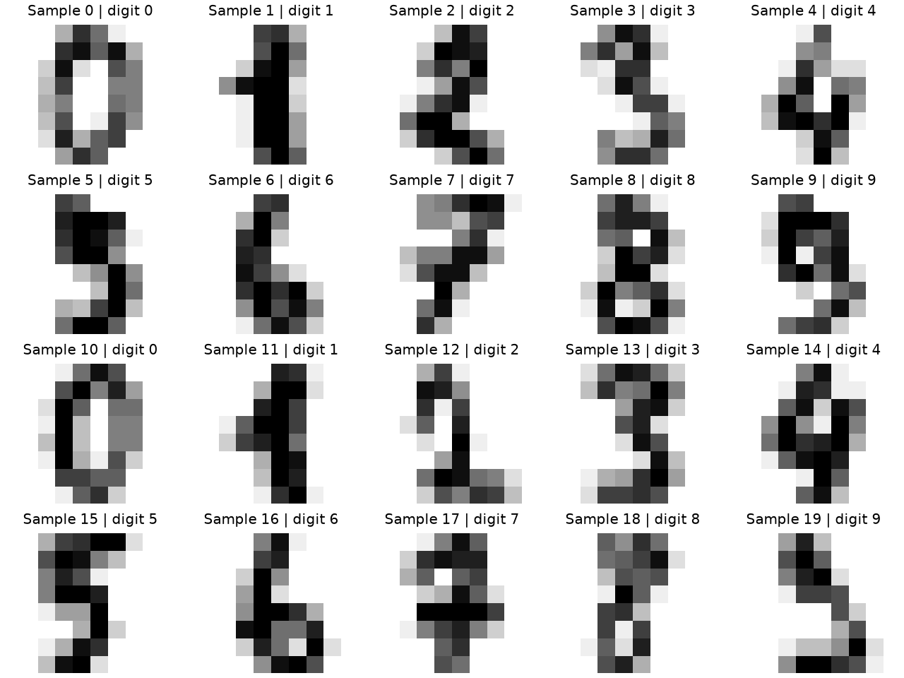
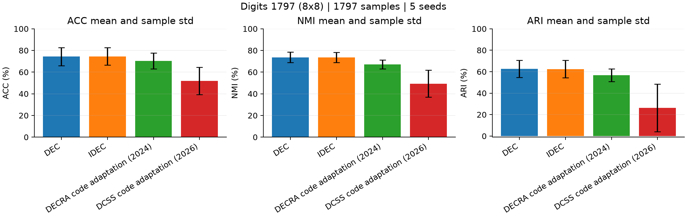
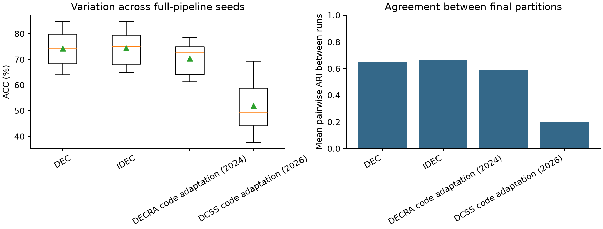
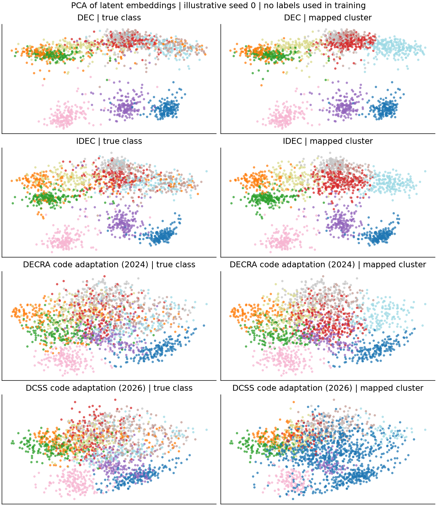

# ĐÁNH GIÁ HIỆU NĂNG VÀ ĐỘ ỔN ĐỊNH — CỦA CÁC PHƯƠNG PHÁP PHÂN CỤM SÂU

BÀI KHẢO SÁT VÀ THỰC NGHIỆM SO SÁNH — Phạm vi tài liệu: 2016–2026

## MỤC LỤC

- [TÓM TẮT](#s7)
- [CHƯƠNG I. TỔNG QUAN](#s11)
- [1.1. Bối cảnh và động cơ nghiên cứu](#s12)
- [1.2. Câu hỏi nghiên cứu](#s16)
- [1.3. Mục tiêu, phạm vi và đóng góp](#s18)
- [1.4. Khái niệm hiệu năng và độ ổn định](#s21)
- [CHƯƠNG II. PHƯƠNG PHÁP VÀ KẾT QUẢ KHẢO SÁT](#s24)
- [2.1. Nguồn tài liệu và tiêu chí lựa chọn](#s25)
- [2.2. Thống kê danh mục công trình](#s29)
- [2.3. Phân hạng tạp chí và chất lượng nguồn](#s35)
- [2.4. Các hướng phương pháp trong danh mục](#s43)
- [2.5. Tiến trình nghiên cứu và các khoảng trống](#s47)
- [CHƯƠNG III. PHÂN TÍCH CÁC PHƯƠNG PHÁP TIÊU BIỂU](#s52)
- [3.1. Khung biểu diễn và phân cụm chung](#s53)
- [3.2. DEC: tự huấn luyện dựa trên phân phối mục tiêu](#s57)
- [3.3. IDEC: bảo toàn cấu trúc bằng reconstruction](#s63)
- [3.4. DECRA: biến đổi embedding và nhất quán tái tạo](#s67)
- [3.5. DCSS: tối ưu hình học cụm bằng soft silhouette](#s72)
- [3.6. BRB và các ứng viên về độ ổn định](#s78)
- [CHƯƠNG IV. THIẾT KẾ VÀ KẾT QUẢ THỰC NGHIỆM](#s85)
- [4.1. Dữ liệu và tiền xử lý](#s86)
- [4.2. Giao thức so sánh và kiến trúc nền](#s94)
- [4.3. Độ đo, cách tổng hợp và kiểm chứng](#s100)
- [4.4. Kết quả trên cùng bộ Digits](#s108)
- [4.5. Phân tích ghép cặp và độ ổn định](#s115)
- [4.6. Độ nhạy của DCSS với khởi tạo RBF](#s123)
- [4.7. Đối chiếu số liệu công bố](#s130)
- [4.8. Điểm mạnh, điểm yếu và giới hạn suy rộng](#s143)
- [CHƯƠNG V. THẢO LUẬN VÀ KẾT LUẬN](#s147)
- [5.1. Trả lời các câu hỏi nghiên cứu](#s148)
- [5.2. Kết quả đạt được và hạn chế](#s153)
- [5.3. Hướng phát triển](#s156)
- [TÀI LIỆU THAM KHẢO](#s159)
- [PHỤ LỤC A. DANH MỤC CÔNG TRÌNH VÀ KHẢ NĂNG TRUY CẬP](#s195)
- [PHỤ LỤC B. MINH HỌA CƠ CHẾ VÀ SỐ LIỆU THEO SEED](#s205)

<a id="s3"></a>

## DANH MỤC TỪ VIẾT TẮT

| Viết tắt | Thuật ngữ | Ý nghĩa |
| --- | --- | --- |
| AE | Autoencoder | Mạng tự mã hóa |
| ACC | Clustering Accuracy | Độ chính xác phân cụm sau ghép nhãn |
| NMI | Normalized Mutual Information | Thông tin tương hỗ chuẩn hóa |
| ARI | Adjusted Rand Index | Chỉ số Rand hiệu chỉnh |
| KL | Kullback–Leibler divergence | Độ phân kỳ giữa phân phối |
| RBF | Radial Basis Function | Hàm cơ sở xuyên tâm |
| MSE | Mean Squared Error | Lỗi bình phương trung bình |
| SJR | SCImago Journal Rank | Hệ thống chỉ số và phân hạng tạp chí |
| SD | Sample standard deviation | Độ lệch chuẩn mẫu |
| SE | Standard error | Sai số chuẩn |
| RMS | Root Mean Square | Căn trung bình bình phương |

## DANH MỤC BẢNG

- [Bảng 2.1. Quy mô và mức trích xuất của danh mục khảo sát](#s30)
- [Bảng 2.2. Phân bố công trình theo năm công bố](#s32)
- [Bảng 2.3. Phân hạng các tạp chí theo SJR best quartile 2024](#s37)
- [Bảng 2.4. Tổng hợp phân hạng trên năm bài tạp chí](#s39)
- [Bảng 2.5. Phân nhóm cơ chế phục vụ phân tích trong báo cáo](#s44)
- [Bảng 3.1. Lý do chọn bốn mốc và giả thuyết cần đánh giá](#s81)
- [Bảng 4.1. Đặc điểm dữ liệu thực nghiệm](#s88)
- [Bảng 4.2. Phân bố mẫu theo lớp tham chiếu](#s90)
- [Bảng 4.3. Cấu hình thực nghiệm chính](#s96)
- [Bảng 4.4. Chất lượng phân cụm của 20 lượt thực nghiệm chính](#s109)
- [Bảng 4.5. Độ ổn định phân hoạch và chi phí của các phương pháp](#s111)
- [Bảng 4.6. ACC theo seed và chênh lệch IDEC so với DEC](#s116)
- [Bảng 4.7. Đối chiếu khởi tạo độ rộng RBF của DCSS](#s127)
- [Bảng 4.8. ACC của DEC và IDEC trong bài IDEC 2017](#s132)
- [Bảng 4.9. Số liệu MNIST trong bài DECRA 2024](#s135)
- [Bảng 4.10. ACC của IDEC có tiền huấn luyện khi bổ sung BRB](#s138)
- [Bảng 4.11. Đánh đổi quan sát được giữa các mốc phương pháp](#s144)
- [Bảng A.1. Công trình, nơi công bố và mã nguồn](#s197)
- [Bảng A.2. Benchmark và mức đối chiếu phạm vi](#s199)
- [Bảng A.3. Các tóm tắt số liệu định lượng trong hồ sơ khảo sát](#s202)
- [Bảng B.1. Kết quả của toàn bộ 20 lượt chính](#s209)

## DANH MỤC HÌNH

- [Hình 3.1. Các mốc phương pháp được chọn cho thực nghiệm; mũi tên biểu thị thời gian công bố](#s83)
- [Hình 4.1. Ví dụ ảnh chữ số trong bộ Digits](#s92)
- [Hình 4.2. Chất lượng phân cụm và thời gian của các bản chuyển thể trên Digits](#s114)
- [Hình 4.3. Biến động ACC và mức đồng thuận phân hoạch giữa các seed](#s119)
- [Hình 4.4. Hình chiếu PCA hai chiều minh họa các phân hoạch ở seed 0](#s121)

<a id="s7"></a>

## TÓM TẮT

Phân cụm sâu kết hợp học biểu diễn với tối ưu cấu trúc cụm để xử lý dữ liệu có chiều cao. Bài khảo sát tổng hợp danh mục 32 công trình trong giai đoạn 2016–2026, gồm 27 bài hội nghị và 5 bài tạp chí, phân tích sự chuyển dịch từ tự huấn luyện dựa trên tâm đến bảo toàn cấu trúc, biến đổi biểu diễn và các cơ chế chú trọng độ ổn định. Bốn phương pháp DEC, IDEC, DECRA và DCSS được lựa chọn để thực nghiệm trên cùng bộ Digits gồm 1.797 mẫu, cùng kiến trúc autoencoder nền và năm seed. Thiết kế này tạo 20 lượt chạy chính, đánh giá đồng thời chất lượng, biến động giữa seed, mức đồng thuận của phân hoạch và chi phí tính toán.

IDEC đạt ACC trung bình 74,50%, cao hơn DEC 0,18 điểm phần trăm, trong khi DEC nhỉnh hơn ở NMI và ARI. DECRA có độ lệch chuẩn ACC nhỏ hơn nhưng chất lượng trung bình và mức đồng thuận phân hoạch thấp hơn. DCSS nhạy với độ rộng RBF khi chuyển sang embedding tuyến tính; thực nghiệm bổ sung sử dụng khởi tạo độ rộng theo dữ liệu cho thấy tác động lớn của yếu tố này. Kết quả cho thấy mốc công bố mới hơn không tự đảm bảo hiệu năng hoặc độ ổn định tốt hơn dưới một giao thức chung. Các triển khai là bản chuyển thể cơ chế, vì vậy kết luận giới hạn trong cấu hình và dữ liệu đã thực nghiệm, chưa xác định phương pháp mạnh nhất toàn lĩnh vực năm 2025–2026.

Từ khóa: phân cụm sâu; học biểu diễn; autoencoder; hiệu năng; độ ổn định; DEC; IDEC; DECRA; DCSS.

<a id="s11"></a>

## CHƯƠNG I. TỔNG QUAN

<a id="s12"></a>

### 1.1. Bối cảnh và động cơ nghiên cứu

Phân cụm là bài toán phân chia các đối tượng thành các nhóm dựa trên cấu trúc tương đồng, không sử dụng nhãn lớp để huấn luyện. Trên dữ liệu ảnh, văn bản hoặc dữ liệu có nhiều đặc trưng, khoảng cách trong không gian đầu vào có thể không phản ánh rõ cấu trúc cần phân nhóm. Các phương pháp phân cụm sâu học một biểu diễn gọn hơn, đồng thời điều chỉnh biểu diễn đó theo mục tiêu phân cụm. Quan hệ giữa học biểu diễn và phân cụm là trục phân loại quan trọng trong các tổng quan gần đây. [32]

Các công trình thường báo cáo cải thiện điểm số trên những benchmark khác nhau, sử dụng kiến trúc, tiền huấn luyện và ngân sách tối ưu khác nhau. Một điểm ACC cao hơn có thể đến từ thay đổi phương pháp, nhưng cũng có thể đến từ đặc trưng tốt hơn, khởi tạo thuận lợi hoặc giao thức đánh giá khác. Do đó, khảo sát theo thời gian cần gắn tiến bộ về cơ chế với điều kiện tạo ra kết quả, thay vì sắp xếp các điểm công bố thành một thứ hạng chung.

Độ ổn định là vấn đề riêng bên cạnh chất lượng trung bình. Một mô hình có thể đạt kết quả cao ở một lần chạy nhưng tạo các phân hoạch rất khác nhau khi đổi seed. Ngược lại, một mô hình có điểm số ít biến động vẫn có thể ổn định quanh một lời giải kém. Báo cáo vì vậy xem xét đồng thời chất lượng phân cụm, độ lệch chuẩn và mức đồng thuận giữa các phân hoạch.

<a id="s16"></a>

### 1.2. Câu hỏi nghiên cứu

Câu hỏi thứ nhất là các hướng phân cụm sâu đã thay đổi cơ chế học như thế nào từ DEC/IDEC đến các công trình gần đây. Câu hỏi thứ hai là những cơ chế mới có cải thiện chất lượng và độ ổn định khi dùng cùng dữ liệu và điểm khởi tạo hay không. Câu hỏi thứ ba là mức độ nhạy với tham số và điều kiện triển khai có ảnh hưởng như thế nào đến lựa chọn phương pháp. Câu hỏi cuối cùng là bằng chứng hiện có đã đủ để xác định một phương pháp tốt nhất trong giai đoạn 2025–2026 hay chưa.

<a id="s18"></a>

### 1.3. Mục tiêu, phạm vi và đóng góp

Nghiên cứu xây dựng danh mục tài liệu có định danh và nguồn, thống kê loại công bố, năm, phân hạng tạp chí, khả năng truy cập mã nguồn và dữ liệu; phân tích các phương pháp theo cơ chế; và thực hiện một so sánh có kiểm soát trên một bộ dữ liệu. Bài IDEC năm 2017 là tài liệu tham chiếu chính, còn DEC đóng vai trò phương pháp nền. DECRA và DCSS đại diện cho hai thay đổi cơ chế trong họ autoencoder. BRB và các ứng viên khác được giữ trong phần khảo sát để đối chiếu và cân nhắc việc mở rộng. [1] [2] [7] [21] [8]

Phạm vi thực nghiệm hiện giới hạn ở phân cụm đơn góc nhìn trên Digits và các bản chuyển thể dùng chung kiến trúc nhỏ. Khảo sát thư mục bao phủ cả một số hướng thị giác, sinh, không gian con và dữ liệu mất cân bằng để cung cấp bối cảnh, nhưng các hướng này không được đưa vào bảng chạy chung nếu cần đầu vào hoặc điều kiện huấn luyện khác. Kết quả tái hiện đúng kiến trúc và môi trường tác giả là một cấp bằng chứng khác với thực nghiệm chuyển thể trong báo cáo.

<a id="s21"></a>

### 1.4. Khái niệm hiệu năng và độ ổn định

Hiệu năng được xem xét qua ACC, NMI, ARI và thời gian xử lý. ACC đo mức trùng khớp nhãn sau khi giải bài toán ghép nhãn cụm; NMI đo lượng thông tin chung giữa phân hoạch dự đoán và nhãn tham chiếu; ARI đo mức đồng thuận cặp đối tượng sau hiệu chỉnh ngẫu nhiên. Trong báo cáo, ACC/NMI/ARI được nhân 100 để trình bày theo phần trăm, còn ARI giữa seed giữ thang đo gốc.

Độ ổn định có hai biểu hiện được đo: biến động điểm số giữa các seed và mức đồng thuận giữa các phân hoạch. Khả năng chịu nhiễu, thay đổi số cụm hoặc dịch chuyển phân phối là những khía cạnh khác của độ ổn định; chúng chưa được suy ra từ thí nghiệm đổi seed hiện tại.

<a id="s24"></a>

## CHƯƠNG II. PHƯƠNG PHÁP VÀ KẾT QUẢ KHẢO SÁT

<a id="s25"></a>

### 2.1. Nguồn tài liệu và tiêu chí lựa chọn

Nguồn khảo sát bao gồm tài liệu tham chiếu được cung cấp, trang proceedings của hội nghị, trang nhà xuất bản, bản thảo công khai của tác giả và kho mã nguồn liên quan. Danh mục được mở rộng quanh các từ khóa deep clustering, deep embedded clustering, reconstruction, sample stability và reclustering. Các bản preprint và bản xuất bản của cùng công trình được đối chiếu để chỉ tính một lần; năm trong thống kê ưu tiên năm issue/proceedings đã xác minh.

Việc lựa chọn có chủ đích, ưu tiên công trình phù hợp với câu hỏi về hiệu năng/độ ổn định và có mã nguồn công khai. Đây chưa phải một tổng quan hệ thống với truy vấn cơ sở dữ liệu và lưu đồ sàng lọc đầy đủ. Do đó, tần suất công bố và tỷ lệ mã nguồn trong danh mục chỉ mô tả mẫu khảo sát này, không ước lượng tỷ lệ tương ứng của toàn bộ lĩnh vực.

Hồ sơ mỗi công trình ghi nhận phương pháp, năm, nơi công bố, loại tài liệu, nguồn mã, benchmark, số liệu đã trích xuất và trạng thái đọc toàn văn. Xác minh metadata, đọc một bảng hoặc kiểm tra README không được coi là hoàn tất đọc toàn văn. Tại thời điểm tổng hợp, có 2 phiếu đọc toàn văn hoàn tất cho DEC/IDEC và 18 tóm tắt số liệu có nguồn; các hồ sơ còn lại chưa hoàn tất mọi trường thực nghiệm. Giới hạn này được giữ rõ khi diễn giải kết quả khảo sát.

<a id="s29"></a>

### 2.2. Thống kê danh mục công trình

<a id="s30"></a>

**Bảng 2.1. Quy mô và mức trích xuất của danh mục khảo sát**

| Hạng mục | Số lượng | Phạm vi diễn giải |
| --- | --- | --- |
| Tổng công trình không trùng | 32 | 31 bài phương pháp và 1 bài tổng quan |
| Bài hội nghị | 27 | 84,4% danh mục |
| Bài tạp chí | 5 | 15,6% danh mục; mẫu số dùng thống kê Q |
| Công trình từ năm 2023 | 16 | 50% danh mục |
| Mã phương pháp công khai | 31 | Có nguồn mã; chưa đồng nghĩa đã chạy môi trường tác giả |
| Bài tổng quan có thư viện/tài nguyên | 1 | Tách khỏi số thuật toán được thực nghiệm |
| Phạm vi/tên benchmark đã đối chiếu | 28 | Xác nhận tên/phạm vi, chưa xác minh toàn bộ link tải |
| Dữ liệu công khai theo hồ sơ | 15 | Khai báo có nguồn; khác việc tải đủ dữ liệu bài gốc |
| Tóm tắt số liệu có nguồn | 18 | Có thể từ bảng, abstract hoặc README; không phải bảng đã tái hiện |
| Phiếu đọc toàn văn hoàn tất | 2 | DEC và IDEC |
| Môi trường mã tác giả đã chạy | 0 | Thực nghiệm báo cáo dùng bản chuyển thể độc lập |

<a id="s32"></a>

**Bảng 2.2. Phân bố công trình theo năm công bố**

| Năm | Số công trình |
| --- | --- |
| 2016 | 2 |
| 2017 | 5 |
| 2018 | 2 |
| 2019 | 1 |
| 2020 | 3 |
| 2021 | 2 |
| 2022 | 1 |
| 2023 | 2 |
| 2024 | 6 |
| 2025 | 6 |
| 2026 | 2 |

Danh mục bao phủ các mốc sớm về embedding và phân cụm dựa trên tâm, các hướng tự giám sát thị giác, và các công trình gần đây về độ tin cậy, mẫu ổn định, reclustering và hình học cụm. Phân bố theo năm chịu ảnh hưởng của tiêu chí chọn mẫu; số lượng trong từng năm không được sử dụng như một chỉ báo về tốc độ tăng trưởng chung của lĩnh vực.

<a id="s35"></a>

### 2.3. Phân hạng tạp chí và chất lượng nguồn

Báo cáo dùng SCImago/SJR best quartile với cùng năm tham chiếu 2024 để giữ thống nhất trong thống kê. Best quartile là phân hạng tốt nhất của tạp chí trên các ngành được xếp hạng; không phải đánh giá chất lượng riêng của từng bài. Năm tham chiếu khác năm xuất bản của một số công trình, vì vậy các giá trị dưới đây không được gọi là Q tại mọi năm công bố hoặc phân hạng mới nhất năm 2026. Hội nghị không được gán Q1–Q4 của tạp chí. [35]

<a id="s37"></a>

**Bảng 2.3. Phân hạng các tạp chí theo SJR best quartile 2024**

| Công trình | Năm bài | Tạp chí | Q tham chiếu |
| --- | --- | --- | --- |
| DECRA [7] | 2024 | Neural Processing Letters | Q2 |
| ProPos [17] | 2023 | IEEE TPAMI | Q1 |
| DCSS [21] | 2026 | Machine Learning | Chưa xác minh |
| DKM [31] | 2020 | Pattern Recognition Letters | Q1 |
| Survey-ACM [32] | 2025 | ACM CS | Q1 |

<a id="s39"></a>

**Bảng 2.4. Tổng hợp phân hạng trên năm bài tạp chí**

| Nhóm | Số bài | Tỷ lệ trên bài tạp chí |
| --- | --- | --- |
| Q1 | 3 | 60,0% |
| Q2 | 1 | 20,0% |
| Q3 | 0 | 0,0% |
| Q4 | 0 | 0,0% |
| Chưa xác minh | 1 | 20,0% |

Bằng chứng phân hạng gồm nội dung được lập chỉ mục trên trang chính chủ SCImago; truy cập trực tiếp trong đợt tra cứu bị hạn chế. Machine Learning được giữ ở nhóm chưa xác minh đủ nguồn chính thay vì suy ra Q từ uy tín tạp chí. Riêng Pattern Recognition Letters có best quartile Q1 năm 2024 nhưng ngành Artificial Intelligence là Q2 trong cả năm 2020 và 2024. Hai cách xét này không được trộn vào cùng một tổng. Q3/Q4 bằng 0 là không có bài được ghi nhận trong các nhóm đó của mẫu hiện tại, không phản ánh toàn bộ lĩnh vực. [35]

Mức uy tín của nơi công bố hỗ trợ lựa chọn tài liệu, nhưng không thay thế đánh giá phương pháp. Khả năng kiểm tra mã, giao thức đánh giá, số lần chạy và mức báo cáo sai số cũng là các yếu tố cần xem xét khi dùng số liệu để lập luận về hiệu năng hoặc độ ổn định.

<a id="s43"></a>

### 2.4. Các hướng phương pháp trong danh mục

<a id="s44"></a>

**Bảng 2.5. Phân nhóm cơ chế phục vụ phân tích trong báo cáo**

| Nhóm | Công trình | Đặc trưng |
| --- | --- | --- |
| Autoencoder và tối ưu cụm | DEC [1]; IDEC [2]; DCN [3]; DEC-DA [4]; DECRA [7]; DCEC [12]; DECCS [14]; DCSS [21]; DKM [31] | Điều chỉnh embedding bằng loss cụm, tái tạo, nhất quán hoặc hình học cụm; phù hợp trục thực nghiệm chung. |
| Nhãn giả, prototype và cập nhật trực tuyến | DeepCluster [10]; DPAC [15]; CA [16]; ProPos [17]; SwAV [28] | Tạo mục tiêu học từ cấu trúc cụm/prototype; hiệu quả phụ thuộc đặc trưng, nhãn giả và tiền huấn luyện. |
| Nhất quán, tương phản và độ ổn định | SCAN [5]; CC [6]; BRB [8]; IIC [13]; NNM [18]; DivClust [19]; LFSS [20]; DCBoost [23]; SANE [24]; CDC [25] | Khai thác lân cận, các bản biến đổi dữ liệu, mẫu tin cậy, reset hoặc calibration; khái niệm ổn định khác nhau giữa các bài. |
| Mục tiêu và chế độ bổ sung | VaDE [9]; JULE [11]; PRCut [22]; P2OT [26]; CPP [27]; IDC [29]; DSCNet [30] | Mô hình sinh, phân cấp, graph cut, mất cân bằng, đặc trưng ngoài, giải thích và không gian con; cần protocol riêng. |

Bốn nhóm là cách tổ chức của báo cáo nhằm trả lời câu hỏi thực nghiệm, không phải các lớp loại trừ lẫn nhau hoặc bản sao nguyên văn taxonomy của bài tổng quan ACM. Một công trình có thể đồng thời sử dụng prototype, tự giám sát và lựa chọn mẫu; ở đây nó được xếp theo cơ chế nổi bật nhất đối với mục tiêu phân tích. Bài tổng quan ACM cung cấp bối cảnh về cách tương tác giữa mô-đun biểu diễn và mô-đun phân cụm. [32]

<a id="s47"></a>

### 2.5. Tiến trình nghiên cứu và các khoảng trống

Giai đoạn 2016–2018 chú trọng học embedding và mục tiêu cụm đồng thời. DEC làm sắc phân phối gán cụm, IDEC bổ sung reconstruction, còn DCN hướng mục tiêu về không gian phù hợp K-means. DKM có preprint năm 2018 và bản journal năm 2020, tiếp tục hướng tối ưu đồng thời này. DCEC mở rộng biểu diễn ảnh bằng convolution; DEC-DA khai thác tăng cường dữ liệu. Những thay đổi này mở rộng khả năng học nhưng vẫn chịu ảnh hưởng của chất lượng tiền huấn luyện và khởi tạo. [1] [2] [3] [31] [12] [4]

Trong giai đoạn 2019–2024, nhiều hướng sử dụng thông tin nhất quán, tương phản, lân cận hoặc prototype. IIC tối ưu thông tin chung; SCAN kết hợp lân cận với tự gán nhãn; CC học tương phản ở mức đối tượng và cụm. Các hướng như ProPos, DPAC và DECCS tiếp tục điều chỉnh biểu diễn hoặc quan hệ cụm. DECRA vẫn theo họ autoencoder nhưng bổ sung khả năng biến đổi embedding thay vì chỉ giữ reconstruction đầu vào. [13] [5] [6] [17] [15] [14] [7]

Các công trình 2025–2026 chú ý rõ hơn đến hạn chế của tự huấn luyện và sự không đồng đều giữa các mẫu. BRB can thiệp quá trình tối ưu bằng reset và reclustering; LFSS dùng ổn định mẫu; DCBoost bổ sung tự giám sát dựa trên lân cận; SANE kết hợp khởi tạo theo mật độ và lựa chọn mẫu động. CDC chú trọng calibration của xác suất, còn DCSS tối ưu trực tiếp tính gọn và tách biệt của cụm. Các mục tiêu này liên quan nhưng không đồng nghĩa: ECE thấp hơn, tốc độ nhanh hơn và ACC cao hơn là ba kết quả khác nhau. [8] [20] [23] [24] [25] [21]

Khoảng trống cần xử lý là việc so sánh các cơ chế dưới cùng điều kiện, báo cáo cả biến động giữa seed và tính nhất quán của phân hoạch, và kiểm tra độ nhạy khi chuyển kiến trúc. Các điểm số trong tài liệu cung cấp bối cảnh, còn thực nghiệm Chương IV xem xét một phần khoảng trống này với giao thức chung.

<a id="s52"></a>

## CHƯƠNG III. PHÂN TÍCH CÁC PHƯƠNG PHÁP TIÊU BIỂU

<a id="s53"></a>

### 3.1. Khung biểu diễn và phân cụm chung

Gọi X = {xᵢ} là tập dữ liệu, fθ là encoder, gψ là decoder, zᵢ = fθ(xᵢ) là biểu diễn và μⱼ là tâm cụm thứ j. Autoencoder học tái tạo x̂ᵢ = gψ(zᵢ), trong khi thành phần phân cụm tác động đến zᵢ và/hoặc μⱼ. Reconstruction bảo toàn thông tin đầu vào; loss phân cụm tạo áp lực để biểu diễn phù hợp cấu trúc phân nhóm. Hai mục tiêu có thể hỗ trợ nhau hoặc xung đột khi thông tin cần tái tạo không phải thông tin hữu ích cho phân cụm.

E = (1/ND) ∑ᵢ ∑ᵈ (xᵢᵈ − x̂ᵢᵈ)² (3.1)

Trong (3.1), N là số mẫu và D là số đặc trưng. Các hệ số trong loss cần được hiểu cùng quy ước chuẩn hóa; cùng một hệ số số học nhưng khác mẫu số N hoặc NK tạo trọng số hiệu dụng khác nhau. Đây là điểm cần giữ rõ khi đối chiếu mô tả bài báo với mã công khai.

<a id="s57"></a>

### 3.2. DEC: tự huấn luyện dựa trên phân phối mục tiêu

DEC khởi tạo encoder từ autoencoder, khởi tạo tâm trong embedding, sau đó tối ưu encoder và tâm bằng phân phối gán mềm Student-t. Phân phối mục tiêu P được xây dựng từ Q để tăng trọng số các gán có độ tin cậy cao và điều chỉnh tần suất cụm. Loss KL hướng Q đến P. Decoder không tiếp tục được dùng để ràng buộc biểu diễn trong giai đoạn phân cụm. [1]

qᵢⱼ = (1 + ‖zᵢ − μⱼ‖²)⁻¹ / ∑ₖ (1 + ‖zᵢ − μₖ‖²)⁻¹ (3.2)

fⱼ = ∑ᵢ qᵢⱼ ;  pᵢⱼ = (qᵢⱼ²/fⱼ) / ∑ₖ(qᵢₖ²/fₖ) (3.3)

Kₙ = (1/N) ∑ᵢ ∑ⱼ pᵢⱼ ln(pᵢⱼ/qᵢⱼ) ;  LDEC = Kₙ (3.4)

DEC là mốc nền phù hợp vì cơ chế gán mềm và tự làm sắc đơn giản, dễ phân tích ảnh hưởng của khởi tạo. Điểm yếu là mục tiêu tự tạo không đảm bảo phản ánh đúng lớp ngữ nghĩa. Nếu khởi tạo kém, quá trình làm sắc có thể củng cố một cấu trúc chưa tốt hoặc làm biến dạng embedding theo các gán sai.

<a id="s63"></a>

### 3.3. IDEC: bảo toàn cấu trúc bằng reconstruction

IDEC giữ decoder khi tối ưu phân cụm và bổ sung lỗi tái tạo. Thiết kế này nhằm hạn chế việc loss phân cụm làm mất cấu trúc có ích của biểu diễn. Trong triển khai chung, loss được viết dưới dạng E + γKₙ, với γ = 0,1; cách ghi hệ số có thể khác khi bài gốc đổi thứ tự hoặc chuẩn hóa hai thành phần. [2]

LIDEC = E + γKₙ ;  γ = 0,1 trong thực nghiệm (3.5)

IDEC được chọn vì là bài target và tạo một đối chiếu trực tiếp với DEC: cùng gán mềm và mục tiêu tự huấn luyện, bổ sung reconstruction khi phân cụm. Ưu điểm dự kiến là hạn chế biến dạng; điểm đánh đổi là thông tin tái tạo có thể chứa nhiễu hoặc đặc trưng không liên quan đến cụm. Lợi ích thực tế phụ thuộc cân bằng loss và dữ liệu, không được khẳng định chỉ từ việc kiến trúc có thêm decoder.

<a id="s67"></a>

### 3.4. DECRA: biến đổi embedding và nhất quán tái tạo

DECRA đề xuất autoencoder có cấu trúc residual/adaptive để điều chỉnh biểu diễn theo nhiệm vụ phân cụm. Bài báo mô tả embedding bổ sung theo dạng residual; mã công khai sử dụng phép biến đổi affine tại embedding và hai đường decode dùng chung tham số. Bản chuyển thể của báo cáo đi theo loss trong mã công khai, không đồng nhất hai mô tả khi chưa đối chiếu đầy đủ. [7]

z̃ = Az + b ;  x̂ = gψ(z) ;  x̃ = gψ(z̃) (3.6)

Econs = MSE(x̃, x̂) ;  LDECRA = 2E + 0,6Econs + 0,1Kₙ/K (3.7)

Trong (3.7), K = 10 là số cụm của thực nghiệm. Phép chia KL cho K phản ánh phép lấy trung bình theo mẫu và cụm trong mã tác giả; reconstruction consistency truyền gradient qua cả hai đường decode. So với IDEC, biến đổi affine tạo thêm khả năng điều chỉnh embedding nhưng tăng số tham số và yêu cầu cân bằng mục tiêu. Thực nghiệm hiện dùng tiền huấn luyện autoencoder thông thường, chưa dùng quy trình tiền huấn luyện residual riêng và chưa đo khả năng chịu nhiễu bằng một thử nghiệm độc lập.

<a id="s72"></a>

### 3.5. DCSS: tối ưu hình học cụm bằng soft silhouette

DCSS sử dụng soft silhouette để khuyến khích cụm gọn và tách biệt, kết hợp reconstruction và entropy. Phân phối cụm được tạo từ Gaussian RBF và softmax; độ rộng RBF là tham số học được. Phương pháp được chọn làm ứng viên 2026 vì cùng họ autoencoder, có mã công khai và bài báo đối chiếu trực tiếp các phương pháp DEC/IDEC/DECRA. Điều này tạo cơ sở phân tích cơ chế, không xác lập DCSS mạnh nhất năm 2026. [21]

φᵢⱼ = exp(−‖zᵢ − μⱼ‖²/σⱼ²) ;  qᵢⱼ = softmaxⱼ(φᵢⱼ/T) (3.8)

LDCSS = E + λ(1 − Ssoft) + βH₂(Q) (3.9)

Trong thực nghiệm chính, λ = β = 0,01; T = 0,25; σⱼ khởi tạo bằng 1. Entropy H₂ dùng log cơ số 2 và lấy trung bình theo mẫu. Soft silhouette được tính trong minibatch. Mã công khai dùng tổng khoảng cách có trọng số xác suất, không chia cho khối lượng cụm; phương trình (13) trong bài có phép chia theo tổng xác suất cụm sau khi loại mẫu đang xét. Mục 5.3 của bài ghi temperature 20, trong khi mã dùng 0,25. Triển khai chung theo phiên bản mã và giữ các khác biệt này như giới hạn khi suy rộng kết quả.

DCSS đưa hình học cụm vào mục tiêu học một cách trực tiếp hơn KL tự làm sắc. Tuy nhiên, RBF phụ thuộc scale embedding và độ rộng khởi tạo; gán gần đều có thể tạo tín hiệu phân cụm yếu. Tính khoảng cách giữa mẫu trong minibatch cũng làm chi phí và hành vi loss phụ thuộc kích thước batch. Những yếu tố này cần được đánh giá cùng chất lượng.

<a id="s78"></a>

### 3.6. BRB và các ứng viên về độ ổn định

BRB là cơ chế bổ sung cho các phương pháp dựa trên tâm, kết hợp soft reset encoder, reclustering và điều chỉnh trạng thái tối ưu của tâm để vượt hạn chế trong quá trình học lặp. Nó không phải một họ mô hình độc lập theo cùng nghĩa với DEC hoặc DCSS. BRB được giữ trong phần số liệu công bố và có thể được đưa vào thực nghiệm sau, nhưng không được mặc định là phương pháp tốt nhất. [8]

LFSS, DCBoost và SANE là các ứng viên gần đây đáng xem xét vì chú trọng ổn định mẫu, lân cận hoặc lựa chọn mẫu động. CDC giải quyết calibration; CPP sử dụng đặc trưng tiền huấn luyện có thông tin ngoài. Khi so sánh các hướng này với họ autoencoder, cần đồng nhất đầu vào, ngân sách và thông tin sẵn có, hoặc tách thành các nhóm benchmark riêng. Cải thiện calibration hay linear evaluation không được đổi thành cải thiện ACC phân cụm. [20] [23] [24] [25] [27] [28]

<a id="s81"></a>

**Bảng 3.1. Lý do chọn bốn mốc và giả thuyết cần đánh giá**

| Mốc | Thay đổi cơ chế | Giả thuyết/điểm đánh đổi |
| --- | --- | --- |
| DEC 2016 | KL và mục tiêu tự làm sắc | Baseline; nhạy khởi tạo và gán sai |
| IDEC 2017 | Bổ sung reconstruction | Hạn chế biến dạng; có thể giữ thông tin không phục vụ cụm |
| DECRA 2024 | Nhánh adaptive và consistency | Biểu diễn linh hoạt hơn; thêm tham số và yêu cầu tiền huấn luyện |
| DCSS 2026 | Soft silhouette, entropy và RBF | Cụm gọn/tách biệt; nhạy scale, độ rộng và batch |

<a id="s83"></a>



Hình 3.1. Các mốc phương pháp được chọn cho thực nghiệm; mũi tên biểu thị thời gian công bố

Các mốc giúp theo dõi thay đổi cơ chế qua thời gian. Khoảng cách năm không biểu thị mức cải thiện, và mũi tên không khẳng định tất cả các bài là quan hệ kế thừa trực tiếp. Lựa chọn ứng viên cuối có thể thay đổi khi có bằng chứng phù hợp hơn từ khảo sát hoặc thực nghiệm mở rộng.

<a id="s85"></a>

## CHƯƠNG IV. THIẾT KẾ VÀ KẾT QUẢ THỰC NGHIỆM

<a id="s86"></a>

### 4.1. Dữ liệu và tiền xử lý

Thực nghiệm sử dụng bộ Digits được phân phối qua scikit-learn, có nguồn gốc từ UCI Optical Recognition of Handwritten Digits. Bản dùng ở đây gồm 1.797 ảnh xám 8×8 và 10 lớp chữ số, khác với toàn bộ bộ UCI gồm 5.620 mẫu. Mỗi ảnh được làm phẳng thành 64 đặc trưng; giá trị pixel ban đầu trong [0,16] được chia cho 16 để đưa về [0,1]. Nguồn UCI ghi giấy phép CC BY 4.0. [33] [34]

<a id="s88"></a>

**Bảng 4.1. Đặc điểm dữ liệu thực nghiệm**

| Thuộc tính | Giá trị |
| --- | --- |
| Số mẫu | 1797 |
| Kích thước ảnh | 8 × 8 pixel, mức xám |
| Số đặc trưng | 64 |
| Số cụm đặt trước | 10 |
| Tiền xử lý | Chia pixel cho 16; cùng thứ tự mẫu cho mọi phương pháp |
| Sử dụng nhãn | Chỉ tính metric sau huấn luyện |
| Chế độ đánh giá | Transductive: học và phân cụm toàn bộ X; không có tập chưa thấy |

<a id="s90"></a>

**Bảng 4.2. Phân bố mẫu theo lớp tham chiếu**

| Chữ số | Số mẫu |
| --- | --- |
| 0 | 178 |
| 1 | 182 |
| 2 | 177 |
| 3 | 183 |
| 4 | 181 |
| 5 | 182 |
| 6 | 181 |
| 7 | 179 |
| 8 | 174 |
| 9 | 180 |

<a id="s92"></a>



Hình 4.1. Ví dụ ảnh chữ số trong bộ Digits

Digits có quy mô nhỏ, cho phép thực hiện nhiều seed và kiểm tra các cơ chế với chi phí thấp. Tuy nhiên, ảnh 8×8 không đại diện cho ảnh tự nhiên, văn bản hoặc dữ liệu có nhiều góc nhìn. Nó phù hợp cho một bước so sánh ban đầu, chưa đủ làm cơ sở suy rộng toàn lĩnh vực.

<a id="s94"></a>

### 4.2. Giao thức so sánh và kiến trúc nền

Bốn phương pháp được chạy trên cùng X, cùng thứ tự mẫu, cùng số cụm và năm seed 0–4. Với mỗi seed, autoencoder được tiền huấn luyện từ đầu bằng MSE; K-means được chạy trên embedding để khởi tạo tâm. Trọng số tiền huấn luyện và tâm ban đầu được sao chép cho từng phương pháp trong seed đó. DECRA thêm nhánh affine, DCSS thêm độ rộng RBF; các thành phần riêng được ghi nhận như khác biệt cơ chế.

<a id="s96"></a>

**Bảng 4.3. Cấu hình thực nghiệm chính**

| Tham số | Giá trị | Vai trò trong so sánh |
| --- | --- | --- |
| Encoder / decoder | 64–64–32–10 / 10–32–64–64 | Kiến trúc nền chung |
| Hàm kích hoạt | ReLU; latent tuyến tính; output sigmoid | Cùng scale và dạng biểu diễn nền |
| Tiền huấn luyện | 120 epoch | Học reconstruction trước phân cụm |
| Huấn luyện phân cụm | 60 epoch | Ngân sách epoch chung |
| Minibatch | 128 | DCSS tính soft silhouette trong batch |
| Optimizer / learning rate | Adam / 0,001 | Áp dụng cho mọi cấu hình |
| K-means | K = 10; 20 khởi tạo | Tâm chung trong từng seed |
| Cập nhật mục tiêu P | Mỗi 5 epoch, trên toàn bộ X | DEC, IDEC và DECRA; không áp dụng DCSS |
| Số seed / lượt chính | 5 / 20 | Đánh giá biến động và so sánh ghép cặp |
| Tối ưu hệ số loss | Giữ cấu hình cố định trong lượt chính | Không chọn bằng ACC trên nhãn đánh giá |

Một epoch tương ứng một lượt đi qua dữ liệu; với batch 128, mỗi epoch có 15 minibatch. DEC/IDEC/DECRA làm mới P trước các epoch theo lịch, giữ P cố định khi tính gradient trong minibatch. DCSS tính xác suất RBF và loss hình học trực tiếp, không dùng P. Mọi mô hình được đánh giá tại điểm kết thúc ngân sách đã định, không chọn epoch tốt nhất dựa trên nhãn.

Các triển khai sử dụng NumPy trên CPU trong môi trường Windows, với một luồng xử lý được cấu hình. So sánh dùng chung backbone nhằm giảm khác biệt kiến trúc, nhưng đồng thời thay đổi một số giả định so với công trình gốc. Kết quả vì vậy là đánh giá các bản chuyển thể cơ chế, không phải chứng nhận tái hiện toàn bộ bảng benchmark tác giả.

<a id="s100"></a>

### 4.3. Độ đo, cách tổng hợp và kiểm chứng

ACC = maxπ (1/N) ∑ᵢ 1[yᵢ = π(cᵢ)] (4.1)

NMI = 2I(Y; C) / (H(Y) + H(C)) (4.2)

Trong (4.1), π là phép hoán vị nhãn cụm tối ưu, được xác định bằng ghép nhãn Hungarian. Công thức (4.2) sử dụng chuẩn hóa bằng trung bình số học của entropy. ARI hiệu chỉnh mức đồng thuận cặp đối tượng so với ngẫu nhiên và không phụ thuộc số hiệu nhãn cụm. Ngoài ARI với nhãn tham chiếu, ARI giữa seed so sánh hai phân hoạch dự đoán mà không cần dùng nhãn lớp.

m̄ = (1/R) ∑ᵣ mᵣ ;  s = √[∑ᵣ(mᵣ − m̄)² / (R − 1)] ;  R = 5 (4.3)

Các bảng chính trình bày trung bình và độ lệch chuẩn mẫu trên năm seed. Mỗi phương pháp có 10 cặp seed để đo đồng thuận phân hoạch; các cặp dùng chung lượt chạy nên không được coi là 10 quan sát độc lập khi suy luận thống kê. So sánh DEC–IDEC còn được ghép theo seed để giảm ảnh hưởng của điểm khởi tạo chung.

Thời gian một lượt bao gồm tiền huấn luyện, khởi tạo K-means, huấn luyện phân cụm và ghi nhận loss, không bao gồm đánh giá cuối, vẽ biểu đồ và xuất tệp. Do tiền huấn luyện được dùng chung trong từng seed, thời gian báo cáo cho từng mô hình là chi phí nếu chạy độc lập, không phải tổng thời gian thực tế của cả chiến dịch.

Đạo hàm được đối chiếu bằng sai phân hữu hạn; nhãn cụm được tính lại từ trọng số đã lưu và metric được tính lại từ các dự đoán. Các kiểm chứng hỗ trợ độ tin cậy số học của implementation và bảng kết quả, nhưng không thay thế xác minh đúng giao thức tác giả hoặc đánh giá trên các benchmark khác.

<a id="s108"></a>

### 4.4. Kết quả trên cùng bộ Digits

<a id="s109"></a>

**Bảng 4.4. Chất lượng phân cụm của 20 lượt thực nghiệm chính**

| Phương pháp | ACC (%) | NMI (%) | ARI (%) |
| --- | --- | --- | --- |
| DEC | 74,32 ± 8,34 | 73,65 ± 4,88 | 62,70 ± 8,04 |
| IDEC | 74,50 ± 8,07 | 73,53 ± 4,66 | 62,49 ± 8,02 |
| DECRA | 70,40 ± 7,36 | 67,10 ± 3,99 | 56,76 ± 5,97 |
| DCSS, σ = 1 | 51,89 ± 12,51 | 49,34 ± 12,37 | 26,23 ± 22,23 |

<a id="s111"></a>

**Bảng 4.5. Độ ổn định phân hoạch và chi phí của các phương pháp**

| Phương pháp | ARI giữa seed | Thời gian (s) | Cặp seed |
| --- | --- | --- | --- |
| DEC | 0,6504 ± 0,0631 | 7,92 ± 1,05 | 10 |
| IDEC | 0,6616 ± 0,0606 | 8,30 ± 1,40 | 10 |
| DECRA | 0,5855 ± 0,0578 | 10,35 ± 0,86 | 10 |
| DCSS | 0,2018 ± 0,1313 | 10,82 ± 1,18 | 10 |

IDEC có ACC và mức đồng thuận giữa seed cao nhất trong lượt chính, nhưng DEC có NMI và ARI với nhãn tham chiếu cao hơn một chút. DECRA có độ lệch chuẩn ACC thấp hơn DEC/IDEC, đồng thời điểm trung bình và đồng thuận phân hoạch thấp hơn. DCSS với độ rộng ban đầu bằng 1 có chất lượng thấp và biến động lớn. Vì vậy, thứ hạng theo một metric không đủ mô tả đầy đủ hiệu năng và độ ổn định.

<a id="s114"></a>



Hình 4.2. Chất lượng phân cụm và thời gian của các bản chuyển thể trên Digits

<a id="s115"></a>

### 4.5. Phân tích ghép cặp và độ ổn định

<a id="s116"></a>

**Bảng 4.6. ACC theo seed và chênh lệch IDEC so với DEC**

| Seed | DEC (%) | IDEC (%) | ΔACC (điểm %) |
| --- | --- | --- | --- |
| 0 | 79,86 | 79,41 | -0,45 |
| 1 | 74,29 | 75,18 | 0,89 |
| 2 | 64,27 | 64,94 | 0,67 |
| 3 | 84,86 | 84,75 | -0,11 |
| 4 | 68,34 | 68,22 | -0,11 |

Chênh lệch ghép cặp trung bình là 0,1781 ± 0,5708 điểm phần trăm; IDEC cao hơn DEC ở 2/5 seed. Kết quả không cho thấy ưu thế nhất quán của IDEC trên bộ Digits với cấu hình này. Biến động chung giữa seed lớn hơn chênh lệch trung bình của hai phương pháp, nhưng so sánh ghép cặp mới là bằng chứng phù hợp để xem xét mức cải thiện khi khởi tạo được dùng chung.

<a id="s119"></a>



Hình 4.3. Biến động ACC và mức đồng thuận phân hoạch giữa các seed

DEC có chi phí thấp nhất và chất lượng gần IDEC. Reconstruction của IDEC giúp bổ sung ràng buộc biểu diễn nhưng chưa tạo cải thiện rõ trong thí nghiệm này. DECRA làm tăng chi phí và chưa cải thiện chất lượng; điều đó có thể liên quan tiền huấn luyện chung, chuẩn hóa loss hoặc ngân sách, không đủ để kết luận DECRA nguyên gốc kém hơn. Các giả thuyết này cần thử nghiệm riêng thay vì được coi là nguyên nhân đã xác nhận.

<a id="s121"></a>



Hình 4.4. Hình chiếu PCA hai chiều minh họa các phân hoạch ở seed 0

Hình chiếu hai chiều hỗ trợ quan sát cấu trúc biểu diễn nhưng không thay thế metric trong không gian học. Seed 0 được dùng để minh họa, không được chọn vì cho kết quả cao nhất. Kết luận chính dựa trên toàn bộ năm seed và các bảng tổng hợp.

<a id="s123"></a>

### 4.6. Độ nhạy của DCSS với khởi tạo RBF

Chẩn đoán trên embedding tiền huấn luyện của seed 0 không sử dụng nhãn cho thấy trung vị khoảng cách bình phương đến tâm gần nhất khoảng 7,21. Với σ = 1, Gaussian activation tương ứng chỉ khoảng 0,00074; xác suất cụm lớn nhất trung bình khoảng 0,1068, gần mức 0,1 của phân phối đều trên 10 cụm. Điều này gợi ý sự không tương thích giữa độ rộng cố định và scale embedding tuyến tính trong bản chuyển thể.

σⱼ = √[(1/|Cⱼ|) ∑ᵢ∈Cⱼ ‖zᵢ − μⱼ‖²] (4.4)

Một thực nghiệm bổ sung khởi tạo σ theo RMS khoảng cách trong từng cụm K-means ban đầu, giữ cùng X, seed, trọng số tiền huấn luyện và tâm. Chỉ X và phân hoạch khởi tạo được dùng để tính độ rộng, không dùng nhãn hoặc tìm kiếm theo ACC. Phép bổ sung được đề xuất sau khi quan sát lượt chính nên có tính thăm dò và được trình bày riêng.

<a id="s127"></a>

**Bảng 4.7. Đối chiếu khởi tạo độ rộng RBF của DCSS**

| Khởi tạo | ACC (%) | NMI (%) | ARI (%) |
| --- | --- | --- | --- |
| σ = 1 (lượt chính) | 51,89 ± 12,51 | 49,34 ± 12,37 | 26,23 ± 22,23 |
| σ = RMS (bổ sung) | 73,64 ± 8,00 | 71,22 ± 4,30 | 61,43 ± 7,08 |

ACC tăng lên 73,64 ± 8,00%, với ARI giữa seed 0,6541 ± 0,0575. Kết quả hỗ trợ nhận định DCSS nhạy với độ rộng khởi tạo dưới backbone chung. Nó không chứng minh hiệu năng của DCSS nguyên gốc và không thay thế dòng σ = 1 trong bảng chính. Chi phí của phép bổ sung được ghi nhận nhưng không dùng để khẳng định tăng tốc vì chiến dịch đo và chi phí theo dõi có thể khác.

<a id="s130"></a>

### 4.7. Đối chiếu số liệu công bố

Các bảng sau trình bày đối chiếu trong từng tài liệu nguồn, tách khỏi kết quả Digits. Ngay cả khi cùng tên MNIST, khác biệt kiến trúc, tiền huấn luyện, lựa chọn siêu tham số và nguồn baseline vẫn có thể thay đổi điểm. Không ghép các điểm tốt nhất của những tài liệu khác nhau thành một chuỗi tăng trưởng thực nghiệm đã được xác nhận.

<a id="s132"></a>

**Bảng 4.8. ACC của DEC và IDEC trong bài IDEC 2017**

| Benchmark | DEC (%) | IDEC (%) | Δ (điểm %) |
| --- | --- | --- | --- |
| MNIST | 86,55 | 88,06 | 1,51 |
| USPS | 74,08 | 76,05 | 1,97 |
| REUTERS-10K | 73,68 | 75,64 | 1,96 |

Nguồn: IDEC, Table 2 [2]. Bảng công bố thể hiện cải thiện của IDEC so với DEC trong giao thức của tài liệu này; bảng không cung cấp mean ± std để suy ra độ ổn định giữa các seed theo cách đo của thực nghiệm hiện tại.

<a id="s135"></a>

**Bảng 4.9. Số liệu MNIST trong bài DECRA 2024**

| Phương pháp | ACC (%) | NMI (%) |
| --- | --- | --- |
| DEC | 84,7 | 79,1 |
| IDEC | 88,1 | 86,7 |
| DECRA | 96,4 | 91,7 |

Nguồn: DECRA, Tables 2–3 [7]. DECRA đạt ACC 96,4% và NMI 91,7% trên MNIST trong bảng nguồn; không có cột std/SE và chưa xác định số lần chạy từ phần thiết lập đã đối chiếu. Baseline được lấy từ số liệu công bố hoặc chạy code, nên chưa xác lập mọi hàng dùng giao thức đồng nhất. NMI dùng chuẩn hóa maximum entropy, khác công thức trung bình số học ở (4.2). Các điểm này không được dùng để thay kết quả Digits.

<a id="s138"></a>

**Bảng 4.10. ACC của IDEC có tiền huấn luyện khi bổ sung BRB**

| Benchmark | IDEC (%) | IDEC + BRB (%) | Δ (điểm %) |
| --- | --- | --- | --- |
| MNIST | 93,16 ± 2,20 | 94,19 ± 2,20 | 1,03 |
| USPS | 81,59 ± 0,28 | 81,87 ± 0,14 | 0,28 |
| OPTDIGITS | 86,83 ± 0,21 | 87,35 ± 0,36 | 0,52 |
| Fashion-MNIST | 53,59 ± 1,01 | 55,96 ± 1,13 | 2,37 |
| KMNIST | 65,09 ± 1,03 | 65,61 ± 1,04 | 0,52 |
| GTSRB | 56,63 ± 2,16 | 62,84 ± 1,89 | 6,21 |

Nguồn: BRB, Table 13 [8]. Các hàng sử dụng reconstruction autoencoder có tiền huấn luyện, 10 seed; sai số là standard error theo quy ước của bài, không phải độ lệch chuẩn mẫu của bảng Digits. Mức tăng thay đổi theo benchmark, lớn nhất trong sáu hàng này là GTSRB. OPTDIGITS của bài sử dụng giao thức khác bản Digits 1.797 mẫu. Không thay baseline IDEC ở đây bằng điểm IDEC 2017 để tính mức tăng của BRB.

DKM cung cấp một đối chiếu hữu ích về khởi tạo và tối ưu đồng thời. Trong preprint v2, Table 2 trên MNIST báo cáo DKMp ACC 84,0 ± 2,2% và IDECp 85,7 ± 2,4%, trên 10 lượt chạy; tác giả chọn siêu tham số bằng nhãn 10% validation và đánh giá phần 90% còn lại. Số liệu này chưa được đối chiếu với bảng journal cuối cùng và không tương đương giao thức không chọn tham số bằng nhãn của Digits. [31]

DCSS báo cáo mean/std của 10 lượt trong các benchmark riêng và mô tả cải thiện NMI/ARI so với các đối chứng, nhưng không cung cấp cùng bảng ACC Digits đang dùng. LFSS, SANE, DCBoost và CDC bổ sung các mục tiêu hoặc điều kiện khác. Bằng chứng hiện tại hỗ trợ xem xét các ứng viên này, chưa cho phép chọn một phương pháp thắng phổ quát. [21] [20] [24] [23] [25]

<a id="s143"></a>

### 4.8. Điểm mạnh, điểm yếu và giới hạn suy rộng

<a id="s144"></a>

**Bảng 4.11. Đánh đổi quan sát được giữa các mốc phương pháp**

| Phương pháp | Điểm mạnh | Điểm yếu/giới hạn bằng chứng |
| --- | --- | --- |
| DEC | Chi phí thấp; NMI/ARI cao nhất lượt chính | Tự làm sắc có thể củng cố gán sai; ACC biến động theo seed |
| IDEC | ACC và đồng thuận seed nhỉnh nhất; ràng buộc tái tạo | Chênh DEC nhỏ, thắng 2/5 seed; cần cân bằng reconstruction |
| DECRA | Nhánh biến đổi linh hoạt; std ACC nhỏ hơn | Chất lượng/đồng thuận thấp hơn; chưa thử nhiễu hay residual pretrain riêng |
| DCSS | Mục tiêu gọn/tách biệt; ablation phát hiện độ nhạy rõ | RBF phụ thuộc scale; chuyển thể và khởi tạo ảnh hưởng mạnh |

Một dataset và năm seed chưa đủ kết luận khả năng tổng quát hóa hoặc thứ hạng toàn lĩnh vực. Việc dùng cùng backbone tạo điều kiện so sánh cơ chế nhưng có thể làm một phương pháp mất lợi thế kiến trúc vốn có. Ngân sách epoch chung không tương đương ngân sách thời gian hay tìm kiếm siêu tham số tối ưu cho từng phương pháp. Khả năng chịu nhiễu và thay đổi phân phối chưa được đo; ablation RBF là phân tích sau quan sát, cần xác nhận bằng thiết kế định trước trên dữ liệu khác.

<a id="s147"></a>

## CHƯƠNG V. THẢO LUẬN VÀ KẾT LUẬN

<a id="s148"></a>

### 5.1. Trả lời các câu hỏi nghiên cứu

Về tiến trình phương pháp, các hướng phát triển không tạo một chuỗi tuyến tính đơn giản. Reconstruction, biến đổi embedding, prototype, nhất quán, lựa chọn mẫu và hình học cụm giải quyết các hạn chế khác nhau. DEC–IDEC–DECRA–DCSS là một trục phù hợp để kiểm tra cơ chế trong họ autoencoder, còn BRB/LFSS/SANE/DCBoost là những ứng viên cần đối chiếu theo điều kiện riêng.

Về cải thiện dưới giao thức chung, IDEC chỉ nhỉnh hơn DEC về ACC trung bình và đồng thuận partition, trong khi DEC nhỉnh hơn ở NMI/ARI. DECRA chưa cải thiện chất lượng trong bản chuyển thể này. Độ lệch chuẩn thấp hơn của một metric không đủ chứng minh ổn định hơn khi chất lượng và mức đồng thuận phân hoạch đồng thời giảm.

Về độ nhạy triển khai, phép đối chiếu RBF cho thấy một lựa chọn khởi tạo có thể làm thay đổi mạnh kết quả DCSS khi dùng embedding tuyến tính. Phân tích này giải thích vì sao cần khảo sát scale, loss và kiến trúc khi chuyển một phương pháp sang bộ thực nghiệm chung, thay vì xem mọi chênh lệch như bằng chứng về năng lực của bài gốc.

Về lựa chọn tốt nhất năm 2025–2026, bằng chứng hiện tại chưa đủ. IDEC là lựa chọn có ACC trung bình cao nhất trong lượt Digits chính, nhưng kết luận đó không mở rộng thành vị trí dẫn đầu toàn lĩnh vực. BRB có cải thiện trong các đối chiếu của tác giả và vẫn là một ứng viên; nó có thể được thay bằng phương pháp khác khi khảo sát và thực nghiệm mở rộng cung cấp bằng chứng phù hợp hơn.

<a id="s153"></a>

### 5.2. Kết quả đạt được và hạn chế

Báo cáo xây dựng danh mục 32 công trình có nguồn, cung cấp thống kê hội nghị/tạp chí, phân hạng có quy ước rõ, mã nguồn và benchmark; phân tích cơ chế bốn mốc tiêu biểu; và trình bày 20 lượt thực nghiệm chính cùng năm lượt đối chiếu độ rộng RBF. Các bảng công bố được giữ riêng theo tài liệu nguồn, giúp tránh nhầm tiến bộ trong paper với kết quả của bản chuyển thể trên cùng data.

Khảo sát toàn văn chưa hoàn tất cho toàn bộ danh mục; phạm vi một số benchmark và số liệu còn thiếu trích xuất. Một tạp chí chưa xác minh đủ Q từ nguồn chính. Các môi trường mã tác giả chưa được chạy trong nghiên cứu này. Do đó, báo cáo là một khảo sát có thực nghiệm bước đầu, với giới hạn bằng chứng được công khai, chưa phải một tổng quan hệ thống hoàn chỉnh hay tái hiện đầy đủ các công trình.

<a id="s156"></a>

### 5.3. Hướng phát triển

Giai đoạn tiếp theo cần hoàn tất phiếu đọc cho các phương pháp được phân tích sâu, trích xuất đúng bảng và giao thức gốc, đồng thời xác minh Q theo ngành/năm khi mục đích báo cáo yêu cầu. Về thực nghiệm, mở rộng thêm hai hoặc ba benchmark khác nhau về kiểu dữ liệu và độ khó, tăng seed và định trước ngân sách, quy tắc chọn siêu tham số cùng phép đo ổn định. Các thử nghiệm nhiễu và thay đổi khởi tạo giúp tách những khía cạnh ổn định chưa được đo trong báo cáo hiện tại.

Để phân biệt ảnh hưởng của cơ chế với ảnh hưởng của kiến trúc, nên thực hiện cả so sánh trên backbone chung và tái hiện cấu hình nguyên gốc. Lựa chọn mô hình cuối cần dựa trên chất lượng, độ ổn định, chi phí và khả năng tái lập qua nhiều benchmark; không chỉ dựa vào năm công bố hoặc một điểm ACC thuận lợi.

<a id="s159"></a>

## TÀI LIỆU THAM KHẢO

[1] Junyuan Xie, Ross Girshick, Ali Farhadi. Unsupervised Deep Embedding for Clustering Analysis. ICML, tr. 478–487, 2016. [Nguồn công bố](https://proceedings.mlr.press/v48/xieb16.html).

[2] Xifeng Guo, Long Gao, Xinwang Liu, Jianping Yin. Improved Deep Embedded Clustering with Local Structure Preservation. IJCAI, tr. 1753–1759, 2017. [Nguồn công bố](https://www.ijcai.org/proceedings/2017/243).

[3] Bo Yang, Xiao Fu, Nicholas D. Sidiropoulos, Mingyi Hong. Towards K-means-friendly Spaces Simultaneous Deep Learning and Clustering. ICML, tr. 3861–3870, 2017. [Nguồn công bố](https://proceedings.mlr.press/v70/yang17b.html).

[4] Xifeng Guo, En Zhu, Xinwang Liu, Jianping Yin. Deep Embedded Clustering with Data Augmentation. ACML, tr. 550–565, 2018. [Nguồn công bố](https://proceedings.mlr.press/v95/guo18b.html).

[5] Wouter Van Gansbeke, Simon Vandenhende, Stamatios Georgoulis, Marc Proesmans, Luc Van Gool. SCAN Learning to Classify Images without Labels. ECCV, 2020. [Nguồn công bố](https://www.ecva.net/papers/eccv_2020/papers_ECCV/html/1057_ECCV_2020_paper.php).

[6] Yunfan Li, Peng Hu, Zitao Liu, Dezhong Peng, Joey Tianyi Zhou, Xi Peng. Contrastive Clustering. AAAI, tr. 8547–8555, 2021. [Nguồn công bố](https://doi.org/10.1609/aaai.v35i10.17037).

[7] Mengli Li, Chao Cao, Chungui Li, Shuhong Yang. Deep Embedding Clustering Based on Residual Autoencoder. Neural Processing Letters 56, Article 127, 2024. [Nguồn công bố](https://doi.org/10.1007/s11063-024-11586-0).

[8] Lukas Miklautz, Timo Klein, Kevin Sidak, Collin Leiber, Thomas Lang, Andrii Shkabrii, Sebastian Tschiatschek, Claudia Plant. Breaking the Reclustering Barrier in Centroid-based Deep Clustering. ICLR, 2025. [Nguồn công bố](https://proceedings.iclr.cc/paper_files/paper/2025/hash/f91685b940d5032f0f0c247edbd72edd-Abstract-Conference.html).

[9] Zhuxi Jiang, Yin Zheng, Huachun Tan, Bangsheng Tang, Hanning Zhou. Variational Deep Embedding: An Unsupervised and Generative Approach to Clustering. IJCAI, tr. 1965–1972, 2017. [Nguồn công bố](https://www.ijcai.org/proceedings/2017/273).

[10] Mathilde Caron, Piotr Bojanowski, Armand Joulin, Matthijs Douze. Deep Clustering for Unsupervised Learning of Visual Features. ECCV, tr. 132–149, 2018. [Nguồn công bố](https://openaccess.thecvf.com/content_ECCV_2018/html/Mathilde_Caron_Deep_Clustering_for_ECCV_2018_paper.html).

[11] Jianwei Yang, Devi Parikh, Dhruv Batra. Joint Unsupervised Learning of Deep Representations and Image Clusters. CVPR, 2016. [Nguồn công bố](https://www.cv-foundation.org/openaccess/content_cvpr_2016/papers/Yang_Joint_Unsupervised_Learning_CVPR_2016_paper.pdf).

[12] Xifeng Guo, Xinwang Liu, En Zhu, Jianping Yin. Deep Clustering with Convolutional Autoencoders. ICONIP, 2017. [Nguồn công bố](https://link.springer.com/chapter/10.1007/978-3-319-70096-0_39).

[13] Xu Ji, Joao F. Henriques, Andrea Vedaldi. Invariant Information Clustering for Unsupervised Image Classification and Segmentation. ICCV, tr. 9865–9874, 2019. [Nguồn công bố](https://openaccess.thecvf.com/content_ICCV_2019/html/Ji_Invariant_Information_Clustering_for_Unsupervised_Image_Classification_and_Segmentation_ICCV_2019_paper.html).

[14] Lukas Miklautz, Martin Teuffenbach, Pascal Weber, Rona Perjuci, Walid Durani, Christian Böhm, Claudia Plant. Deep Clustering With Consensus Representations. ICDM, 2022. [Nguồn công bố](https://ieeexplore.ieee.org/document/10027597).

[15] Yuxuan Yan, Na Lu, Ruofan Yan. Deep Online Probability Aggregation Clustering. ECCV, 2024. [Nguồn công bố](https://www.ecva.net/papers/eccv_2024/papers_ECCV/papers/06944.pdf).

[16] Louis Mahon, Thomas Lukasiewicz. Hard Regularization to Prevent Deep Online Clustering Collapse without Data Augmentation. AAAI, tr. 14281–14288, 2024. [Nguồn công bố](https://ojs.aaai.org/index.php/AAAI/article/view/29340).

[17] Zhizhong Huang, Jie Chen, Junping Zhang, Hongming Shan. Learning Representation for Clustering Via Prototype Scattering and Positive Sampling. IEEE Transactions on Pattern Analysis and Machine Intelligence 45(6), tr. 7509–7524, 2023. [Nguồn công bố](https://doi.org/10.1109/TPAMI.2022.3216454).

[18] Zhiyuan Dang, Cheng Deng, Xu Yang, Kun Wei, Heng Huang. Nearest Neighbor Matching for Deep Clustering. CVPR, tr. 13693–13702, 2021. [Nguồn công bố](https://openaccess.thecvf.com/content/CVPR2021/html/Dang_Nearest_Neighbor_Matching_for_Deep_Clustering_CVPR_2021_paper.html).

[19] Ioannis Maniadis Metaxas, Georgios Tzimiropoulos, Ioannis Patras. DivClust: Controlling Diversity in Deep Clustering. CVPR, tr. 3418–3428, 2023. [Nguồn công bố](https://openaccess.thecvf.com/content/CVPR2023/html/Metaxas_DivClust_Controlling_Diversity_in_Deep_Clustering_CVPR_2023_paper.html).

[20] Zhixin Li, Yuheng Jia, Hui Liu, Junhui Hou. Learning from Sample Stability for Deep Clustering. ICML, tr. 34904–34919, 2025. [Nguồn công bố](https://proceedings.mlr.press/v267/li25am.html).

[21] Georgios Vardakas, Ioannis Papakostas, Aristidis Likas. Deep Clustering Using the Soft Silhouette Score: Towards Compact and Well-Separated Clusters. Machine Learning 115, Article 81, 2026. [Nguồn công bố](https://link.springer.com/article/10.1007/s10994-026-07026-w).

[22] Ayoub Ghriss, Claire Monteleoni. Deep Clustering via Probabilistic Ratio-Cut Optimization. AISTATS, tr. 4870–4878, 2025. [Nguồn công bố](https://proceedings.mlr.press/v258/ghriss25a.html).

[23] Hanyang Li, Yuheng Jia, Hui LIU, Junhui Hou. You Can Trust Your Clustering Model: A Parameter-free Self-Boosting Plug-in for Deep Clustering. NeurIPS, tr. 14066–14091, 2025. [Nguồn công bố](https://proceedings.neurips.cc/paper_files/paper/2025/hash/14c11b0ddbae4593c566ea158df642be-Abstract-Conference.html).

[24] Zhengxing Jiao, Yaxin Hou, Jun Ma, Yuhang Li, Ding Ding, Yuheng Jia, Hui LIU, Junhui Hou. Samples Are Not Equal: A Sample Selection Approach for Deep Clustering. ICLR, 2026. [Nguồn công bố](https://proceedings.iclr.cc/paper_files/paper/2026/hash/63ef323523f3be8b58ed9277cc747485-Abstract-Conference.html).

[25] Yuheng Jia, Jianhong Cheng, Hui LIU, Junhui Hou. Towards Calibrated Deep Clustering Network. ICLR, 2025. [Nguồn công bố](https://proceedings.iclr.cc/paper_files/paper/2025/hash/ffbe1a03c35d611e0fc8362b316a9237-Abstract-Conference.html).

[26] Chuyu Zhang, Hui Ren, Xuming He. P2OT: Progressive Partial Optimal Transport for Deep Imbalanced Clustering. ICLR, 2024. [Nguồn công bố](https://proceedings.iclr.cc/paper_files/paper/2024/hash/3d03791377a31cb3e7357014ba58eb80-Abstract-Conference.html).

[27] Tianzhe Chu, Shengbang Tong, Tianjiao Ding, Xili Dai, Benjamin Haeffele, Rene Vidal, Yi Ma. Image Clustering via the Principle of Rate Reduction in the Age of Pretrained Models. ICLR, 2024. [Nguồn công bố](https://proceedings.iclr.cc/paper_files/paper/2024/hash/697200c9d1710c2799720b660abd11bb-Abstract-Conference.html).

[28] Mathilde Caron, Ishan Misra, Julien Mairal, Priya Goyal, Piotr Bojanowski, Armand Joulin. Unsupervised Learning of Visual Features by Contrasting Cluster Assignments. NeurIPS, tr. 9912–9924, 2020. [Nguồn công bố](https://proceedings.nips.cc/paper_files/paper/2020/hash/70feb62b69f16e0238f741fab228fec2-Abstract.html).

[29] Jonathan Svirsky, Ofir Lindenbaum. Interpretable Deep Clustering for Tabular Data. ICML, tr. 47314–47330, 2024. [Nguồn công bố](https://proceedings.mlr.press/v235/svirsky24a.html).

[30] Pan Ji, Tong Zhang, Hongdong Li, Mathieu Salzmann, Ian Reid. Deep Subspace Clustering Networks. NeurIPS, 2017. [Nguồn công bố](https://papers.nips.cc/paper/6608-deep-subspace-clustering-networks).

[31] Maziar Moradi Fard, Thibaut Thonet, Eric Gaussier. Deep k-Means: Jointly clustering with k-Means and learning representations. Pattern Recognition Letters 138, tr. 185–192, 2020. [Nguồn công bố](https://doi.org/10.1016/j.patrec.2020.07.028). Bản preprint 2018 và bản journal 2020 được tính một công trình. [Preprint v2 và bảng số liệu](https://arxiv.org/pdf/1806.10069).

[32] Sheng Zhou, Hongjia Xu, Zhuonan Zheng, Jiawei Chen, Zhao Li, Jiajun Bu, Jia Wu, Xin Wang, Wenwu Zhu, Martin Ester. A Comprehensive Survey on Deep Clustering: Taxonomy, Challenges, and Future Directions. ACM Computing Surveys 57(3), Article 69, tr. 1–38, 2025. [Nguồn công bố](https://doi.org/10.1145/3689036). Online 2024; issue 57(3), Article 69, 2025.

[33] Scikit-learn. Load digits: bộ dữ liệu ảnh chữ số 8×8. [Tài liệu dữ liệu](https://scikit-learn.org/stable/modules/generated/sklearn.datasets.load_digits.html).

[34] E. Alpaydin và C. Kaynak. Optical Recognition of Handwritten Digits. UCI Machine Learning Repository. [Nguồn dữ liệu](https://archive.ics.uci.edu/dataset/80/optical+recognition+of+handwritten+digits); DOI: 10.24432/C50P49.

[35] SCImago Journal & Country Rank. SJR, năm tham chiếu 2024. [Neural Processing Letters](https://www.scimagojr.com/journalrank.php?country=NL&min=1&min_type=cd&ord=desc&order=titem&page=11&total_size=2130); [IEEE Transactions on Pattern Analysis and Machine Intelligence](https://www.scimagojr.com/journalrank.php?country=Northern+America&ord=desc&order=tc&page=2&total_size=5171&wos=true); [Pattern Recognition Letters](https://www.scimagojr.com/journalsearch.php/journalsearch.php?q=24825&tip=sid); [ACM Computing Surveys](https://www.scimagojr.com/journalrank.php?country=OECD&page=12&total_size=24095). Phân hạng ngành của PRLetters được đối chiếu riêng.

<a id="s195"></a>

## PHỤ LỤC A. DANH MỤC CÔNG TRÌNH VÀ KHẢ NĂNG TRUY CẬP

Phụ lục liên hệ từng phương pháp với nơi công bố, mã công khai và benchmark đã ghi nhận. Tên benchmark có thể lấy từ bài, mục dữ liệu hoặc README; nó không chứng minh toàn bộ dữ liệu đã tải hoặc mọi phép đánh giá đã chạy. Q là năm tham chiếu 2024 đã nêu ở mục 2.3; dấu — áp dụng cho hội nghị, không phải Q thấp.

<a id="s197"></a>

**Bảng A.1. Công trình, nơi công bố và mã nguồn**

| Phương pháp / năm | Nơi công bố | Loại / Q | Mã hoặc tài nguyên |
| --- | --- | --- | --- |
| DEC (2016) [1] | ICML | Hội nghị / — | [Công khai](https://github.com/piiswrong/dec) |
| IDEC (2017) [2] | IJCAI | Hội nghị / — | [Công khai](https://github.com/XifengGuo/IDEC) |
| DCN (2017) [3] | ICML | Hội nghị / — | [Công khai](https://github.com/boyangumn/DCN-New) |
| DEC-DA (2018) [4] | ACML | Hội nghị / — | [Công khai](https://github.com/XifengGuo/DEC-DA) |
| SCAN (2020) [5] | ECCV | Hội nghị / — | [Công khai](https://github.com/wvangansbeke/Unsupervised-Classification) |
| CC (2021) [6] | AAAI | Hội nghị / — | [Công khai](https://github.com/Yunfan-Li/Contrastive-Clustering) |
| DECRA (2024) [7] | Neural Processing Letters | Tạp chí / Q2 | [Công khai](https://github.com/lml-mengli/DECRA) |
| BRB (2025) [8] | ICLR | Hội nghị / — | [Công khai](https://github.com/Probabilistic-and-Interactive-ML/breaking-the-reclustering-barrier) |
| VaDE (2017) [9] | IJCAI | Hội nghị / — | [Công khai](https://github.com/slim1017/VaDE) |
| DeepCluster (2018) [10] | ECCV | Hội nghị / — | [Công khai](https://github.com/facebookresearch/deepcluster) |
| JULE (2016) [11] | CVPR | Hội nghị / — | [Công khai](https://github.com/jwyang/JULE.torch) |
| DCEC (2017) [12] | ICONIP | Hội nghị / — | [Công khai](https://github.com/XifengGuo/DCEC) |
| IIC (2019) [13] | ICCV | Hội nghị / — | [Công khai](https://github.com/xu-ji/IIC) |
| DECCS (2022) [14] | ICDM | Hội nghị / — | [Công khai](https://gitlab.cs.univie.ac.at/lukas/deccs) |
| DPAC (2024) [15] | ECCV | Hội nghị / — | [Công khai](https://github.com/aomandechenai/Deep-Probability-Aggregation-Clustering) |
| CA (2024) [16] | AAAI | Hội nghị / — | [Công khai](https://github.com/Lou1sM/online_hard_clustering) |
| ProPos (2023) [17] | IEEE TPAMI | Tạp chí / Q1 | [Công khai](https://github.com/Hzzone/ProPos) |
| NNM (2021) [18] | CVPR | Hội nghị / — | [Công khai](https://github.com/ZhiyuanDang/NNM) |
| DivClust (2023) [19] | CVPR | Hội nghị / — | [Công khai](https://github.com/ManiadisG/DivClust) |
| LFSS (2025) [20] | ICML | Hội nghị / — | [Công khai](https://github.com/LZX-001/LFSS) |
| DCSS (2026) [21] | Machine Learning | Tạp chí / chưa xác minh | [Công khai](https://github.com/gvardakas/Soft-Silhouette) |
| PRCut (2025) [22] | AISTATS | Hội nghị / — | [Công khai](https://github.com/ayghri/prcut) |
| DCBoost (2025) [23] | NeurIPS | Hội nghị / — | [Công khai](https://github.com/l-h-y168/DCBoost) |
| SANE (2026) [24] | ICLR | Hội nghị / — | [Công khai](https://github.com/notoaudrey/Samples-Are-Not-Equal) |
| CDC (2025) [25] | ICLR | Hội nghị / — | [Công khai](https://github.com/ChengJianH/CDC) |
| P2OT (2024) [26] | ICLR | Hội nghị / — | [Công khai](https://github.com/rhfeiyang/PPOT) |
| CPP (2024) [27] | ICLR | Hội nghị / — | [Công khai](https://github.com/LeslieTrue/CPP) |
| SwAV (2020) [28] | NeurIPS | Hội nghị / — | [Công khai](https://github.com/facebookresearch/swav) |
| IDC (2024) [29] | ICML | Hội nghị / — | [Công khai](https://github.com/jsvir/idc) |
| DSCNet (2017) [30] | NeurIPS | Hội nghị / — | [Công khai](https://github.com/panji530/Deep-subspace-clustering-networks) |
| DKM (2020) [31] | Pattern Recognition Letters | Tạp chí / Q1 | [Công khai](https://github.com/MaziarMF/deep-k-means) |
| Survey-ACM (2025) [32] | ACM CS | Tạp chí / Q1 | [Công khai](https://github.com/zhoushengisnoob/OpenDeepClustering) |

<a id="s199"></a>

**Bảng A.2. Benchmark và mức đối chiếu phạm vi**

| Phương pháp | Benchmark trong hồ sơ | Phạm vi đối chiếu |
| --- | --- | --- |
| DEC [1] | MNIST (70000); STL-10 labeled (13000; HOG+color features); REUTERS-10K (10000); REUTERS filtered (685071) | Đã đối chiếu tên/phạm vi |
| IDEC [2] | MNIST (70000); USPS (9298); REUTERS-10K (10000) | Đã đối chiếu tên/phạm vi |
| DCN [3] | RCV1-v2 (365968 single-label documents in 20 topics; subsets 4/8/12/16/20); 20Newsgroups (18846); raw MNIST (70000); preprocessed MNIST (70000) | Đã đối chiếu tên/phạm vi |
| DEC-DA [4] | MNIST; MNIST-test; USPS; Fashion-MNIST | Đã đối chiếu tên/phạm vi |
| SCAN [5] | CIFAR10; CIFAR100-20; STL10; ImageNet (including 50/100/200/1000 cluster configurations) | Đã đối chiếu tên/phạm vi |
| CC [6] | CIFAR-10; CIFAR-100; STL-10; Tiny-ImageNet; ImageNet-10; ImageNet-dogs | Đã đối chiếu tên/phạm vi |
| DECRA [7] | MNIST (70000); Fashion-MNIST (70000); REUTERS-10K (10000); MNIST-test (10000); USPS (9298); COIL20 (1440) | Đã đối chiếu tên/phạm vi |
| BRB [8] | Repo-supported: MNIST; FashionMNIST; KMNIST; USPS; GTSRB; OPTDIGITS; CIFAR10; CIFAR100-20 | Đã đối chiếu tên/phạm vi |
| VaDE [9] | MNIST; REUTERS-10K; REUTERS filtered; HHAR; CelebA generation | Đã đối chiếu tên/phạm vi |
| DeepCluster [10] | ImageNet; YFCC100M; transfer evaluation on PASCAL VOC and retrieval datasets | Đã đối chiếu tên/phạm vi |
| JULE [11] | Chưa trích xuất đầy đủ | Chưa xác minh đầy đủ |
| DCEC [12] | MNIST-full (70000); MNIST-test (10000); USPS (9298) | Đã đối chiếu tên/phạm vi |
| IIC [13] | STL10; CIFAR10; ImageNet variant; segmentation benchmarks | Đã đối chiếu tên/phạm vi |
| DECCS [14] | Synthetic data; small UCI datasets; image datasets (full names pending) | Đã đối chiếu tên/phạm vi |
| DPAC [15] | CIFAR-10; CIFAR-100; STL-10 | Đã đối chiếu tên/phạm vi |
| CA [16] | Chưa trích xuất đầy đủ | Chưa xác minh đầy đủ |
| ProPos [17] | CIFAR-10 (60000); CIFAR-20 (60000); STL-10 (13000+unlabeled pretraining); ImageNet-10 (13000); ImageNet-Dogs (19500); Tiny-ImageNet (100000); ImageNet-1k (1281167) | Đã đối chiếu tên/phạm vi |
| NNM [18] | CIFAR-10; CIFAR-100 with 20 superclass clustering; STL-10 | Đã đối chiếu tên/phạm vi |
| DivClust [19] | CIFAR10; CIFAR100 with20superclasses; ImageNet-10; ImageNet-Dogs | Đã đối chiếu tên/phạm vi |
| LFSS [20] | CIFAR-10 (60000); CIFAR-20 (60000); STL-10 (13000+unlabeled pretraining); ImageNet-10 (13000); ImageNet-Dogs (19500); Tiny-ImageNet (100000); ImageNet-1k (1281167) | Đã đối chiếu tên/phạm vi |
| DCSS [21] | Pendigits; EMNIST MNIST; EMNIST Balanced Digits; EMNIST Balanced Letters A-J/K-T/U-Z; KMNIST; Fashion-MNIST; HAR; Waveform-v1; synthetic | Đã đối chiếu tên/phạm vi |
| PRCut [22] | CIFAR10/CIFAR100 and FashionMNIST examples with pretrained representations; full paper list pending | Đã đối chiếu tên/phạm vi |
| DCBoost [23] | Chưa trích xuất đầy đủ | Chưa xác minh đầy đủ |
| SANE [24] | CIFAR-10; CIFAR-100-20; STL-10; ImageNet-10; ImageNet-Dogs; non-image CNAE-9/Semeion/News20 in appendix | Đã đối chiếu tên/phạm vi |
| CDC [25] | CIFAR-10; CIFAR-20; STL-10; ImageNet-10; ImageNet-Dogs; Tiny-ImageNet | Đã đối chiếu tên/phạm vi |
| P2OT [26] | Chưa trích xuất đầy đủ | Chưa xác minh đầy đủ |
| CPP [27] | CIFAR-10; CIFAR-100; ImageNet-1k; LAION-Aesthetics; WikiArts | Đã đối chiếu tên/phạm vi |
| SwAV [28] | ImageNet; transfer evaluation datasets | Đã đối chiếu tên/phạm vi |
| IDC [29] | TOX-171; ALLAML; PROSTATE; SRBCT; BIASE; INTESTINE; PBMC-2; CNAE-9; MFEATZ; MiniBooNE; ALBERT; MNIST10K image extension | Đã đối chiếu tên/phạm vi |
| DSCNet [30] | Extended Yale B (2432); ORL; COIL20 (1440); COIL100 (7200) | Đã đối chiếu tên/phạm vi |
| DKM [31] | MNIST (70000); USPS (9298); 20NEWS (18846); RCV1 subset (10000) | Đã đối chiếu tên/phạm vi |
| Survey-ACM [32] | Benchmark catalog: MNIST; Fashion-MNIST; USPS; CIFAR-10; CIFAR-100; STL-10; text/graph/video collections (survey, not one experimental dataset) | Đã đối chiếu tên/phạm vi |

Mã công khai ở đây bao gồm nguồn tác giả và các tài nguyên đã được đối chiếu trong hồ sơ; availability không đồng nghĩa thực thi thành công. Bài tổng quan ACM cung cấp thư viện và danh mục tài nguyên, không được đếm thành một thuật toán đã chạy.

<a id="s202"></a>

**Bảng A.3. Các tóm tắt số liệu định lượng trong hồ sơ khảo sát**

| Công trình | Benchmark / độ đo | Số liệu nguồn | Giao thức / mức chứng cứ |
| --- | --- | --- | --- |
| DEC [1] | MNIST / ACC | 84,30% | Tốt nhất trong 9 thiết lập, không phải trung bình seed |
| IDEC [2] | MNIST / ACC | DEC 86,55 → IDEC 88,06% | Table 2; giao thức của bài IDEC |
| DCN [3] | MNIST / ACC | Raw 83%; tiền xử lý 95% | Hai biểu diễn khác nhau, không gộp thành một kết quả |
| DEC-DA [4] | MNIST / ACC, NMI | 98,5%; 96,0% | README; cách tổng hợp cần đối chiếu bài gốc |
| CC [6] | CIFAR-10/100 / NMI | 0,705 / 0,431 | Abstract nhà xuất bản |
| DECRA [7] | MNIST / ACC, NMI | 96,4%; 91,7% | Tables 2–3; không hiển thị std/SE |
| BRB [8] | MNIST / ACC | 93,16 ± 2,20 → 94,19 ± 2,20% | IDEC có pretrain; 10 seed; mean ± SE |
| VaDE [9] | MNIST / ACC | 94,46% | README/checkpoint của tác giả |
| DPAC [15] | CIFAR-10 / ACC | 93,4% | README tác giả; chưa chạy lại |
| NNM [18] | CIFAR-10 / ACC | 84,30% | Model zoo của tác giả |
| DCSS [21] | NMI / ARI | Tăng 0,03–0,07 / 0,03–0,06 | Mô tả §5.5 so với đối chứng thứ hai; benchmark riêng |
| DCBoost [23] | CIFAR-10 / ACC | ProPos 94,4 → 96,0% | Phần giới thiệu; sử dụng mô hình tiền huấn luyện |
| SANE [24] | Accuracy / hiệu quả huấn luyện | Cải thiện đến 6,1%; đến 1,3× | Giá trị tối đa mô tả trong abstract, không phải Digits |
| CDC [25] | ECE | Giảm khoảng 5 lần trung bình | Calibration error; không phải tăng ACC 5 lần |
| CPP [27] | ImageNet-1k / ACC | 57 → 66% | Sử dụng đặc trưng pretrained, có thông tin ngoài |
| SwAV [28] | ImageNet / linear top-1 | 75,3% | Đánh giá biểu diễn; không phải clustering ACC |
| DSCNet [30] | COIL20 / error | 5,14% | DSCNet-L2; error thấp hơn tốt hơn |
| DKM [31] | MNIST / ACC | 84,0 ± 2,2% | Preprint v2; 10 lượt; validation có nhãn 10% |

Nguồn của mỗi hàng được liên hệ với công trình tương ứng trong tài liệu tham khảo và hồ sơ số liệu. Các hàng lấy từ abstract, README hoặc model zoo có mức chi tiết thấp hơn một bảng thực nghiệm đầy đủ. Không xếp hạng chéo các hàng do khác dữ liệu, độ đo và giao thức. Mười ba công trình còn thiếu trích xuất số liệu là SCAN, DeepCluster, JULE, DCEC, IIC, DECCS, CA, ProPos, DivClust, LFSS, PRCut, P2OT và IDC. Bài tổng quan ACM cung cấp taxonomy và tài nguyên, không có điểm của một mô hình cạnh tranh mới trong bảng này.

<a id="s205"></a>

## PHỤ LỤC B. MINH HỌA CƠ CHẾ VÀ SỐ LIỆU THEO SEED

Đoạn Python dưới đây minh họa cách tạo phân phối mục tiêu của DEC/IDEC với ma trận xác suất Q có dạng N×K. Cơ chế bình phương xác suất ưu tiên các gán tự tin, còn f điều chỉnh theo tần suất cụm. P được tính ngoài bước lấy gradient và giữ cố định trong các cập nhật theo lịch. Đây là minh họa cơ chế, không phải mã huấn luyện đầy đủ.

```python
def target_distribution(q):
    frequency = q.sum(axis=0)
    weight = q ** 2 / frequency
    return weight / weight.sum(axis=1, keepdims=True)
```

Trong DEC, gradient cập nhật encoder và tâm theo KL; IDEC cộng gradient tái tạo. DECRA còn cập nhật nhánh affine và consistency hai đường decode. DCSS thay mục tiêu P bằng xác suất RBF, soft silhouette và entropy. Các cơ chế này giải thích khác biệt được khảo sát ở Chương III; kết quả đầy đủ theo seed được tổng hợp dưới đây.

<a id="s209"></a>

**Bảng B.1. Kết quả của toàn bộ 20 lượt chính**

| Phương pháp | Seed | ACC (%) | NMI (%) | ARI (%) |
| --- | --- | --- | --- | --- |
| DEC | 0 | 79,86 | 74,92 | 66,53 |
| IDEC | 0 | 79,41 | 74,87 | 66,50 |
| DECRA | 0 | 75,07 | 67,13 | 59,52 |
| DCSS | 0 | 49,36 | 43,48 | 12,71 |
| DEC | 1 | 74,29 | 74,70 | 62,89 |
| IDEC | 1 | 75,18 | 75,57 | 64,07 |
| DECRA | 1 | 72,95 | 70,75 | 60,56 |
| DCSS | 1 | 69,45 | 65,81 | 55,80 |
| DEC | 2 | 64,27 | 65,81 | 51,05 |
| IDEC | 2 | 64,94 | 66,05 | 51,36 |
| DECRA | 2 | 61,27 | 60,84 | 48,24 |
| DCSS | 2 | 58,82 | 57,82 | 43,99 |
| DEC | 3 | 84,86 | 79,21 | 72,80 |
| IDEC | 3 | 84,75 | 78,45 | 72,31 |
| DECRA | 3 | 78,52 | 70,36 | 62,53 |
| DCSS | 3 | 37,62 | 34,68 | 5,29 |
| DEC | 4 | 68,34 | 73,59 | 60,24 |
| IDEC | 4 | 68,22 | 72,73 | 58,20 |
| DECRA | 4 | 64,16 | 66,39 | 52,94 |
| DCSS | 4 | 44,18 | 44,90 | 13,37 |
