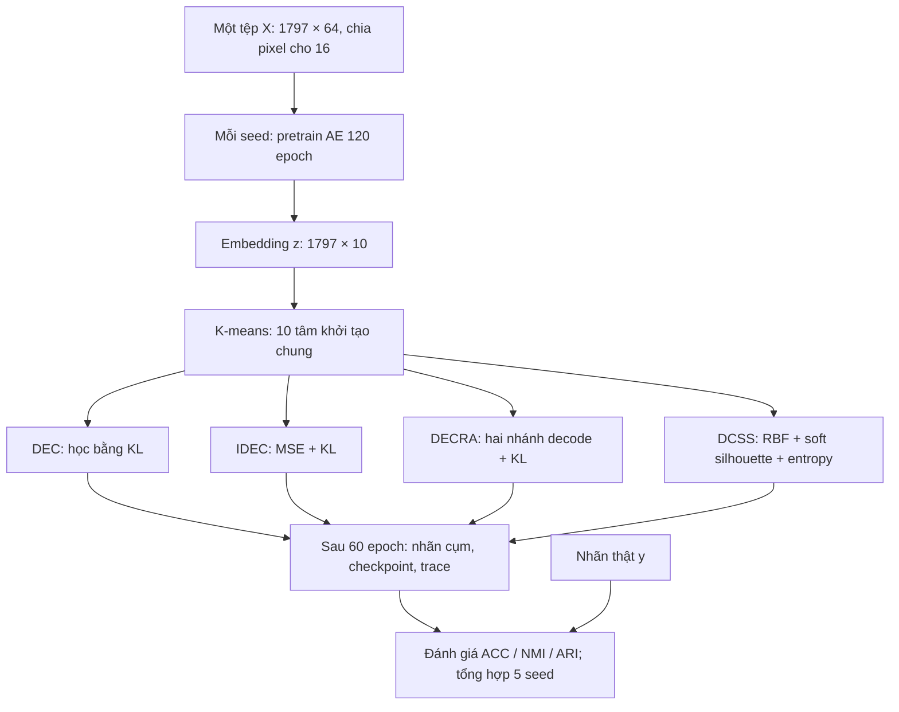

# Thực nghiệm bốn mốc hoạt động như thế nào?

Thực nghiệm ngày 13/10/2026 đã chạy **DEC → IDEC → DECRA → DCSS trên cùng
một tệp Digits**, năm seed cho mỗi phương pháp, tổng cộng **20 lượt chạy**.
Đây là so sánh các cơ chế trên một backbone nhỏ thống nhất. Code tác giả
được đọc để đối chiếu, nhưng các repo nguyên gốc chưa được chạy; DECRA/DCSS
được ghi rõ là bản chuyển cơ chế public code sang NumPy.

## Dữ liệu và điểm xuất phát chung

Dữ liệu là UCI Optical Recognition of Handwritten Digits, qua
`sklearn.datasets.load_digits`: 1.797 ảnh xám 8×8, mỗi ảnh thành vector
64 giá trị; pixel gốc 0–16 được chia 16 để nằm trong [0,1]. Đây là Digits,
khác MNIST 28×28 dùng trong nhiều paper. Nguồn:
[UCI](https://archive.ics.uci.edu/dataset/80/optical+recognition+of+handwritten+digits),
[scikit-learn](https://scikit-learn.org/stable/modules/generated/sklearn.datasets.load_digits.html).

Tệp [digits_1797.npz](../data/digits_1797.npz) chứa X=(1797,64), y=(1797,).
X là dữ liệu học; y là chữ số thật để chấm sau khi học. K=10 được đặt trước
theo benchmark. Nguồn, phép chuẩn hóa, số mẫu mỗi lớp và hash được ghi tại
[metadata.json](../data/metadata.json); code tạo dữ liệu ở
[prepare_data.py](../scripts/prepare_data.py).

Mỗi seed 0–4 tạo một autoencoder, pretrain 120 epoch chỉ bằng X, rồi chạy
K-means trên embedding để có 10 tâm ban đầu. Bốn phương pháp nhận **bản sao
đúng cùng trọng số pretrain và tâm cụm trong seed đó**. DECRA thêm một nhánh
affine 10→10; DCSS thêm độ rộng RBF học được. Giữa các seed, toàn bộ quá
trình được làm lại để quan sát sự phụ thuộc vào khởi tạo.

## Bốn mốc thay đổi điều gì?

| Mốc | Vấn đề muốn giải quyết | Cơ chế trong thực nghiệm | Hàm/code tương ứng | Điểm mạnh của thiết kế | Hạn chế cần kiểm chứng |
| --- | --- | --- | --- | --- | --- |
| DEC, 2016 | Học đặc trưng rồi K-means riêng rẽ chưa tối ưu cho phân cụm | Tính xác suất cụm Q bằng Student-t, làm sắc target P, học encoder và tâm để Q gần P | `assignments`, `target_distribution`, `train_dec(reconstruct=False)` trong [models.py](../src/models.py) | Đặc trưng thay đổi theo nhiệm vụ phân cụm; fine-tune ít tính toán hơn các cấu hình còn lại | Target sai có thể tự củng cố; bỏ reconstruction nên cấu trúc dữ liệu có thể bị biến dạng |
| IDEC, 2017 | DEC có thể làm mất cấu trúc hữu ích của dữ liệu | Giữ decoder và thêm MSE tái tạo ảnh bên cạnh KL | `train_dec(reconstruct=True)` trong [models.py](../src/models.py) | Giữ thông tin của X trong khi học nhóm; cùng họ với DEC nên dễ so sánh từng thành phần | Cần cân bằng reconstruction và clustering; chưa chắc MSE giữ đúng thông tin cần cho phân cụm |
| DECRA, 2024 | Reconstruction quá mạnh có thể giữ cả nhiễu, hạn chế embedding | Thêm affine z_hat=A(z), decode z và z_hat bằng decoder chung, giảm sai khác hai reconstruction và học KL trên z | `initialize_adaptive_layer`, `decra_loss_and_gradients`, `train_decra` trong [decra.py](../src/decra.py) | Tạo đường biến đổi embedding linh hoạt; thiết kế hướng tới khả năng chịu nhiễu | Có thêm tham số và objective; demo chưa làm thử nghiệm nhiễu hoặc pretrain residual riêng để xác nhận lợi ích |
| DCSS, 2026 | Cụm gọn chưa bảo đảm tách xa các cụm khác | Gaussian RBF→softmax; học soft silhouette để kết hợp độ gọn và tách biệt; entropy giảm xác suất quá đều | `rbf_assignments`, `soft_silhouette_loss_and_gradients`, `train_dcss` trong [dcss.py](../src/dcss.py) | Tiêu chí nội tại không cần y; gradient đi qua cả assignment và khoảng cách giữa embedding | Nhạy với scale embedding/độ rộng RBF và thành phần batch; tính pairwise distance tốn hơn |

Các mục “điểm mạnh” mô tả lý do thiết kế, chưa phải tất cả đều đã được
thực nghiệm Digits chứng minh. Nguồn gốc cơ chế:
[DEC](https://proceedings.mlr.press/v48/xieb16.pdf),
[IDEC](https://www.ijcai.org/proceedings/2017/0243.pdf),
[DECRA](https://doi.org/10.1007/s11063-024-11586-0),
[DCSS](https://doi.org/10.1007/s10994-026-07026-w).

## Trong một epoch chương trình làm gì?

Một epoch là một lượt đi qua toàn bộ 1.797 mẫu. Batch size=128 tạo 15 batch;
batch cuối có 5 mẫu. Với mỗi batch, mạng tạo embedding z và reconstruction,
tính loss, lan truyền gradient ngược, rồi Adam cập nhật tham số với learning
rate=0,001. Các trainer không nhận y.

DEC/IDEC/DECRA tính lại P từ **toàn bộ X** ở đầu epoch 1,6,11,…,56; giữ P
cố định khi cập nhật minibatch. DEC chỉ dùng KL; IDEC dùng MSE+0,1×KL.
DECRA theo source dùng `2×MSE(main,X)+0,6×MSE(aux,main)+0,1×KLmean` và
gradient đi qua cả hai đường decoder, không đóng băng main trong consistency.
KL của DECRA chia N×K, còn DEC/IDEC chia N: cùng số 0,1 không đồng nghĩa
cùng độ mạnh clustering loss.

DCSS không cần P. Trong mỗi batch, nó tính RBF Q, ma trận khoảng cách của
các embedding, soft silhouette và entropy. Objective mặc định là
`MSE+0,01×(1-soft silhouette)+0,01×entropy_bits`. Trọng số mạng, tâm RBF và
log_sigma đều được cập nhật. Trace cuối epoch được tính lại trên các batch
đánh giá cố định; đó là score theo batch, không phải silhouette đầy đủ của
toàn bộ Digits. Total loss giữa bốn mô hình có định nghĩa khác nhau nên không
dùng để xếp hạng.

Sau đủ 60 epoch, chương trình lấy cụm có xác suất lớn nhất, lưu checkpoint,
nhãn cụm từng mẫu và trace. Khi đó [evaluation.py](../src/evaluation.py) mới
dùng y: Hungarian ghép tên cụm với tên chữ số để tính ACC; NMI/ARI đo độ
khớp partition. Cụm có ID=3 không tự mang nghĩa “chữ số 3”. Toàn bộ X được
dùng để học và đánh giá theo kiểu transductive; chưa có test set chưa thấy
để đo khả năng tổng quát hóa.

## Kết quả thực đo nói được điều gì?

Từ [summary.csv](../results/timeline_20261013/summary.csv), mỗi phương pháp
có 5 seed. ACC ghi trung bình ± sample std; NMI/ARI đổi sang phần trăm.
Thời gian gồm pretrain, K-means khởi tạo, fine-tune và ghi nhận loss; phụ
thuộc máy và không có nghĩa chi phí giữa thuật toán luôn tương đương.

| Cấu hình | ACC (%) | NMI (%) | ARI (%) | Thời gian trung bình (s) | ARI giữa seed |
| --- | ---: | ---: | ---: | ---: | ---: |
| DEC | 74,32 ± 8,34 | 73,65 | 62,70 | 7,92 | 0,650 |
| IDEC | 74,50 ± 8,07 | 73,53 | 62,49 | 8,30 | 0,662 |
| DECRA code adaptation | 70,40 ± 7,36 | 67,10 | 56,76 | 10,35 | 0,585 |
| DCSS code adaptation, sigma ban đầu=1 | 51,89 ± 12,51 | 49,34 | 26,23 | 10,82 | 0,202 |

IDEC cao hơn DEC về ACC trung bình **0,18 điểm phần trăm**, nhỏ so với
biến động khoảng 8 điểm giữa seed. DEC nhỉnh hơn về NMI/ARI. Vì vậy dữ liệu
hiện tại chưa đủ kết luận IDEC thắng DEC ổn định. DECRA/DCSS kém hơn trong
protocol này cũng chưa phủ nhận kết quả paper hoặc hiệu quả trên data khác.

DCSS có dấu hiệu cụ thể về scale: chẩn đoán X-only ở seed 0 thấy khoảng
cách bình phương tới tâm gần nhất có trung vị 7,21. Với sigma=1, Gaussian
activation trung vị chỉ khoảng 0,00074; xác suất cụm lớn nhất trung bình
0,1068, rất gần mức đều 0,1 của 10 cụm. Entropy chuẩn hóa là 0,9989, gần
mức cực đại. Đây là bằng chứng đường RBF khó tạo assignment phân biệt khi
ghép vào embedding tuyến tính chung, không phải bằng chứng DCSS nguyên gốc
yếu. Artifact: [dcss_width_diagnostics.json](../checks/dcss_width_diagnostics.json).

Ablation sau lần chạy chính thử khởi tạo sigma bằng RMS khoảng cách trong
cụm K-means, chỉ dùng X. Năm seed đạt **ACC 73,64 ± 8,00%; NMI 71,22%;
ARI 61,43%**. Nó cho thấy kết quả nhạy với độ rộng RBF. Đây là phân tích
thăm dò sau khi xem main run; không thay bảng chính, không phải kết quả
chọn trước và chưa phải tái hiện paper. Xem
[summary ablation](../results/dcss_width_ablation_20261013/summary.csv).

## Các giới hạn tái hiện và cách xem hoạt động

DECRA paper viết phép cộng residual `z+H(z)`, nhưng repo public dùng affine
riêng và consistency hai đường decode. DCSS paper chia tổng distance cho
khối lượng xác suất cụm, nhưng repo public không chia; paper ghi T=20,
source chia logits cho 0,25. Demo chọn cơ chế source và ghi rõ khác biệt;
cả hai dùng backbone/pretrain chung thay mạng tác giả. Chi tiết đối chiếu
ở [model_audit.md](model_audit.md).

20 prediction/checkpoint đã được kiểm lại, metric được tính lại từ nhãn
cụm, và hash X xác nhận mọi lượt dùng chung dữ liệu. Kết quả kiểm tra ở
[verification.json](../results/timeline_20261013/verification.json). Gradient
checks có 216 phép cho core, 117 cho DECRA và 210 cho DCSS; chúng xác nhận
đạo hàm code hiện tại, chưa xác nhận tương đương toàn bộ paper.

Để xem hoạt động, mở
[notebook bốn mốc](../notebooks/demo_4_timeline_verified.ipynb): dữ liệu →
kiến trúc/loss → kết quả từng seed → loss curves → embedding → confusion
matrix → ablation. Một ví dụ thực đo: reconstruction MSE pretrain seed 0
giảm từ 0,13406 ở epoch 1 xuống 0,01194 ở epoch 120. Điều này cho thấy mạng
đã học tái tạo ảnh; cần thêm metric cụm và độ biến động seed để đánh giá
chất lượng phân cụm, thay vì chỉ nhìn loss giảm.
